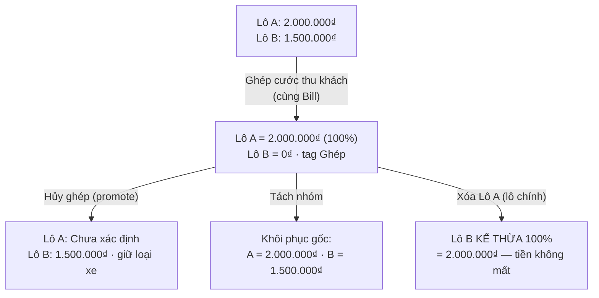
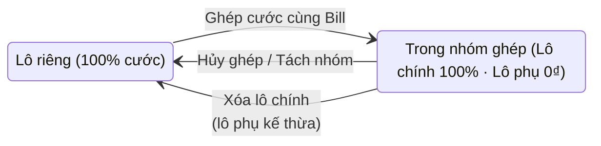

# Logic nghiệp vụ Hàng lẻ (LCL)

# Silversea — Logic nghiệp vụ Hàng lẻ (LCL)

## 1. Định nghĩa & phân loại

Hàng lẻ (LCL) là lô không gắn container cụ thể nào của khách — được vận chuyển bằng xe tải theo trọng tải (từ 1.25T đến 15T) hoặc gom chung container 20'/40' chạy ghép. Ngược lại, FCL là lô gắn container có số riêng (MSKU…, 20DC/40DC…).

Mọi bảng đều có badge phân loại Nhập·Cont / Nhập·Lẻ / Xuất·Lẻ, bắt buộc phải phân biệt rõ hàng lẻ với hàng container.

Một dòng hàng lẻ có cụm thông số dạng "Lô hàng lẻ | Thu: Xe 3.5T | Trả: Xe 10T"; xe thu và xe trả có thể khác loại nhau.

Một dòng ghép mang tag "Lẻ · Ghép (n/N)", trong đó n là vị trí của lô trong nhóm và N là tổng số lô ghép.

## 2. Tạo lô hàng lẻ

Khi chọn Loại hàng = Hàng lẻ, hệ thống không bắt nhập số container; người dùng chỉ cần nhập 4 trường: Quy cách đóng gói, Số lượng, Trọng lượng (kg) và Thể tích (CBM).

Số Bill/Booking và Hãng tàu khai báo như FCL; trường Hình thức XNK là bắt buộc.

Số tờ khai được quản lý theo container, không còn ô nhập ở cấp lô — ô này đã bị gỡ khỏi form tạo/sửa và dialog Chứng từ; phía backend chặn key declarationNumber trong payload tạo lô và trả lỗi 400.

Ô Kho lấy hàng (CFS/Cảng) tìm kiếm khớp cả full mã (GLC) lẫn prefix (LC).

Về quy tắc container: hàng lẻ đi bằng xe tải luôn chạy 100% xe ngoài (chặn BKS nội bộ, trả 400); hàng lẻ gom cont 20'/40' thì dùng được cả xe nội bộ lẫn xe ngoài. Khi ghép, các dòng anh em còn trống sẽ kế thừa giá trị theo luật /521 — chỉ điền vào dòng trống, không ghi đè giá trị đã khác nhau.

## 3. Danh mục & bảng giá

Danh mục vehicle_size_classes gồm: 1.25T, 2.5T, 3.5T, 5T, 8T, 10T, 15T, CONT20, CONT40 (CRUD tại /config/vehicle-size-classes).

Bảng giá được xây theo Tuyến × Khách hàng/Nhà thầu, gồm cước thu và cước trả theo từng trọng tải.

Cước thu/trả dự kiến hiển thị trên dialog Chỉnh sửa điều phối; ở chế độ dense, Phân loại và Cước thu nằm cùng hàng.

## 4. Điều vận: Kế hoạch Tổng quát & Chi tiết Xe

Kế hoạch Tổng quát trên mobile ở chế độ dense: mỗi lô là một card 3 dòng kèm badge lẻ/cont; nút Phân bổ nhà xe dạng compact và tự ẩn khi lô đã được phân.

Kế hoạch Chi tiết Xe có ô Container 3 dòng và popup Gán xe nhóm; mỗi dòng có BKS THỰC và BKS BÁO KHÁCH (biển ảo — nếu để trống thì mặc định bằng BKS thực).

Với cước trả điều vận, Lô 1 chịu 100% còn các lô từ 2 trở đi là 0₫.

Gán xe nhóm cho phép điền một lần áp cho cả nhóm; khi đổi BKS nhóm, hệ thống chặn gõ tay "Bổ sung sau" (chỉ nhận BKS thật hoặc để trống; nếu cần trì hoãn thì dùng nút riêng ở lô đơn).

Cột THAO TÁC xếp stack dọc (nút send phía trên, nút ⋯ phía dưới); hành động "Hoàn thành" và Phát lệnh nằm trong menu ⋯; phím ←/→ cuộn ngang mọi bảng.

Cột Số tờ khai xuất hiện ở mọi bảng liệt kê container và cho phép click để sửa.

## 5. Gộp xe thu khách & bảo toàn doanh thu

Ghép cước thu khách áp dụng cho nhiều lô cùng khách hàng, cùng loại xe thu, mỗi lô có một BKS ảo riêng. Sau khi ghép, Lô 1 giữ nguyên 100% cước, các Lô 2..N về 0₫, và nhóm mang tag "Ghép cước cùng Bill [Bill Lô 1]". Tổng doanh thu không đổi.

Hủy ghép (promote): Lô 2 nhận lại 100%, Lô 1 về trạng thái Chưa xác định và giữ nguyên loại xe.

Tách nhóm: cả hai lô khôi phục cước gốc; nếu Lô 2 chưa có ước tính (null estimate) thì hiển thị "—", không ghi 0₫.

Xóa lô chính đã ghép: lô còn lại kế thừa quyền lô chính cùng toàn bộ 100% số tiền.

Luật mirror dispatch: mọi quy tắc trên áp dụng y hệt cho cước TRẢ điều vận.

## 6. Chứng từ (CUS) — Chi tiết lô hàng

Thông số container hiển thị dạng "Lô hàng lẻ | Thu: Xe 3.5T | Trả: Xe 10T".

Khối phân xe gồm 2 dòng: BKS Thực và ô sửa nhanh BKS Báo khách.

Số tờ khai theo từng container: click để sửa từng dòng; các dòng trong một lô được phép trùng một phần hoặc toàn bộ; khi sửa một dòng, hệ thống không ép đồng bộ các dòng khác.

Dòng hàng lẻ được click-to-edit tờ khai và phân xe như FCL.

Ở màn Tổng quan, cột CHỨNG TỪ hiển thị Bill cùng tất cả số tờ khai của lô.

## 7. Kế toán & Debit Note

Khi chốt debit, cột Thông số hiển thị dạng "Lẻ · Thu: 5T / Trả: 10T" hoặc "Ghép cùng Bill…"; phải thu/trả tự động tính 100%/0₫ theo nhóm.

Debit Note cho KHÁCH in BKS BÁO KHÁCH (tuyệt đối không in BKS thực) kèm loại xe thu và chú thích ghép.

Bảng kê cho NHÀ XE in BKS THỰC kèm loại xe trả.

Với hoàn ứng: kế toán lập phiếu; khi replay với cùng idempotency-key, hệ thống trả 200; nếu dùng key khác sau khi đã duyệt thì trả 409.

## 8. Doctrine UI/UX

Nền toàn ứng dụng dùng màu SAGE #E3E8E5 (token --bg/--bg-1), card trắng nổi trên nền.

Cấm cắt chữ (truncate): mọi ô dữ liệu wrap trọn văn bản — cuộn ngang thay vì cắt ký tự.

Data-dense: card 3 dòng, meta gộp, nút compact, footer hành động một dòng sticky.

Cột THAO TÁC xếp stack dọc cao ~44-48px; hành động "Hoàn thành" nằm trong menu ⋯.

## Sơ đồ gộp / tách cước (hàng lẻ)

