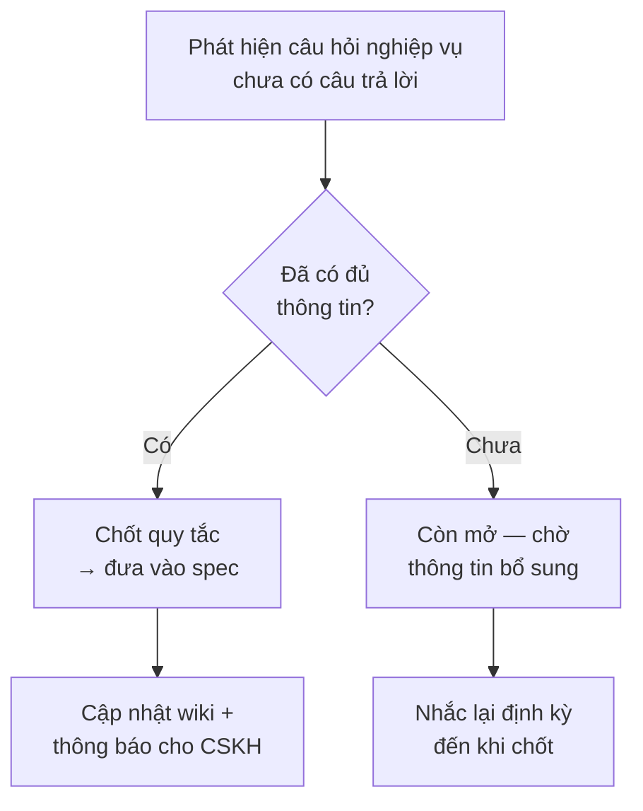

# 8. Quyết định ràng buộc và vấn đề đang mở

Chương này: (a) **quyết định ràng buộc** của chủ dự án/khách hàng — căn cứ tham chiếu khi phát triển hệ thống điều vận Silversea; (b) **11 vấn đề còn mở**; (c) **12 hạng mục đã hủy**; (d) **rủi ro & phụ thuộc**.

**Quy ước đọc**
- Mỗi quyết định được nhận dạng bằng **ngày + chủ đề** (cột “Đối tượng áp dụng”).
- Ngày chỉ ghi khi nguồn có nêu; không có → *không ghi ngày*.
- Đoạn in **nguyên văn** là lời chủ dự án/khách hàng — giữ nguyên, không dịch.
- Bảng có thể **cũ hơn thực tế** (một vài nội dung từng ghi “đang mở” nhưng đã đóng) — chương này theo bảng mới nhất.

---

## 8.1 Bảng quyết định ràng buộc

Theo chủ đề: tờ khai/cont → điều phối → cước phí → lái xe → UI → quy trình/phát hành.

### 8.1.1 Tờ khai / chứng từ / container

Các quyết định trong nhóm này xoay quanh mô hình tờ khai theo container, thứ tự các trường nhận diện lô và hành vi thêm/bớt container; mỗi dòng ghi ngày ra quyết định, nội dung chốt và phạm vi áp dụng.

- **Ngày 26/10/2026** — **CHỐT mô hình tờ khai, nguyên văn:** “1. Số tờ khai quản lý THEO CONT, không theo lô — thêm cột Số tờ khai ở bảng cont (chi tiết lô / Tổng quan) để mỗi cont có số tờ khai riêng. 2. Cho phép số tờ khai của các cont thuộc cùng 1 lô giống nhau 1 PHẦN hoặc TOÀN BỘ — không chặn trùng số tờ khai trong cùng 1 lô. 3. Cho phép sửa số tờ khai của TỪNG cont riêng lẻ (không đồng bộ ép toàn lô khi sửa 1 cont, trừ các dòng đang trống nếu có cơ chế copy riêng). 4. BỎ phần nhập số tờ khai theo lô — gỡ input số tờ khai ở cấp lô (form tạo lô và mọi điểm nhập theo lô còn lại), số tờ khai chỉ nhập/sửa ở cấp cont.” Quyết định áp dụng cho Mẫu dữ liệu tờ khai: form tạo lô, drawer, mọi bảng cont, /shipments.

- **Ngày 25/10/2026** — Drawer Tổng quan chưa cho thêm số tờ khai → nhập theo **từng cont** + copy nhanh tờ khai dòng đầu cho các dòng dưới. Quyết định áp dụng cho Drawer Tổng quan lô.

- **Ngày 26/10/2026 (10:03)** — Yêu cầu khẩn cấp: “Nhập số tờ khai từng cont trong drawer + copy nhanh; phía máy chủ đồng bộ và đối soát.” Tiếp theo quyết định 25/10 (bảng container trong drawer bị gỡ → mất ô nhập từng cont) và sau lỗi: sửa 1 cont làm bản ghi của các cont anh em bị ghi đè. Kiểm thử BE+FE theo phạm vi sửa + ảnh chụp giao diện 3 cỡ màn hình; **không phát hành, không thông báo tự động**. Quyết định áp dụng cho Khôi phục ô nhập tờ khai từng cont trong drawer.

- **Ngày không ghi ngày** — Chi tiết lệnh điều phối: thêm cột Số tờ khai, sửa ngay trên ô; chủ dự án: “cell click-to-edit là đủ, không cần nút Sửa riêng”. Quyết định áp dụng cho /dispatch-detail.

- **Ngày không ghi ngày** — Thêm cột Số tờ khai vào **TẤT CẢ bảng liệt kê cont theo dòng** (không chỉ chi tiết lệnh điều phối), sửa ngay trên ô, theo mô hình tờ khai 26/10. Quyết định áp dụng cho Mọi bảng liệt kê container.

- **Ngày không ghi ngày** — /shipments cột CHỨNG TỪ phải hiển thị **TẤT CẢ số tờ khai của lô** (lô 3 cont → đủ 3 số); hiện chỉ Bill + “Chưa có tờ khai”. Bản tổng hợp cấp lô của mô hình 26/10. Quyết định áp dụng cho Danh sách lô /shipments.

- **Ngày 22/10/2026** — Khách yêu cầu, nguyên văn: “Tại màn hình Tạo mới lô hàng: Khách yêu cầu đổi vị trí trường nhập liệu Số Bill/Booking và Hình thức xuất nhập khẩu. Ngoài ra trường Số tờ khai có thể cân nhắc đẩy xuống dưới cùng phần Nhận diện lô. (Lưu ý …: Đây là thông tin gán theo từng cont, nhiều cont có thể có cùng số tờ khai, với lô hàng chỉ gán 1 số tờ khai sẽ mặc định copy số tờ khai cho toàn bộ các cont trong lô)” Quyết định áp dụng cho Form Tạo mới lô — Nhận diện lô.

- **Ngày không ghi ngày** — Thứ tự chứng từ chi tiết lô: **1. Số Booking → 2. Số Tờ khai → 3. Nhập/Xuất → 4. Hãng tàu.** Quyết định áp dụng cho Chi tiết lô.

- **Ngày 18/10/2026** — Quyết định tổng quan: A.1 Tổng quan **auto-copy trừ Số container + Loại container**; A.2 bỏ nút thêm/xóa cont ở Chi tiết lô; A.3 thứ tự Booking → tờ khai → Nhập/Xuất → Hãng tàu; A.5 sửa tờ khai **inline**. Quyết định áp dụng cho Tổng quan + Chi tiết lô.

- **Ngày 22/10/2026 (đảo)** — Nguyên văn: “Adding a container to a lot auto-copies the container TYPE, violating the reversed owner ruling (22/10/2026): a newly added container copies ALL fields EXCEPT số cont and loại cont. The type must be blank for the user to choose.” (Bản ghi trước khi đảo — bỏ.) Quyết định áp dụng cho Auto-copy khi thêm container.

- **Ngày không ghi ngày** — “Sửa lỗi … chỉnh sửa số lượng cont của lô đã tạo. Khi bổ sung cont mới, tự động sao chép các trường thông tin chung xuống, chỉ để trống số cont và loại cont.” Quyết định áp dụng cho Lô đã tạo.

- **Ngày không ghi ngày (bản dựng cũ)** — Tờ khai cấp lô lan sang **mọi dòng tờ khai trống**, kể cả dòng thêm mới. *Mô hình cũ trước quyết định 26/10 — khi làm phải đối chiếu, không tái tạo ô nhập cấp lô.*. Quyết định áp dụng cho Thêm container mới.

- **Ngày không ghi ngày** — Nhiều tờ khai/lô, thêm tờ khai 1 cont → đồng bộ tất cả cont. **Trái chiều mô hình 26/10 — mô hình 26/10 thắng.** Quyết định áp dụng cho Chỉ giá trị lịch sử.

- **Ngày không ghi ngày** — TAB từ “Số cont” sang “Loại cont”: gõ phím phải **tự kích hoạt danh sách gợi ý**, không bắt buộc click. Quyết định áp dụng cho Combobox form tạo lô.

- **Ngày không ghi ngày** — Gõ đè sau khi đã chọn loại cont bị về nhãn cũ; bản vá trước đó chưa hết → phải sửa tiếp; kiểm thử hồi quy “chọn-đè-chọn-lại” phải giữ giá trị **MỚI**. **CẢNH BÁO: brief từng ghi nhầm sang một số hiệu đã bị một hạng mục khác chiếm → KHÔNG cập nhật nhầm hạng mục.** Quyết định áp dụng cho Ô tìm kiếm / ô chọn loại cont.

- **Ngày không ghi ngày** — Thêm nút **“Xóa cont”** ngay trong bảng chi tiết lô khách hàng. Quyết định áp dụng cho Bảng chi tiết lô.

### 8.1.2 Điều phối / điều vận

Nhóm này tập hợp các quyết định về màn điều phối và điều vận — từ phát lệnh, gán xe, đổi nhà xe đến bố cục bảng kế hoạch; mỗi dòng ghi ngày ra quyết định, nội dung chốt và phạm vi áp dụng.

- **Ngày 18/10/2026** — B.1 **đổi lại nhà xe/biển số** sau khi chọn; B.2 **nhà xe ngoài: phát lệnh khi chưa có biển số** (khách hàng cập nhật sau); B.3 sửa “lấy lẻ” tự nhảy “đảo vỏ”; B.4 sửa lỗi báo trùng khung giờ; B.5 số container **in đậm**. Quyết định áp dụng cho Luồng điều phối.

- **Ngày không ghi ngày** — Nhà xe ngoài phát lệnh **trước khi có biển số**; biển + tài xế do khách hàng/điều phối cập nhật sau. Quyết định áp dụng cho Phát lệnh nhà xe ngoài.

- **Ngày không ghi ngày** — Được **đổi lại nhà xe / biển số** đã gán cho tác vụ đã phân bổ khi phát sinh thay đổi. Quyết định áp dụng cho Phân bổ tác vụ.

- **Ngày không ghi ngày** — Bỏ popup ngày giờ khi phát lệnh → **icon phát lệnh một chạm**. Quyết định áp dụng cho Nút phát lệnh.

- **Ngày không ghi ngày** — Kẹp 2 cont 20ft: **gán cùng 1 đầu kéo cho cả 2 cont** (cont 2 bị chặn “trùng đầu kéo”). Quyết định áp dụng cho Điều xe kẹp.

- **Ngày không ghi ngày** — Thêm tác vụ **“Lấy Lẻ”**: vỏ cont rỗng đi đóng hàng lẻ chuyển kho rồi hạ rỗng/đóng hàng hạ cảng. Quyết định áp dụng cho Phân loại tác vụ.

- **Ngày không ghi ngày** — Sửa “Lấy Lẻ” tự chuyển thành “Đảo vỏ” + lỗi báo trùng khung giờ. Quyết định áp dụng cho Phân loại tác vụ.

- **Ngày không ghi ngày** — Bộ lọc trạng thái xe: “Chờ/Đang/Đã phân xe”, “Chưa/Đã gán biển”. Quyết định áp dụng cho Danh sách điều phối.

- **Ngày không ghi ngày** — Nhập/sửa **“Giờ trả hàng”** ngay lúc gán biển; sửa lỗi lưu không cập nhật cột thời gian/lịch trình. Quyết định áp dụng cho Form gán biển.

- **Ngày không ghi ngày** — Bảng kế hoạch điều xe: **IN ĐẬM số container**, tên Cảng chữ thường. Quyết định áp dụng cho Bảng Kế hoạch điều xe.

- **Ngày không ghi ngày** — Ô Ghi chú chặn phím Space → soạn thảo bình thường. Quyết định áp dụng cho Ô Ghi chú ĐV.

- **Ngày 26/10/2026** — (1) “Ngày giao 23/10/2026” đè lên “Trả hàng”; (2) **CẤM cắt chữ — hiện trọn mọi ô**; (3) header cột 2 dòng đè nhau. Quyết định áp dụng cho /dispatch-detail.

- **Ngày không ghi ngày** — Cột ĐIỀU PHỐI **tách mỗi thông tin 1 dòng** (nhà xe / biển đủ / tài xế / SĐT / trạng thái), không chi tiết nào bị ẩn. Quyết định áp dụng cho /dispatch-detail.

- **Ngày không ghi ngày** — Nguyên văn: “Per the owner, the \\"CUS sẽ bổ sung\\" line must be removed and that line left blank.” Quyết định áp dụng cho /dispatch-detail.

- **Ngày không ghi ngày** — **Mâu thuẫn layout, giải quyết cùng nhau:** một bên muốn cột THAO TÁC nút xếp cùng dòng (~144px, “Hoàn thành” + ⋯ cùng hàng, đã kiểm thử đạt) — bên kia muốn xếp nút dọc, “Hoàn thành” vào menu ⋯. Quyết định áp dụng cho Cột THAO TÁC.

- **Ngày 27/10/2026** — send + ⋯ nằm NGANG làm cột phình → **stack DỌC**, bề rộng vừa 1 nút (~44–48px). Quyết định áp dụng cho Cột THAO TÁC.

- **Ngày không ghi ngày** — Dialog “Chỉnh sửa điều phối” **dùng hết bề rộng màn, không scroll dọc**; footer Hủy/Lưu/Phát lệnh không bị cắt dưới fold. (Đã kiểm thử đạt; vấn đề mật độ còn lại giao cho việc gộp Phân loại + Cước thu.) Quyết định áp dụng cho Dialog Chỉnh sửa điều phối.

- **Ngày không ghi ngày** — **Gộp Phân loại + Cước thu dự kiến cùng hàng**, ô tiền không cần rộng. Quyết định áp dụng cho Dialog Chỉnh sửa điều phối.

- **Ngày không ghi ngày** — Cột PHÂN LOẠI: tag compact vừa cột, 1 nhãn/dòng, header 1 dòng. Quyết định áp dụng cho /dispatch-detail.

- **Ngày không ghi ngày** — **TOÀN CỤC: phím ← → cuộn ngang bảng** cho MỌI bảng trong ứng dụng. Quyết định áp dụng cho Mọi bảng.

- **Ngày 26/10/2026** — Nguyên văn: “redesign UI UX ELEGANT, DATA-DENSE, không lãng phí chỗ (mobile-first theo ảnh).” Quyết định áp dụng cho Kế hoạch Tổng quát (mobile).

- **Ngày không ghi ngày (bản dựng cũ)** — Tiêu đề “CHỌN LÔ CHON” → đồng bộ “CHỌN LÔ” (chỉnh hình thức). Quyết định áp dụng cho /dispatch vs /dispatch-detail.

### 8.1.3 Cước phí / gộp hàng LCL / kế toán / công nợ

Nhóm này tập hợp các quyết định về cước phí, gộp xe và gộp hàng LCL, khai chi phí, định dạng tiền cùng các trang kế toán – công nợ; mỗi dòng ghi ngày ra quyết định, nội dung chốt và phạm vi áp dụng.

- **Ngày 23/10/2026** — Nguyên văn: “Điều vận (Đầu vào - Trả nhà xe): … gộp nhiều lô đi chung 1 xe thực tế nhằm tính cước trả nhà xe (Loại xe, Nhà xe, BKS thực, Cước trả ĐV). Không nhập BKS báo khách (xe ảo) tại màn hình Điều vận. CUS (Đầu ra - Thu khách & Làm Debit): Mặc định mỗi lô hàng lẻ được tính là 1 chuyến xe riêng biệt … CUS dùng chức năng Gộp hàng riêng của CUS … (độc lập hoàn toàn với việc gộp xe của Điều vận).” UI: “Ẩn cột CHỌN (Checkbox) ở đầu bảng. Trên khu vực Filter, hiển thị nút [📦 Gộp hàng]” — chỉ bấm mới hiện checkbox + thanh thao tác nổi. Quyết định áp dụng cho Tách biệt gộp xe ĐV vs gộp hàng khách hàng.

- **Ngày không ghi ngày** — Nguyên văn: “Hàng lẻ chạy bằng Xe tải: Mặc định 100% là Xe ngoài (Nhà thầu/Vendor). Hàng lẻ chạy bằng Xe Cont (20'/40'): Có thể dùng Xe nội bộ (SilverSea) hoặc Xe ngoài.” “Quy tắc nhảy tiền khi Ghép (Lô 1 = 100%, Lô 2..N = 0đ) … ở cả chiều Thu lẫn Trả … các lô từ số 2 = 0 ₫.” Cước theo tải trọng xe hoặc Cont 20'/40'; có trường **BKS Báo khách (xe ảo)** tách BKS thực. Quyết định áp dụng cho Bảng giá + gộp/tách cước LCL.

- **Ngày 18/10/2026** — Nguyên văn: “Quy tắc cốt lõi: khi ghép N lô, Lô 1 giữ 100% tiền cước, các lô còn lại = 0đ.” “Trường 3 — Biển số báo khách / Xe ảo: Mặc định tự động copy từ Biển số xe thực tế … cho phép điều vận sửa lại cho từng lô.” “Nếu Trường 1 chọn Xe tải: mặc định 100% là Xe ngoài … gõ tay biển ngoài.” Tính năng **“Gán xe nhóm hàng lẻ” KHÔNG tồn tại trên bản dựng kiểm thử → cần khôi phục** (3 trường bắt buộc, chung nhóm chi phí; xe nội bộ → tiền đường tính **1 lần vào Lô 1**). Quyết định áp dụng cho Gán xe nhóm hàng lẻ (ĐV).

- **Ngày 19/10/2026** — Nguyên văn: “Tại ô Chụp / Chọn ảnh: Có thể chụp hoặc không, không ghi nhận thiếu chứng từ …” “TOÀN BỘ TRƯỜNG PHẢI ĐIỀN SỐ TIỀN, MẶC ĐỊNH … 1,000,000 (CÓ DẤU CHẤM HOẶC PHẨY NGĂN CÁCH – TẤT CẢ DỮ LIỆU CỦA CÁC PHÂN HỆ)”. Kèm: **“BÁO CÁO THU / TRẢ PHƠI”**, fix xuất Debit, duyệt tạm ứng/hoàn ứng. Quyết định áp dụng cho Khai chi phí Ops, định dạng tiền, phơi phiếu, Debit.

- **Ngày không ghi ngày** — Nguyên văn: “Tiền đường: (hệ thống tự động ghi nhận; kế toán điều chỉnh): lxe không được điền, chỉ được nhìn”; “Được them chi phí liên tục mà không cần lưu mới được nhập them chi phí…”; cảnh báo “ĐÃ ĐƯỢC ID…. NHẬP TRƯỚC ĐÓ, BẠN VẪN TIẾP TỤC NHẬP CHỨ, …”. Bỏ phân biệt “Người chi / Công ty chi”; Nâng/Hạ tự động cộng. Quyết định áp dụng cho Chi phí lô / tiền đường (lái xe, Ops, kế toán).

- **Ngày 24/10/2026** — Nguyên văn: “Yêu cầu: pending (null/chưa chốt) → ô TRỐNG, không pill, không 'Chưa xác định'. Giữ nguyên: số thật, '0' (đã tính = 0), group subtotal/foot total '—' khi chưa có gì chốt, badge ghi chú Ghép hàng.” Áp cả desktop lẫn mobile; cập nhật kiểm thử neo. Quyết định áp dụng cho /shipments-debit.

- **Ngày 24/10/2026** — Trang kỳ giá nhiên liệu: badge 'Đang áp dụng'/'Sắp áp dụng'; ghi chú cắt bớt + tooltip; người nhập trống → **'—'** (không in 'Chưa rõ người nhập'); hàng 40–48px; **không đổi API/kiểm tra phía máy chủ**, giữ phân quyền KẾ TOẢN/QUẢN TRỊ. Quyết định áp dụng cho Trang kỳ giá nhiên liệu.

- **Ngày 24/10/2026** — Trang công nợ: gộp hero + khối chỉ số → **1 dải tóm tắt 88–96px** (tái dùng mẫu /payables); bỏ cột 'Sổ rõ ràng' khi toàn null; badge TUỔI NỢ theo bucket; **không đổi API/con số tính nợ**. Quyết định áp dụng cho Trang công nợ.

- **Ngày 24/10/2026** — Trang phải trả: dải đồng bộ /debt; **sửa sub-line '_' rỗng** (không render khi alias trống); tên NCC 1 dòng + tooltip; không đổi API. Quyết định áp dụng cho Trang phải trả.

- **Ngày 24/10/2026** — Trang chi phí: 3 khối chỉ số → **1 thanh chỉ số 64–80px**; 'NHÁP' → badge; ẩn phân trang ≤1 trang; SỐ TIỀN dùng chữ số đều bề; **không đổi API**. Quyết định áp dụng cho Trang chi phí.

### 8.1.4 Lái xe / Driver app

Nhóm này tập hợp các quyết định cho ứng dụng lái xe, từ hiển thị mã chuyến, yêu cầu ảnh đến trình tự giao nhận trên màn nhận lệnh.

- **Ngày 22/10/2026** — Phần lái xe — **bỏ hiển thị mã chuyến**. Quyết định áp dụng cho App lái xe.

- **Ngày không ghi ngày** — mục này chỉ ghi phạm vi áp dụng: Thẻ lệnh lái xe (kiểm thử + sản xuất); nội dung quyết định để trống trong tài liệu gốc.

- **Ngày 22/10/2026** — Nguyên văn: “bỏ những phần bắt buộc phải tải ảnh lên … (let us keep them optional, not compulsory to have image)” → **ảnh tùy chọn**. Quyết định áp dụng cho Luồng nhận lệnh.

- **Ngày không ghi ngày** — SĐT kho/nhà máy là hyperlink **`tel:`**. Quyết định áp dụng cho Nhận lệnh.

- **Ngày không ghi ngày** — Điều vận tự cập nhật/bổ sung SĐT nhà máy, bãi kho; đối tác **chỉ có địa chỉ, không có SĐT**. Quyết định áp dụng cho Danh mục đối tác.

- **Ngày không ghi ngày** — Sửa logic chuyến **kẹp (2 cont 20ft)**: lộ trình + trình tự giao nhận hiển thị sai. Quyết định áp dụng cho App lái xe.

- **Ngày không ghi ngày** — Sửa đảo lộn bãi hạ ↔ Địa chỉ giao hàng; Cảng hạ báo 'Chưa có nơi trả rỗng'. Quyết định áp dụng cho Nhận lệnh.

### 8.1.5 UI / form / theme

Nhóm này tập hợp các quyết định về giao diện, biểu mẫu và theme chung của ứng dụng; phần lớn kèm nguyên văn chỉ đạo của chủ dự án.

- **Ngày 25/10/2026** — Nguyên văn: “what fuck shit is this design, do a proper job” + chỉ đạo “follow /shipments/new for the drawer” → **BỎ bảng container custom trong drawer — drawer DÙNG form `/shipments/new` cho cả xem lẫn sửa — “ONE form layout everywhere”.** Hệ quả: ô nhập tờ khai từng cont + copy của drawer cũ mất theo → được khôi phục (25–26/10). Quyết định áp dụng cho Drawer chi tiết lô.

- **Ngày 24/10/2026** — “remove button Sửa, because we can click cell to edit right?” → **bỏ nút Sửa ở cột Số tờ khai — click vào ô để sửa là đủ**. Quyết định áp dụng cho /shipments-detail.

- **Ngày 25/10/2026** — “Sửa, not chuyển sang sửa, wtf kind of text is that” → nút **'Sửa'** (trang + drawer dùng chung một thành phần nút). Quyết định áp dụng cho Trang/drawer chi tiết lô.

- **Ngày 27/10/2026** — Nguyên văn: “sage please make it global rule” — đảo quyết định trước: màu sage `#E3E8E5` là design chính thức: biến màu nền trả về `#E3E8E5` toàn ứng dụng; khối nội dung giữ trắng để nổi trên nền. Kiểm thử neo màu đã đổi sang `#FFFFFF`. Hạng mục đối lập (nền trang Khách hàng chưa trắng) bị đảo theo quyết định này → **hủy**. Quyết định áp dụng cho Theme toàn app.

- **Ngày 24/10/2026** — Trang danh mục nhà máy: “redesign this page, remove column Trang thai also” → **bỏ cột TRẠNG THÁI** (hàng ngưng → mờ + tooltip 'Đã ngưng'), gộp MÃ + TÊN, Địa chỉ/Liên hệ 1 dòng, bỏ STT; **không đổi API**. Quyết định áp dụng cho Danh mục nhà máy.

- **Ngày 24/10/2026** — Trang vi phạm: bỏ illustration, 4 KPI → strip 56–64px; gộp 'Vi phạm 90N' + 'Phạt YTD'; MỨC chỉ badge khi ≠ 'A+'; **giữ segmented 7/30/90/YTD (theo quyết định 27/9)**; không đổi logic. Quyết định áp dụng cho Trang vi phạm.

- **Ngày 26/10/2026** — Gộp **LOẠI + TRỌNG LƯỢNG vào cột SỐ CONTAINER** (edit riêng từng dòng); cột **SỐ TỜ KHAI ~11 ký tự**. Quyết định áp dụng cho Bảng Thông tin hàng.

- **Ngày 26/10/2026** — Sửa form **lệch baseline**; header action không đè dải 'Nhận diện lô'. Quyết định áp dụng cho Form Tạo lô hàng.

- **Ngày 26/10/2026** — Footer action bar **cố định đáy, footer chỉ MỘT dòng**. Quyết định áp dụng cho Form Tạo lô hàng.

- **Ngày 26/10/2026** — **Bỏ chip '📅 Áp dụng cho N container'** — hành vi áp dụng cho tất cả giữ nguyên, chỉ không hiện chip. Quyết định áp dụng cho Form Tạo lô hàng.

- **Ngày 26/10/2026** — Bảng **fill hết bề rộng khối**; cột NGÀY GIỜ ĐÓNG/TRẢ thu gọn. Quyết định áp dụng cho Bảng Thông tin hàng.

- **Ngày 26/10/2026** — Cột TRỌNG LƯỢNG thu hẹp; **click copy phải TẠO DÒNG MỚI**; nút copy không đè thanh cuộn. Quyết định áp dụng cho Bảng Thông tin hàng.

- **Ngày 26/10/2026** — (a) Màn hình sau khi tạo /shipments/:id → **NÉN 1 màn hình không scroll** (mockup = đích thiết kế); (b) **thêm lại nút 'Tạo mới lô hàng'** (mất sau lần cải tổ trước) + ô 'Chưa phân nhà xe' phải **gán được khi bấm**. Quyết định áp dụng cho Màn hình sau khi tạo.

- **Ngày 24/10/2026** — Mobile /shipments-detail: **Đợt 1 chỉ CSS ≤520px ĐÃ LÀM** (bo góc/shadow, ẩn placeholder thấp, gộp badge 'Thiếu N thông tin', **100 kiểm thử tương thích đạt**); **Đợt 2 CHỜ chủ dự án chọn** (khối 2 tầng hoặc 'Xem thêm N trường'). Thanh đầu trang ~260px → thanh tóm tắt 40px cuộn ngang, ẩn dải chọn nhanh; **không làm bottom sheet 48px** (đụng bộ lọc dùng chung + luật một tầng bộ lọc). Quyết định áp dụng cho /shipments-detail mobile.

- **Ngày 24/10/2026** — Chủ dự án chê UI Khách hàng & Đối tác (“looks shit”) → redesign; đặc tả ghi chú vào yêu cầu. Quyết định áp dụng cho Khách hàng & Đối tác.

- **Ngày 22/10 + 26/10/2026** — Phân biệt hàng lẻ/cont: badge **NHẬP LẺ/XUẤT LẺ**; sửa text 'Không có hàng lẻ chọn ngay đã chọn'; cột PHÂN LOẠI hiện đủ Nhập/Lẻ. Quyết định áp dụng cho Tổng quan + màn lô hàng.

- **Ngày không ghi ngày** — (a) nhập đủ 2 chữ số giờ → nhảy ô phút; (b) Enter → **LƯU và THOÁT về danh sách**; (c) nút **'Copy thời gian'** gán ngày giao cho toàn bộ cont; (d) hiện gọn tên nhà máy + nút 'Xem chi tiết'; (e) **bỏ 2 số 0 thập phân** trọng lượng. Quyết định áp dụng cho Ô giờ/ngày, nhà máy, định dạng kg.

- **Ngày không ghi ngày** — Form hàng lẻ: 'Thêm kho lấy hàng' tối giản; Lịch & Ghi chú **chỉ giữ 'Ngày giao hàng'**; Quy cách đóng gói gợi ý + danh mục; đổi nhãn 'Ngày giao dự kiến' → 'Ngày giao hàng'; **CBM KHÔNG bắt buộc**. Quyết định áp dụng cho Form tạo lô hàng lẻ.

### 8.1.6 Quy trình & phát hành

Nhóm này tập hợp các quyết định về quy trình phát triển, cổng kiểm thử và cổng phát hành.

- **Ngày 24/10/2026** — Nguyên văn: “Dừng hoàn toàn việc quản lý bằng tài liệu văn phòng. Cổng phát hành đang đếm việc dở trên tài liệu — chuyển sang đọc bảng công việc trực tuyến (Backlog + Đang làm > 0 → chặn phát hành, tương đương 'còn việc dở' trước đây). Rà mọi script còn dùng công cụ tài liệu cũ → thay bằng bảng.” Quyết định áp dụng cho Cổng phát hành, script tích hợp.

- **Ngày 24/10/2026** — Bắt buộc: mọi thay đổi mã **có yêu cầu trước**; quản lý yêu cầu qua hệ thống quản lý công việc tích hợp. Quyết định áp dụng cho Quy trình phát triển.

- **Ngày 24/10/2026** — “Khi hoàn tất: cập nhật yêu cầu về Đã xong (bằng chứng: kết quả kiểm thử + số lượng kiểm thử) + thông báo qua Telegram.” Quyết định áp dụng cho Quy trình hoàn tất.

- **Ngày không ghi ngày** — Cổng kiểm thử giao diện: toàn bộ **5753/5753** kiểm thử phải đạt (trước đó còn 1 kiểm thử đã đỏ sẵn từ trước) + kiểm thử neo mật độ 1200px — **kiểm thử phạm vi hẹp phải gồm tệp kiểm thử bị đụng**. Quyết định áp dụng cho Kiểm thử trước khi đóng.

---

## 8.2 Vấn đề đang mở (11 vấn đề chưa đóng)

Tổng hợp vấn đề — **11/435** vấn đề chưa Đã xong/Đã hủy.

- **Vấn đề 1: Chi tiết lệnh điều phối: thu hẹp cột THAO TÁC — xếp nút dọc (gửi trên, ⋯ dưới), đưa “Hoàn thành” vào menu ⋯** — tác động của vấn đề này: Mâu thuẫn với phương án nút cùng dòng ~144px (đã kiểm thử đạt) — giải quyết cùng nhau.

- **Vấn đề 2: Chi tiết lệnh điều phối: cột PHÂN LOẠI vỡ — pill “Lẻ · Ghép (n/2)” quá to, tràn cột, nhãn “Lẻ” lặp** — tác động của vấn đề này: Tràn sang cột ĐIỀU PHỐI/GHI CHÚ.

- **Vấn đề 3: “Chỉnh sửa điều phối”: gộp Phân loại + Cước thu dự kiến cùng hàng, ô tiền không cần rộng** — tác động của vấn đề này: Phần còn lại của vấn đề dialog (đã kiểm thử đạt).

- **Vấn đề 4: Chi tiết lệnh điều phối: thêm cột Số tờ khai, click để sửa** — tác động của vấn đề này: Thực thi mô hình tờ khai 26/10.

- **Vấn đề 5: Nút “Gộp hàng” dùng emoji → đổi icon thật đồng bộ các nút khác** — tác động của vấn đề này: Giữ nguyên hành vi nút theo quyết định 23/10.

- **Vấn đề 6: Thêm cột Số tờ khai vào TẤT CẢ bảng liệt kê cont theo dòng** — tác động của vấn đề này: Mở rộng mô hình tờ khai 26/10; dở dang → tờ khai lệch.

- **Vấn đề 7: Toàn cục: phím ← → cuộn ngang bảng — mọi bảng** — tác động của vấn đề này: Đọc bảng dữ liệu dày.

- **Vấn đề 8: /shipments: cột CHỨNG TỪ hiện TẤT CẢ số tờ khai của lô** — tác động của vấn đề này: Tổng hợp cấp lô; thiếu → mở từng lô.

- **Vấn đề 9: Form “Tạo lô hàng”: bảng “Thông tin hàng” thưa → đặc tả dày dữ liệu** — tác động của vấn đề này: Giải quyết cùng nhóm quyết định bảng Thông tin hàng (26/10).

- **Vấn đề 10: Trang “Tạo lô hàng”: đặc tả dày dữ liệu toàn trang (FCL + hàng lẻ)** — tác động của vấn đề này: Giữ đủ trường + footer cố định; liên kết với vấn đề số 9.

- **Vấn đề 11: Lái xe: bỏ mã chuyến nội bộ trên thẻ lệnh** — tác động của vấn đề này: Rò rỉ mã nội bộ ra **môi trường sản xuất**; kiểm tra cả kiểm thử lẫn sản xuất.

---

## 8.3 Tính năng demo đã hủy (không áp dụng sản xuất)

12 hạng mục đã hủy. **8 tính năng demo** (dưới đây) + 4 hạng mục nghiệp vụ khác.

- **Demo Shell + Điều hướng (6 tuyến màn hình)** — lý do hủy / ghi chú: Thuộc **“Bố cục demo 24/10”** — bãi theo quyết định dọn dẹp 24/10/2026; demo không dùng cho sản xuất..

- **Lưới Điều Hành 6 cột** — lý do hủy / ghi chú: Demo — tiêu chí nghiệm thu để trống. Ghi chú: một brief từng nhầm số hiệu sang hạng mục này..

- **Lịch khai thác đội xe (biểu đồ 00–24h)** — lý do hủy / ghi chú: Demo — bãi theo quyết định dọn dẹp 24/10/2026..

- **Hộc trượt 40% (slide-over)** — lý do hủy / ghi chú: Demo — bãi theo quyết định dọn dẹp 24/10/2026..

- **Thu cảng: hàng đợi lệnh ủy nhiệm + Sổ hoàn ứng** — lý do hủy / ghi chú: Demo — bãi theo quy��� định dọn dẹp 24/10/2026; cũng là nguồn 3/4 kiểm thử hợp đồng đỏ..

- **Kế toán: phải thu + phải trả (cấn trừ chi hộ)** — lý do hủy / ghi chú: Demo — bãi theo quyết định dọn dẹp 24/10/2026..

- **Dữ liệu gốc: đội xe + Đối tác + Bảng giá** — lý do hủy / ghi chú: Demo — bãi theo quyết định dọn dẹp 24/10/2026 (nguồn chữ giữ chỗ in hoa trong kiểm thử hợp đồng)..

- **Ứng dụng lái xe bản demo (OCR + E-POD)** — lý do hủy / ghi chú: Demo — bãi theo quyết định dọn dẹp 24/10/2026..

- **Nền trang Khách hàng vẫn màu sage (chưa trắng `#FFFFFF`)** — lý do hủy / ghi chú: **Đảo bởi quyết định theme 27/10:** “sage please make it global rule” — sage `#E3E8E5` là design chính thức → hủy..

- **Drawer: ô nhập Số tờ khai từng copy + copy nhanh** — lý do hủy / ghi chú: Lập thay cho một yêu cầu lỗi còn trống; hủy, **không ghi rõ lý do**; tiếp nối bằng yêu cầu 25–26/10 và mô hình tờ khai 26/10..

- **Số Bill/Booking nằm sau Hình thức XNK (hồi quy)** — lý do hủy / ghi chú: Hủy, **không ghi lý do**; hạng mục liên quan từng “CẦN QUYẾT ĐỊNH” nhưng quyết định cuối **không có trong ghi chép** → **Chưa chốt: cần trích lại yêu cầu gốc.**.

- **Đồng bộ dữ liệu kiểm thử ↔ sản xuất** — lý do hủy / ghi chú: Clone dữ liệu/tài khoản demo (nhập liệu 2 lần); hủy, **không ghi lý do/thay thế**..

**Cơ sở chung 8 tính năng demo:** quyết định của chủ dự án ngày 24/10/2026 (buổi tối): **“remove all code changes related to the demo”** → **XOÁ TOÀN BỘ cây tính năng demo `/demo/*`** (theo đặc tả Bố cục demo 24/10; một lần hợp nhất từng làm 4/5719 kiểm thử giao diện đỏ). Hạng mục dọn dẹp và hạng mục kiểm thử hợp đồng liên quan hiện **đã hoàn tất**.

---

## 8.4 Rủi ro & phụ thuộc

**Tài chính / dữ liệu**
- **Gộp/tách cước làm mất tiền (một loạt lỗi cước giữa tháng 10):** Lô 1 doanh thu trống dù toast “Lô 1 giữ 100%”, tổng mất đúng 3.500.000₫ (bên điều vận: 1.000.000₫); đã sửa nhưng là **hồi quy luật nhảy tiền (23–24/10)** → mọi sửa nhóm chi phí/doanh thu/cước trả điều vận phải kiểm thử lại cụm “Lô 1 = 100%, Lô 2..N = 0₫” cả 2 chiều.
- **Debit/công nợ:** còn mục chưa sửa (xuất Debit, duyệt tạm ứng/hoàn ứng, giao diện chốt debit); còn giữ biển số đã xóa — nghi **lỗi chụp ảnh chụp nhanh trạng thái (lock-snapshot)**. Một hạng mục từng chặn hạng mục khác (đã hoàn tất).

**Xung đột quyết định / hồi quy**
- **Thứ tự Bill/Booking ↔ Hình thức XNK:** một hạng mục đã hủy, hạng mục liên quan từng “CẦN QUYẾT ĐỊNH” nhưng quyết định cuối không có trong ghi chép → **Chưa chốt: cần trích lại yêu cầu gốc.**
- **Tờ khai:** mô hình 26/10 **thắng** cách hiểu copy cấp lô của các quyết định cũ; quyết định đảo 22/10 bỏ cách hiểu copy toàn lô — sửa mới phải đối chiếu 3 nguồn, không tái tạo ô nhập cấp lô.
- **Cột THAO TÁC:** 3 quyết định chồng nhau (nút cùng dòng ~144px — đã kiểm thử đạt; xếp dọc; stack ~44–48px ngày 27/10) — giải quyết một lần.
- **Theme:** quyết định 27/10 đảo quyết định trước → còn **kiểm thử neo màu `#FFFFFF`** phải chuyển sang `#E3E8E5`, nếu không nhánh chính đỏ lại.
- **Số hiệu nhầm lẫn:** brief từng ghi nhầm sang một hạng mục khác → chỉ cập nhật đúng hạng mục.

**Môi trường / quy trình**
- **Cổng phát hành mới:** bảng công việc trực tuyến (Backlog + Đang làm > 0 → chặn phát hành) + quy trình “yêu cầu trước khi sửa” + quy trình hoàn tất; bảng/tiêu chuẩn sai → chặn/mở phát hành sai; script còn dùng công cụ tài liệu cũ phải rà.
- **Cổng kiểm thử giao diện:** mục tiêu **5753/5753** (từng 5752/5753; một kiểm thử neo 1060 vs 1200); kiểm thử phạm vi hẹp phải gồm tệp kiểm thử bị đụng.

**Phụ thuộc giữa 11 vấn đề còn mở**
- Vấn đề 4 → 6 → 8 là **chuỗi một mô hình tờ khai 26/10** (ô riêng → mọi bảng cont → tổng hợp cấp lô); làm rời rạc → tờ khai lệch giữa các màn.
- Nhóm quyết định bảng Thông tin hàng 26/10 là **đầu vào** của vấn đề 9 và 10 (còn chờ kiểm tra) — giữ ràng buộc đã chốt (gộp cột, cột tờ khai 11 ký tự, footer 1 dòng cố định, ẩn chip áp-cho-tất-cả nhưng vẫn giữ hành vi).
- Vấn đề 7 (cuộn ngang toàn cục) áp cho cả bảng của vấn đề 1, 2 và 6 → làm trước hoặc cùng đợt.

---

*Kết thúc Chương 8.*

## Sơ đồ quy trình ra quyết định

