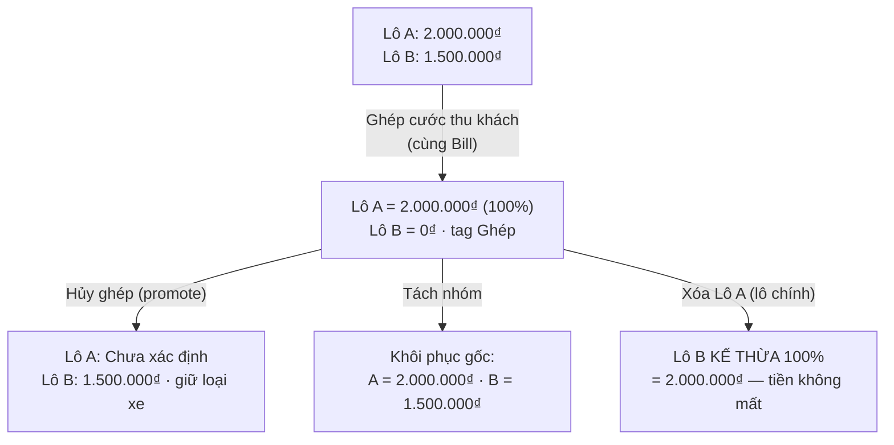
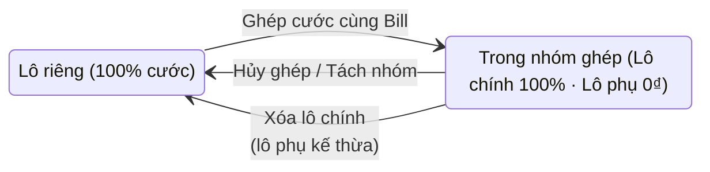

# Logic nghiệp vụ Hàng lẻ (LCL)

# Silversea — Logic nghiệp vụ Hàng lẻ (LCL)

## 1. Định nghĩa & phân loại
- Hàng lẻ (LCL): lô KHÔNG gắn container cụ thể của khách — vận chuyển bằng xe tải trọng tải (1.25T → 15T) hoặc gom cont 20'/40' chạy ghép. Đối lập FCL: lô gắn container số riêng (MSKU…, 20DC/40DC…).
- Badge phân loại mọi bảng: Nhập·Cont / Nhập·Lẻ / Xuất·Lẻ — bắt buộc phân biệt rõ lẻ vs cont.
- Row hàng lẻ có spec phrase: "Lô hàng lẻ | Thu: Xe 3.5T | Trả: Xe 10T" (thu/trả có thể khác loại xe).
- Row ghép: tag "Lẻ · Ghép (n/N)" — n = vị trí lô trong nhóm, N = tổng số lô ghép.

## 2. Tạo lô hàng lẻ
- Chọn Loại hàng = Hàng lẻ → KHÔNG bắt nhập số container; nhập 4 trường: Quy cách đóng gói, Số lượng, Trọng lượng (kg), Thể tích (CBM).
- Số Bill/Booking + Hãng tàu như FCL; Hình thức XNK bắt buộc.
- SỐ TỜ KHAI: quản lý THEO CONT — không còn input cấp lô (đã gỡ ở form tạo/sửa + dialog Chứng từ; BE chặn key declarationNumber trong payload → 400).
- Kho lấy hàng (CFS/Cảng): tìm kiếm khớp full mã (GLC) lẫn prefix (LC) — .
- Quy tắc cont: hàng lẻ xe tải = 100% xe ngoài (chặn BKS nội bộ, 400); gom cont 20'/40' = nội bộ hoặc ngoài. Sibling trống kế thừa theo /521 (chỉ fill dòng trống, không ghi đè diverge).

## 3. Danh mục & bảng giá
- vehicle_size_classes: 1.25T, 2.5T, 3.5T, 5T, 8T, 10T, 15T, CONT20, CONT40 (CRUD /config/vehicle-size-classes).
- Bảng giá = Tuyến × Khách hàng/Nhà thầu: cước thu + cước trả theo trọng tải.
- Cước thu/trả dự kiến hiển thị trên dialog Chỉnh sửa điều phối (dense: Phân loại + Cước thu cùng hàng — ).

## 4. Điều vận: Kế hoạch Tổng quát & Chi tiết Xe
- Tổng quát mobile dense: card 3 dòng, badge lẻ/cont, nút Phân bổ nhà xe compact ẩn khi đã phân.
- Chi tiết Xe: ô Container 3 dòng; popup Gán xe nhóm; BKS THỰC + BKS BÁO KHÁCH (ảo — mặc định = thực nếu trống).
- Cước trả ĐV: Lô 1 = 100%, Lô 2..N = 0₫.
- Gán xe nhóm: điền 1 lần áp cả nhóm; đổi BKS nhóm chặn gõ tay "Bổ sung sau" (chỉ BKS thật/trống; defer qua nút riêng lô đơn) — .
- THAO TÁC: stack dọc (send trên, ⋯ dưới); "Hoàn thành" + Phát lệnh trong menu ⋯; phím ←/→ cuộn ngang mọi bảng.
- Cột Số tờ khai có ở mọi bảng liệt kê container, click-to-edit.

## 5. Gộp xe thu khách & bảo toàn doanh thu
- Ghép cước thu khách: nhiều lô cùng khách + loại xe thu + BKS ảo per-lô. Sau ghép: Lô 1 giữ 100%, Lô 2..N = 0₫, tag "Ghép cước cùng Bill [Bill Lô 1]". Tổng doanh thu không đổi.
- Hủy ghép (promote): Lô 2 nhận 100%, Lô 1 về Chưa xác định, giữ loại xe.
- Tách nhóm: khôi phục cước gốc cả hai lô; Lô 2 null estimate hiển thị "—" không ghi 0₫.
- Xóa lô chính đã ghép: lô còn lại KẾ THỪA quyền lô chính + 100% tiền.
- Mirror dispatch: cùng luật cho cước TRẢ ĐV.

## 6. Chứng từ (CUS) — Chi tiết lô hàng
- Thông số container: "Lô hàng lẻ | Thu: Xe 3.5T | Trả: Xe 10T".
- Phân xe 2 dòng: BKS Thực + sửa nhanh BKS Báo khách.
- Số tờ khai per-cont: click-to-edit từng dòng, cho phép trùng 1 phần/toàn bộ trong 1 lô, không đồng bộ ép khi sửa 1 dòng.
- Row hàng lẻ click-to-edit được tờ khai + phân xe như FCL.
- Tổng quan: cột CHỨNG TỪ = Bill + TẤT CẢ số tờ khai của lô.

## 7. Kế toán & Debit Note
- Chốt debit: cột Thông số ("Lẻ · Thu: 5T / Trả: 10T" | "Ghép cùng Bill…"); phải thu/trả tự động 100%/0₫.
- Debit Note KHÁCH: BKS = BÁO KHÁCH (tuyệt đối không in BKS thực) + loại xe thu + chú thích ghép.
- Bảng kê NHÀ XE: BKS = THỰC + loại xe trả.
- Hoàn ứng: kế toán lập phiếu; replay cùng idempotency-key → 200; key khác sau duyệt → 409.

## 8. Doctrine UI/UX
- SAGE GLOBAL: nền app #E3E8E5 (token --bg/--bg-1), card trắng nổi trên nền.
- CẤM TRUNCATE: mọi cell wrap full — h-scroll thay vì cắt chữ.
- DATA-DENSE: card 3 dòng, meta gộp, nút compact, footer action 1 dòng sticky.
- THAO TÁC stack dọc ~44-48px; "Hoàn thành" trong menu ⋯.

## Sơ đồ gộp / tách cước (hàng lẻ)

