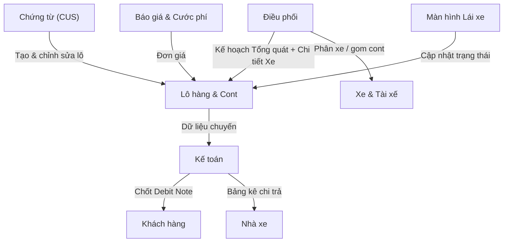

# 1. Tổng quan hệ thống và nguyên tắc chung

## Sơ đồ kiến trúc

> **Sơ đồ:** [Sơ đồ kiến trúc: trục cốt lõi & phân hệ vệ tinh](https://book.tingting.vip/s/silversea/p/artifact-ea725bcd059a02df69c0554f)

Chương này định vị hệ thống Silversea (TTransport) trong nghiệp vụ khách hàng, thống kê người dùng và vai trò, xác định ranh giới trong/ngoài phạm vi và trình bày các nguyên tắc áp dụng cho **toàn bộ** các chương sau. Mọi quy tắc nêu tại đây là quy tắc **đang áp dụng**; khi yêu cầu trước đây mâu thuẫn với quy tắc nêu tại đây, quy tắc đã chốt tại đây thắng.

---

## 1.1 Bối cảnh & mục tiêu

### 1.1.1 Dự án và các bên

### 1.1.2 Vị trí trong nghiệp vụ

Silver Sea là phần mềm quản lý vận tải / forwarder logistics cho doanh nghiệp giao nhận vận tải. Chuỗi nghiệp vụ hệ thống phủ:

> **tiếp nhận lô → lập kế hoạch vận chuyển → giao nhận → chi phí, hồ sơ, công nợ**.

Người dùng gồm nhân sự doanh nghiệp giao nhận vận tải: tiếp vụ (chứng từ), điều phối/điều vận, lái xe, hiện trường (Ops), kế toán, quản lý, chủ doanh nghiệp; thêm khách hàng của doanh nghiệp với màn hình theo dõi riêng.

### 1.1.3 Mục tiêu chất lượng của sản phẩm

Hệ thống **bắt buộc** đạt ba điều sau cho người dùng:

1. Người dùng **biết việc cần làm**, biết **dữ liệu còn thiếu** và thấy **kết quả hành động ngay tại chỗ**;
2. **Không nhập lại** dữ liệu đã có (kế thừa đúng nơi);
3. **Không có trạng thái mâu thuẫn** giữa các màn hình.

Đây là gốc rễ của mọi quy tắc ở §1.5 và là tiêu chí đối chiếu cho mọi chương sau.

### 1.1.4 Kiến trúc trục cốt lõi & phân hệ vệ tinh

Theo tài liệu giải pháp tổng thể, hệ thống được tổ chức quanh một **trục cốt lõi** là quy trình O2C khép kín: **tiếp nhận → điều vận → vận chuyển → chứng từ/cước → quyết toán**. Dữ liệu nghiệp vụ được sinh ra và chốt ngay trên trục vào đúng thời điểm phát sinh, không chờ chuyển tay giữa các bộ phận.

Các **phân hệ vệ tinh** — công nợ, sổ quỹ, nhân sự, báo cáo quản trị — không nhập liệu riêng mà **khai thác dữ liệu tự động từ trục**: lô hoàn thành chuyển chứng từ sang kế toán, chuyến hoàn thành đẩy nhật ký tiền sang sổ quỹ, dữ liệu vận hành nuôi số liệu chấm công và báo cáo. Đây là cách thi hành cụ thể của nguyên tắc **không nhập lại** và **không có trạng thái mâu thuẫn** giữa các màn hình (§1.1.3).

Phần lớn việc xử lý trên trục chạy theo **kích hoạt tự động**: hành động xảy ra ngay khi sự kiện nghiệp vụ xảy ra, không cần thao tác chuyển tay.

**Bảng kích hoạt tự động (rút gọn):**

- **Sự kiện trên trục:** Khởi tạo lô
- **Hành động tự động:** tự tính cước dự kiến theo bảng giá đang áp

- **Sự kiện trên trục:** Kẹp 2 chiều
- **Hành động tự động:** tự tối ưu chi phí cầu đường

- **Sự kiện trên trục:** Hoàn thành chuyến
- **Hành động tự động:** tự chốt công nợ liên quan

- **Sự kiện trên trục:** Ghi nhận chứng từ giao hàng
- **Hành động tự động:** tự cập nhật hồ sơ, chứng từ cho kế toán

- **Sự kiện trên trục:** Khóa kỳ
- **Hành động tự động:** tự tổng hợp số liệu cho báo cáo quản trị

Hệ thống **không khóa cứng dữ liệu**: sau khi hoàn thành, việc thay đổi chi phí không bị chặn mà **phát cảnh báo để kế toán đối soát** — số liệu đã chốt vẫn được giữ nguyên, điều chỉnh được ghi nhận có kiểm soát.

Lưu ý về thuật ngữ: một tài liệu giải pháp trước đây dùng từ **“chờ duyệt / phê duyệt”**; theo nguyên tắc hiện hành (§1.4) hệ thống **không có bước phê duyệt nội bộ**, mọi nghiệp vụ chỉ có **thao tác trực tiếp** — từ ngữ cũ chỉ để đọc lại lịch sử, không tương ứng với bất kỳ bước chờ nào trong hệ thống hiện hành.

---

## 1.2 Người dùng & vai trò

Hệ thống định nghĩa **8 vai trò**; bảng dưới nêu nhu cầu chính của từng vai:

- **Vai trò:** **Quản trị**
- **Nhu cầu chính:** Tài khoản, phạm vi quyền, danh mục nhất quán; ngừng hoạt động = **không nhận việc mới, lịch sử vẫn đọc được**

- **Vai trò:** **Quản lý**
- **Nhu cầu chính:** Tiến độ, việc tồn, tài chính bằng số liệu có ý nghĩa; điều chỉnh theo thẩm quyền

- **Vai trò:** **Chứng từ (CUS)**
- **Nhu cầu chính:** Nhập lô nhanh, lưu thông tin chưa đầy đủ, bổ sung đúng lúc, chuyển dữ liệu chính xác sang điều vận & kế toán

- **Vai trò:** **Điều vận**
- **Nhu cầu chính:** Nhìn phần chưa phân bổ, chọn nguồn lực, phát lệnh, xử lý thay đổi **không trùng lịch / không mất việc**

- **Vai trò:** **Lái xe**
- **Nhu cầu chính:** Đúng lệnh giao, hiểu việc + liên hệ, cập nhật chứng từ, hoàn thành với ít thao tác

- **Vai trò:** **Ops (hiện trường)**
- **Nhu cầu chính:** Kế hoạch, phối hợp cảng/nhà máy, ghi tiền thực nhận/thực chi, bổ sung chứng từ, đối chiếu quỹ

- **Vai trò:** **Kế toán**
- **Nhu cầu chính:** Đối chiếu hồ sơ/số tiền, bảng kê, thanh toán/phân bổ, lương, khóa kỳ trong phạm vi cấp

- **Vai trò:** **Khách hàng**
- **Nhu cầu chính:** Theo dõi lô, tiến độ, thông tin chia sẻ; **xác nhận thực tế giao nhận** khi thuộc quy trình

### 1.2.1 Nguyên tắc phân quyền theo vai

- **Tên vai không đồng nghĩa với toàn quyền**: mỗi màn hình chỉ hiển thị thông tin/thao tác trong phạm vi người dùng; cùng nghiệp vụ phải **thống nhất giữa các vai** (cùng dữ liệu, cùng trạng thái).
- Máy chủ là nơi chốt quyền: truy cập ngoài phạm vi bị từ chối ở máy chủ, không chỉ bị ẩn trên giao diện (vai Kế toán mở màn quản lý người dùng bị chặn; đọc chuyến/đội xe/cấu hình phạt theo quyền).
- Một số màn hình được giới hạn phạm vi ngay tại máy chủ và **không nhận tham số định danh từ trình duyệt**, ví dụ sổ quỹ của Ops chỉ đọc được dòng tiền của chính mình.
- **Điều vận và Lái xe không có “hộp việc đến” — theo thiết kế**: Điều vận làm việc trên `/dispatch`, `/dispatch-detail`, Sổ chuyến đi; Lái xe trên `/my-trips`; hộp việc đến chỉ dành cho Ops (`/my-orders`) và CUS (`/portal/shipments`).
- Về phiên: chấp nhận **một trình duyệt cho mỗi vai**; đổi vai bằng cách đăng xuất/đăng nhập lại; chia sẻ phiên giữa nhiều tab không phải lỗi.

### 1.2.2 Sự kiện nghiệp vụ của người dùng

Hai thao tác giữ nguyên ý nghĩa **sự kiện nghiệp vụ**, không phải bước phê duyệt: **Lái xe nhận lệnh** và **Khách hàng xác nhận thực tế giao nhận**; xác nhận cho thao tác của chính người dùng (ví dụ xác nhận hủy) cũng **khác** bước phê duyệt của người khác.

---

## 1.3 Phạm vi hệ thống (trong / ngoài)

### 1.3.1 Nằm trong phạm vi

- Toàn bộ chuỗi **tiếp nhận lô → lập kế hoạch vận chuyển → giao nhận → chi phí, hồ sơ, công nợ**.
- Thực thể nghiệp vụ chính: **lô hàng**, **container**, **công việc**, **chuyến (trip)**, **kẹp/kết hợp**, **lệnh chạy ngoài**, **tờ khai hải quan**, **vận đơn / Bill-Booking**, **chứng từ giao hàng**, **cước phí và phụ phí**, **chi phí chi hộ**, **tạm ứng/hoàn ứng**, **quỹ**, **bảng kê và công nợ**, **chấm công/lương** (phân hệ Kế toán).
- Màn hình theo vai: CUS (`/shipments/new`, `/shipments/:id`, `/portal/shipments`), Điều vận (`/dispatch`, `/dispatch-detail`), Lái xe (`/my-trips`), Ops (`/my-orders`), Kế toán (`/finance`, `/accounting/chot-debit`, phơi phiếu, công nợ), Báo cáo (`/reports`), Quản trị (`/users`, `/config/factories`).
- Hai luồng tạo lô: **luồng chuẩn** (khách hàng + nhà máy thuộc danh mục, có bảng định mức nội bộ) và **lệnh chạy ngoài** (hàng đi xin bên ngoài; chỉ có cước khách báo và các phí chi hộ; không áp bảng định mức — đây là **bản chất** của loại lô này, không phải cơ chế bỏ qua kiểm tra).

### 1.3.2 Nằm ngoài phạm vi

- Bảng phạm vi chi tiết từng mảng ở §1.6; các ranh giới thường gặp: **công thức cước và thiết kế bảng giá** không thuộc chuỗi O2C, tạo lô mới, lô kẹp/kết hợp hay phân hệ Kế toán; **lương lái xe và công nợ khách hàng** không thuộc vận hành Ops; **điều vận và kế toán** không thuộc màn hình lái xe.
- Ngoài ra không có: **quy trình phê duyệt nội bộ** (§1.4.1), **lưu/hứa lưu ngoại tuyến** (§1.4.2), trạng thái chờ duyệt hay bước gửi duyệt khi tạo lô (§1.4.5).
- Các mục **chưa chốt** được ghi tại mục *Điểm còn mở* ở cuối từng phần kèm hành vi tạm thời; bộ đặc tả **không tự đặt điều khoản lấp chỗ trống**.

### 1.3.3 Đi sâu hơn ở chương khác

Phạm vi chi tiết từng mảng (O2C, dữ liệu chủ, lô ghép/kết hợp, Ops, lái xe, cước, báo giá, kế toán) đặc tả ở các chương chuyên đề; chương này chỉ chốt khung và nguyên tắc chung.

---

## 1.4 Nguyên tắc chung

Năm nguyên tắc dưới đây áp dụng cho mọi phần, mọi màn hình, mọi vai.

### 1.4.1 Nguyên tắc 1 — Thao tác trực tiếp, không phê duyệt nội bộ

- **Lưu / phát hành / điều chỉnh / hủy** được thực hiện **trực tiếp** ngay khi đã đủ quy tắc nghiệp vụ.
- Hệ thống **không có**: gửi duyệt, người duyệt, chờ duyệt theo cấp tiền, tự động duyệt. Quyết định ngày 17/09/2026 mở rộng cho **mọi nghiệp vụ hiện hành** (tạo khách hàng/danh mục, sửa lô, điều vận, hồ sơ giao nhận, chi phí, tạm ứng/hoàn ứng, nhiên liệu, hạn mức tín dụng, chấm công, lương, khóa/mở kỳ): không giữ màn hình/hàng đợi/nút/thông báo phê duyệt chờ triển khai sau, không mô phỏng bước kiểm tra/duyệt sau nút lưu.
- Vẫn **giữ nguyên** các cơ chế bảo vệ: **quyền thao tác**, **kiểm tra dữ liệu**, **lý do điều chỉnh**, **lịch sử thay đổi**, **khóa kỳ**.
- Giữ nguyên ý nghĩa sự kiện nghiệp vụ: **Lái xe nhận lệnh**, **Khách hàng xác nhận thực tế giao nhận**. “Xác nhận thao tác của chính người dùng” (ví dụ xác nhận hủy) **không phải** bước phê duyệt của người khác.
- **“Yêu cầu ứng” = yêu cầu cấp tiền**; chỉ **giao dịch thực tế** mới ghi tiền nhận/chi.
- Lịch sử quyết định cũ vẫn đọc được để đối chiếu, nhưng **không tạo thao tác duyệt mới**.

### 1.4.2 Nguyên tắc 2 — Internet, mất kết nối, thử lại

- Ứng dụng **cần Internet**, **không hứa lưu ngoại tuyến**; toàn bộ hệ thống thống nhất **không phụ thuộc chế độ ngoại tuyến**.
- Mất kết nối: báo rõ chưa thể lưu và giữ nội dung đang nhập; người dùng chủ động thử lại khi có mạng.
- **Bấm lưu lặp / mất kết nối không tạo trùng** lô, chuyến, ảnh, tiền, phiếu, phân bổ, bản giá, khoản tiền; mười lệnh ghi tài chính bắt buộc mang **`Idempotency-Key`**  — gửi lại không bao giờ nhân đôi bút toán.

### 1.4.3 Nguyên tắc 3 — Trạng thái & nhãn

Năm tình trạng dưới đây là **năm tình trạng khác nhau**, không được gộp: (1) ghi nhận chi phí; (2) thiếu chứng từ; (3) hoàn thành vận chuyển; (4) đã thanh toán; (5) đã khóa kỳ.

- Nhãn phải **nói đúng sự kiện** của nó; **không suy ra tất cả từ một trạng thái chung**; **không thay giá trị chưa biết bằng số 0**. Thi hành cụ thể: vắng nguồn hiển thị **“—”**, số 0 tính được từ đầu đầy đủ thì hiển thị **0 đúng nghĩa**.
- Ba thông tin tài chính tách biệt: **chi thực tế**, **số tính cho khách**, **tiền đã thu/trả**; đối chiếu không tạo thêm dòng tiền hoặc cấp duyệt.
- Khóa hiển thị là **khóa nghiệp vụ**: nhận diện lô bằng **Số Bill / Số Booking**; mã kỹ thuật nội bộ (mã lô, mã chuyến, mã chứng từ, số thứ tự) chỉ là khóa kỹ thuật, **không bao giờ hiển thị**.

### 1.4.4 Nguyên tắc 4 — Quy tắc cước đang áp dụng

Khách hàng xác nhận ngày 09/09/2026, đang áp dụng nguyên vẹn:

1. **Kẹp phụ phí dầu về 0** khi giá dầu kỳ < giá mốc (Câu 1 = phương án B).
2. **Luôn tính km khứ hồi theo hợp đồng**, kể cả chuyến một chiều (Câu 4 = phương án A).
3. Chọn **Ngày vận chuyển** làm mốc áp giá; **không hồi tố** cước đã chốt.
4. Thông số khách hàng **chưa xác định** thì **không tự thay** bằng số minh họa.

Các giá trị, phạm vi, điều kiện cụ thể nằm ở phần cước phí, không lặp lại tại đây.

### 1.4.5 Nguyên tắc 5 — Phạm vi danh mục phí / trường chuyến / tạo lô

Quyết định của chủ sản phẩm ngày 01/10/2026 — **giữ nguyên chính sách hiện tại**:

- **CUS giữ nguyên phạm vi truy cập danh mục phí báo giá hiện tại**: không mở thêm quyền danh mục, **không tự thêm cột giá phí**; quyền đọc/xuất chi tiết công nợ là **phạm vi riêng**.
- Số lượng, đơn giá, tiền phụ cấp trên **biểu mẫu chuyến** phải **không âm**; quy tắc **dòng chi phí âm** (hiển thị nhưng không cộng tổng) không đổi — dòng âm vẫn hiện để đối soát, mọi tổng không trừ số âm, màn nhập Ops/lái xe/kế toán vẫn yêu cầu số dương.
- **Tạo lô ở trạng thái nháp (`DRAFT`)**, rồi tiếp theo luồng sẵn sàng/hồ sơ/hiện tại; **không thêm trạng thái gửi duyệt** hay bước phê duyệt nội bộ. Đây là quyết định **không mở thêm quyền hoặc thao tác gửi duyệt**, không phải thay đổi đã triển khai.

---

## 1.5 Nguyên tắc chất lượng trải nghiệm

Bộ yêu cầu trải nghiệm gồm **7 nhóm** phải đạt. Đây là tiêu chí nghiệm thu chung, độc lập với từng màn hình.

### 1.5.1 Dễ nhận biết
Người dùng luôn biết **đang ở đâu**, lô/kỳ **nào**, **thiếu gì**, **bước sau** là gì; tên, ngày, tiền, trạng thái **thống nhất** giữa danh sách, màn chi tiết và chứng từ.

### 1.5.2 Ít nhập lại
Dữ liệu **kế thừa đúng nơi**; đổi một lựa chọn thì các trường phụ thuộc cập nhật theo; **không âm thầm mất** nội dung đang sửa.

### 1.5.3 Lưu đáng tin cậy
Bấm lưu **nhiều lần không tạo bản ghi trùng**; khi **người khác sửa cùng dữ liệu** thì hiển thị thay đổi và để người dùng **tự quyết cách tiếp tục**, không bị ghi đè.

### 1.5.4 Tận dụng diện tích
Bảng hỗ trợ **so sánh**; màn nhỏ ưu tiên **định danh, lịch, trạng thái, số liệu chính, hành động**; mã quan trọng (mã lô, số container, số Bill…) **không bị cắt/gãy ký tự**; nhóm trường dùng **khoảng cách + tiêu đề**, tránh nhiều lớp khung.

### 1.5.5 Thao tác thuận tiện
Thao tác **dễ chạm** và **dùng được bàn phím**; có **lỗi cạnh trường**; **nút Lưu/Đóng luôn tiếp cận được** kể cả khi bàn phím ảo điện thoại đang mở; **không phân biệt trạng thái chỉ bằng màu** hoặc hover.

### 1.5.6 Phản hồi rõ & ổn định
Phân biệt rạch ròi *đang tải* / *trống* / *lỗi tải* / *đang lưu* / *đã lưu*; tôn trọng cài đặt **giảm chuyển động**; cập nhật dữ liệu **không làm nhảy hàng** và **không làm mất nút đang dùng**.

### 1.5.7 Giữ ngữ cảnh
Quay lại danh sách **giữ bộ lọc, trang và vị trí**; **đổi tài khoản không để lại dữ liệu** của người trước; lỗi kết nối tạm **không đá phiên làm việc còn hợp lệ**.

### 1.5.8 Quy tắc hiển thị hợp nhất (bổ sung đang áp dụng)

Quyết định ngày 16/09–22/09/2026 hợp nhất quy tắc hiển thị: dữ liệu bảng **trọn vẹn, không cắt cụt** (mã/BKS/SĐT giữ nguyên cụm); **trạng thái dạng chữ**; **một kiểu thanh lọc dùng chung**; **màn trống thống nhất**; **lớp nổi** dùng chung nền; **bảng màu hiệu chuẩn** — chữ tương phản ≥ 4,5:1, xanh “thành công” chỉ cho hoàn thành/đã thu, **tiền chưa thu = vàng cảnh báo**; vi phạm phải được **kiểm tra tự động** ngay.

### 1.5.9 Xử lý tình huống bất thường

Sản phẩm phải đáp ứng **cả** luồng thường lẫn: **thiếu dữ liệu, nhập sai, mất kết nối, đổi đồng thời, tên/mã dài, nhiều bản ghi**.

---

## 1.6 Phạm vi chi tiết theo mảng và thuật ngữ

### 1.6.1 Phạm vi từng mảng

- **Mảng nghiệp vụ:** **Chuỗi O2C**
- **Thuộc phạm vi:** tiếp nhận lô → điều vận, giao nhận, hồ sơ, thu tiền; trách nhiệm từng vai
- **Không thuộc:** công thức cước, thiết kế bảng giá

- **Mảng nghiệp vụ:** **Tạo mới lô**
- **Thuộc phạm vi:** màn Tạo mới lô (`/shipments/new`), thứ tự trường theo luồng chứng từ giấy
- **Không thuộc:** cước, phân xe, O2C chung

- **Mảng nghiệp vụ:** **Dữ liệu chủ**
- **Thuộc phạm vi:** khách hàng, nhà máy, tuyến, địa điểm; quan hệ lựa chọn dữ liệu; lệnh chạy ngoài
- **Không thuộc:** cước, phân xe, lương

- **Mảng nghiệp vụ:** **Lô kẹp / kết hợp**
- **Thuộc phạm vi:** kẹp 2 container + kết hợp 2 công việc nối tiếp; nguồn lực, tiến độ, chi phí, doanh thu
- **Không thuộc:** lô đơn lẻ

- **Mảng nghiệp vụ:** **Vận hành Ops**
- **Thuộc phạm vi:** kế hoạch hàng, phương tiện, tiền ứng, chi phí, chứng từ, quyết toán của Ops
- **Không thuộc:** lương lái xe, công nợ khách hàng

- **Mảng nghiệp vụ:** **Màn hình lái xe**
- **Thuộc phạm vi:** hành trình lái xe: nhận lệnh, thực hiện, ảnh/chứng từ, hoàn thành
- **Không thuộc:** điều vận, kế toán

- **Mảng nghiệp vụ:** **Cước phí & phụ phí dầu**
- **Thuộc phạm vi:** công thức cước, tham số hợp đồng, bảng số tham chiếu, làm tròn
- **Không thuộc:** trải nghiệm cấu hình giá

- **Mảng nghiệp vụ:** **Thiết kế dữ liệu cước**
- **Thuộc phạm vi:** dữ liệu cước, ngày hiệu lực, giải thích số tiền, bảo toàn lịch sử
- **Không thuộc:** công thức tính cước

- **Mảng nghiệp vụ:** **Phương án tính cước tự động**
- **Thuộc phạm vi:** cấu hình, tính cước theo ngày vận chuyển, thiếu giá, điều chỉnh giá trên bảng kê
- **Không thuộc:** công thức gốc, bảng giá hợp đồng

- **Mảng nghiệp vụ:** **Báo giá**
- **Thuộc phạm vi:** khung giá theo khách hàng, lưới nhà máy×tuyến×hạng xe, phụ phí kỳ giá dầu, bảng tính, lịch sử phiên bản
- **Không thuộc:** cách tính cước áp khi phát lệnh

- **Mảng nghiệp vụ:** **Phân hệ Kế toán**
- **Thuộc phạm vi:** giao diện và quy tắc Kế toán (bảng tổng hợp tiền/cược/quỹ, phơi phiếu, công nợ, quỹ, chấm công/lương)
- **Không thuộc:** phân hệ khác, O2C chung, công thức cước

Mỗi mảng có phần đặc tả chi tiết riêng; đặc tả chi tiết **không thay thế** các quy tắc đang áp dụng nêu tại đây.

### 1.6.2 Thuật ngữ chuẩn

- **Thuật ngữ:** **Lô**
- **Định nghĩa:** `shipment` — nhiều container (FCL) hoặc hàng lẻ

- **Thuật ngữ:** **Công việc**
- **Định nghĩa:** phần việc gắn 1 container hoặc hàng LCL

- **Thuật ngữ:** **Chuyến (trip)**
- **Định nghĩa:** hành trình thực tế của 1 xe

- **Thuật ngữ:** **Kẹp**
- **Định nghĩa:** 2 container đồng thời trên cùng xe

- **Thuật ngữ:** **Kết hợp**
- **Định nghĩa:** 2 công việc nối tiếp dùng chung vỏ

- **Thuật ngữ:** **Lệnh chạy ngoài**
- **Định nghĩa:** lô không do SilverSea tạo ra

### 1.6.3 Quy ước đọc và viết tài liệu

- **Một quy tắc chỉ định nghĩa ở một nơi**; các phần khác chỉ tham chiếu, không định nghĩa lại.
- Không đánh số lại mục; tham chiếu chéo theo dạng `§n.m`.
- **Không ghi lịch sử trong tài liệu** — lịch sử thay đổi nằm ở nhật ký công việc; mục **“Điểm còn mở”** ở cuối mỗi phần kèm **hành vi tạm thời**; không tự đặt điều khoản lấp chỗ trống.
- Phải đáp ứng cả luồng thường lẫn tình huống bất thường (§1.5.9).

---

## 1.7 Kỹ thuật vận hành và giao diện

### 1.7.1 Giao diện & màn hình

- Ứng dụng web cho **máy tính và điện thoại**, có chế độ **PWA** cài đặt độc lập trên điện thoại.
- Tuyến màn hình chính: `/shipments/new`, `/shipments/:id` (và `/edit`), `/dispatch`, `/dispatch-detail`, `/my-trips`, `/my-orders`, `/portal/shipments`, `/accounting/chot-debit`, `/reports`, `/finance`, `/users`, `/fleet`, `/penalties`, `/config/factories`.

### 1.7.2 Giao tiếp & tính toàn vẹn dữ liệu

- Giao tiếp theo **API HTTP kiểu REST** tiền tố `/api/…`.
- **Khóa lạc quan**: lệnh ghi dòng phải mang token phiên bản kỳ vọng; thiếu token thì máy chủ từ chối — tránh ghi đè dữ liệu mà người khác vừa sửa.
- **Mọi lệnh ghi tài chính phải đi qua biên lệnh bền vững** với mã nhận diện giao dịch (`Idempotency-Key`) **bắt buộc**: gửi lại cùng mã trả về kết quả đã phát lại, mã khác trả về xung đột; kiểm tra tự động chặn mọi điểm ghi tài chính chưa được khai báo.
- **Bảo vệ dữ liệu tài chính**: lịch sử cước chỉ được ghi thêm, không ghi đè quá khứ; lô khóa kế toán đóng băng số tiền và nhãn tại thời điểm khóa.

### 1.7.3 Môi trường vận hành

- **Môi trường:** Kiểm thử (QA)
- **Ghi chú:** Dữ liệu kiểm thử; dựng lại từ dữ liệu vận hành

- **Môi trường:** Vận hành (production)
- **Ghi chú:** Dữ liệu thật của khách hàng

Hai môi trường tách dữ liệu → yêu cầu sao chép dữ liệu và tài khoản mẫu (xem §1.1.1).

### 1.7.4 Điểm còn mở

- **Chưa chốt:** thao tác xóa lô của Điều vận — quyết định ngày 21/10/2026 đã cho phép, nhưng máy chủ hiện vẫn còn chặn.
- **Chưa chốt:** bản ghi đã xóa còn hiển thị trên màn Kiểm soát phơi phiếu.
- **Chưa chốt:** chế độ điền tự động tên hãng tàu ().
- **Chưa chốt:** nhóm nghiệp vụ chấm công và một số yêu cầu chưa có bằng chứng xác nhận hoàn tất.

*Điểm còn mở của chương được liệt kê tại §1.7.4; hành vi tạm thời từng điểm ghi tại phần tương ứng, không tự đặt điều khoản lấp chỗ trống.*

## Sơ đồ tổng quan hệ thống

