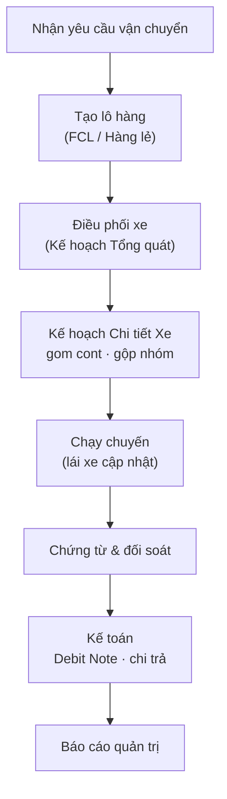

# Đặc tả nghiệp vụ — Silversea (TTransport)

## Sơ đồ kiến trúc

> Bản đặc tả nghiệp vụ của phần mềm quản lý vận tải Silversea (TTransport) — hệ thống quản lý lô hàng, điều phối, cước phí và kế toán cho doanh nghiệp giao nhận vận tải. Ngày tổng hợp: 27/10/2026.

Tài liệu mô tả **luồng nghiệp vụ, quy tắc tính tiền, trạng thái dữ liệu và yêu cầu giao diện** đang áp dụng của hệ thống — 

## Mục lục

- **Chương:** [1. Tổng quan hệ thống và nguyên tắc chung](spec/1-t-ng-quan-h-th-ng-v-nguy-n-t-c-chung.md)
- **Nội dung:** Vai trò người dùng, phạm vi, các nguyên tắc vận hành cốt lõi, chuẩn trải nghiệm

- **Chương:** [2. Luồng nghiệp vụ Order-to-Cash](spec/2-lu-ng-nghi-p-v-order-to-cash-o2c.md)
- **Nội dung:** Luồng tiếp nhận đơn → điều vận → giao hàng → thu tiền, trạng thái lô/chuyến, ngoại lệ

- **Chương:** [3. Tiếp vụ, lô hàng và tờ khai hải quan](spec/3-module-ti-p-v-l-h-ng-v-t-khai-h-i-quan.md)
- **Nội dung:** Tạo lô, ghép lô, container và số tờ khai, chứng từ, hàng lẻ

- **Chương:** [4. Điều phối, lái xe và dữ liệu chủ](spec/4-module-i-u-ph-i-m-n-h-nh-l-i-xe-v-d-li-u-ch.md)
- **Nội dung:** Bảng điều vận, ứng dụng lái xe, danh mục nhà máy–kho–khách hàng

- **Chương:** [5. Cước phí, chứng từ vận đơn và báo giá](spec/5-c-c-ph-ch-ng-t-v-n-n-v-b-o-gi.md)
- **Nội dung:** Danh mục phí, công thức tính cước, tính cước tự động, khai chi phí, báo giá

- **Chương:** [6. Phân hệ kế toán](spec/6-ph-n-h-k-to-n.md)
- **Nội dung:** Chứng từ, công nợ phải thu/trả, thu chi, đối soát, báo cáo

- **Chương:** [7. Ma trận yêu cầu chính thức](spec/7-ma-tr-n-y-u-c-u-ch-nh-th-c.md)
- **Nội dung:** Bảng 35 yêu cầu chính thức và 23 yêu cầu bổ sung kèm trạng thái

- **Chương:** [8. Quyết định nghiệp vụ và vấn đề đang mở](spec/8-quy-t-nh-r-ng-bu-c-v-v-n-ang-m.md)
- **Nội dung:** Các quyết định đã chốt theo ngày, lỗi đang sửa, tính năng đã hủy, rủi ro

## Sơ đồ nghiệp vụ

- **Sơ đồ:** [Luồng nghiệp vụ O2C](https://book.tingting.vip/s/silversea/p/artifact-6cae21e6292b6fa715eab0d2)
- **Dùng ở:** Chương 2

- **Sơ đồ:** [Trạng thái lô hàng và chuyến](https://book.tingting.vip/s/silversea/p/artifact-cc20f74b41c9086a7aac09d0)
- **Dùng ở:** Chương 2

- **Sơ đồ:** [Tương tác các bên trong luồng O2C](https://book.tingting.vip/s/silversea/p/artifact-9c85e35463c15af4585bcc80)
- **Dùng ở:** Chương 2–4

- **Sơ đồ:** [Kiến trúc: trục cốt lõi & phân hệ vệ tinh](https://book.tingting.vip/s/silversea/p/artifact-ea725bcd059a02df69c0554f)
- **Dùng ở:** Chương 1

- **Sơ đồ:** [Quy trình tính cước](https://book.tingting.vip/s/silversea/p/artifact-214cc718911bdf1c06ec8ac6)
- **Dùng ở:** Chương 5

## Một số thuật ngữ

- **Thuật ngữ:** **Lô**
- **Nghĩa:** Một đơn vận tải; hàng nguyên container có thể nhiều container

- **Thuật ngữ:** **Công việc**
- **Nghĩa:** Phần việc gắn với một container hoặc một phần hàng lẻ

- **Thuật ngữ:** **Chuyến**
- **Nghĩa:** Hành trình thực tế của một xe

- **Thuật ngữ:** **Kẹp**
- **Nghĩa:** Hai container đồng thời trên cùng xe

- **Thuật ngữ:** **Kết hợp**
- **Nghĩa:** Hai công việc nối tiếp dùng chung vỏ container

- **Thuật ngữ:** **Tờ khai**
- **Nghĩa:** Tờ khai hải quan — quản lý theo từng container

## Sơ đồ một trang

