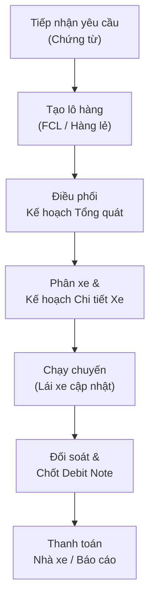
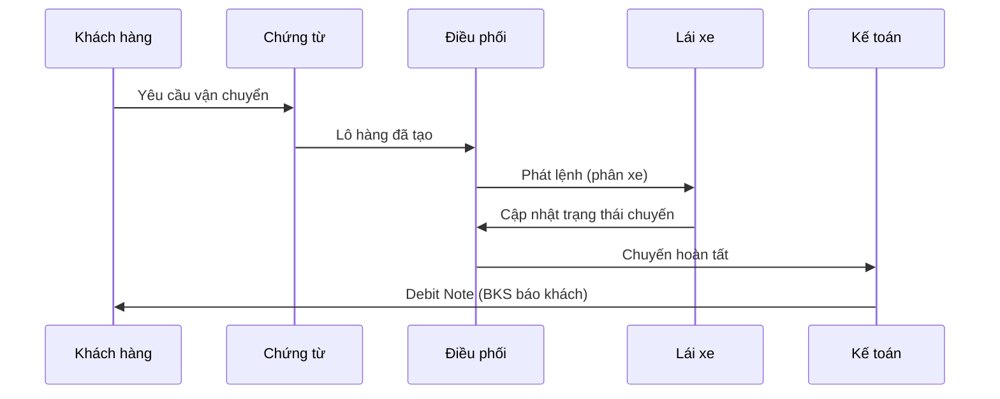

# 2. Luồng nghiệp vụ Order-to-Cash (O2C)

> **Sơ đồ:** [Sơ đồ luồng O2C](https://book.tingting.vip/s/silversea/p/artifact-6cae21e6292b6fa715eab0d2) · [Sơ đồ trạng thái lô/chuyến](https://book.tingting.vip/s/silversea/p/artifact-cc20f74b41c9086a7aac09d0) · [Sơ đồ tương tác các bên](https://book.tingting.vip/s/silversea/p/artifact-9c85e35463c15af4585bcc80)

Chương này mô tả trọn vòng đời một lô hàng của Silversea: từ lúc
tiếp nhận yêu cầu vận chuyển của khách hàng đến khi thu tiền, khóa công nợ và chốt kỳ kế toán. Nội
dung là bản đặc tả quy tắc — không phải hướng dẫn thao tác — nên mọi điều kiện, công thức, giới hạn
hệ thống đều được ghi ở mức có thể kiểm chứng lại.

**Phạm vi.** Áp cho cả hai hình thức hàng **FCL** và **LCL**, với ba loại lệnh **Đơn**, **Kẹp**,
**Kết hợp**.

**Bốn nguyên tắc nền tảng áp cho toàn chương**:

1. **Thao tác trực tiếp, không phê duyệt nội bộ.** Lưu/phát hành/điều chỉnh/hủy trực tiếp khi đủ
   quy tắc nghiệp vụ; không có gửi duyệt, người duyệt, chờ duyệt theo cấp tiền hay tự động duyệt
. Vẫn giữ: quyền thao tác, kiểm tra dữ liệu, lý do
   điều chỉnh, lịch sử thay đổi, khóa kỳ.
2. **Hai sự kiện phản hồi được giữ lại:** lái xe **nhận lệnh** và khách hàng **xác nhận thực tế giao
   nhận**. Xác nhận thao tác của chính người dùng (VD xác nhận hủy) không phải bước phê duyệt người
   khác.
3. **Cần Internet, không hỗ trợ ghi ngoại tuyến**.
4. **Nhiều trạng thái song song, không suy ra lẫn nhau.** Ghi nhận chi phí · thiếu chứng từ · hoàn
   thành vận chuyển · đã thanh toán · đã khóa kỳ là năm tình trạng khác nhau; không thay giá trị chưa
   biết bằng số 0.

**Các khái niệm phân biệt bắt buộc**:

- **Lô hàng** (khách hàng + chứng từ + hàng hóa, gồm nhiều phần việc) **≠ Công việc / chuyến vận
  chuyển** (phần giao cho xe hoặc nhà vận tải; LCL có công việc riêng, không cần container).
- Ba sự việc độc lập: **đã nhập biển số**, **đã phát lệnh**, **lái xe đã nhận** — không suy ra lẫn
  nhau.
- Năm thông tin độc lập: **hoàn thành vận chuyển / đủ chứng từ / sẵn sàng lập bảng kê / đã thanh toán
  / đã khóa kỳ** — một trạng thái không tự chứng minh trạng thái còn lại.

---

## 2.1 Sơ đồ luồng tổng thể


> Bản đồ chi tiết từng bước: xem mục 2.2. Sơ đồ trạng thái: xem mục 2.3.

Dạng rút gọn theo sự kiện:

- **[1] Tiếp nhận** → lô ở trạng thái nháp; dữ liệu thiếu vẫn lưu được, ghi rõ thiếu gì.
- **[2] Báo giá** → khung giá có ngày hiệu lực; thiếu điều khoản thì báo thiếu, không đặt giá thay.
- **[3] Tạo lô hàng** → sinh mã lô; lô đủ dữ liệu tự xuất hiện trong kế hoạch Điều vận.
- **[4] Điều phối** → phân bổ nguồn lực → **phát lệnh** (tạo chuyến + thông báo tài xế).
- **[5] Thực hiện chuyến** → lái xe nhận lệnh, ghi tiến độ, bằng chứng, **hoàn thành chuyến**.
- **[6] Chứng từ** → CUS tổng hợp hồ sơ, ghi nhận chứng từ gốc; khách xác nhận thực tế (tuỳ chọn).
- **[7] Phát sinh cước** → cước + phụ phí + chi phí phát sinh trên đúng lô/chuyến.
- **[8] Đối soát & thu tiền** → phơi phiếu, đối chiếu, phiếu thu/chi, phân bổ công nợ.
- **[9] Kế toán** → bảng kê, debit, khóa lô, khóa kỳ.

Không có bước “gửi yêu cầu — kiểm tra — phê duyệt nội bộ” ở bất kỳ khâu nào; hai phản hồi thực tế
duy nhất là **lái xe nhận lệnh** và **khách hàng xác nhận giao hàng**.

**Phân biệt đầu ra của từng bước** (mỗi bước là một sự kiện ghi nhận riêng, không gộp):

- Ở bước 3, sự kiện được ghi nhận là **mã lô tồn tại** — và chỉ vậy thôi: chưa thể suy ra lô đã đủ dữ liệu điều xe.
- Ở bước 4, sự kiện được ghi nhận là **đã phát lệnh** — chưa thể suy ra lái xe đã nhận hay xe đã xuất phát.
- Ở bước 5, sự kiện được ghi nhận là **hoàn thành vận chuyển** — chưa thể suy ra đã đủ chứng từ hay đã lập bảng kê.
- Ở bước 6, sự kiện được ghi nhận là **đã nhận chứng từ giấy (kèm người và ngày nhận)** — chưa thể suy ra đã thanh toán.
- Ở bước 7, sự kiện được ghi nhận là **cước đã khóa / chi phí đã ghi** — chưa thể suy ra tiền đã thu.
- Ở bước 8, sự kiện được ghi nhận là **phiếu thu/chi đã ghi, phân bổ đã ghi** — chưa thể suy ra chuyển khoản thực tế đã xảy ra.
- Ở bước 9, sự kiện được ghi nhận là **kỳ đã khóa** — ngoài ra không suy diễn gì thêm, và kỳ khóa không tự mở lại.

---

## 2.2 Từng bước trong luồng O2C

### 2.2.1 Bước 1 — Tiếp nhận yêu cầu

**CUS (chứng từ) chịu trách nhiệm chính**; Quản trị viên và Quản lý thay khi có quyền.

1. Khi nhận yêu cầu vận chuyển, CUS tra cứu xem đã có lô/hợp đồng/báo giá phù hợp chưa. Việc tìm
   kiếm phải trả lời được vì sao một lô **không** xuất hiện trong kết quả (bộ lọc nào đang áp, cách
   xóa lọc).
2. Nếu chưa có lô, CUS mở biểu mẫu **Tạo mới lô hàng**. Lô được tạo ở trạng thái
   **DRAFT** rồi tiếp theo luồng sẵn sàng/hồ sơ hiện tại — **không** có bước nộp hay gửi duyệt
   nội bộ (quyết định ngày 2026-10-01).
3. Thứ tự các trường “Nhận diện lô” đã được chốt ngày 24/10:
   - **Band 1:** Khách hàng · **Hình thức xuất nhập khẩu**;
   - **Band 2:** Số Bill/Booking · Hãng tàu (chỉ hiện với FCL);
   - **Band 3 (full width):** Tuỳ chọn — Lệnh chạy ngoài · Có cược container · Đóng kết hợp;
   - **Band 4 (cuối):** Số tờ khai (chip, dán nhiều số).
   Thay đổi bố cục này cần Trưởng bộ phận Điều vận chấp thuận; **không đảo thứ tự lần thứ tư khi
   chưa có quyết định mới**.
4. **Cổng Bill/Booking:** ô bị tắt cho tới khi chọn *Hình thức xuất nhập khẩu*; sau
   đó ghi số Bill (chiều Nhập khẩu) **hoặc** số Booking (chiều Xuất khẩu),
   **không bao giờ cả hai**.
5. **Tờ khai hải quan:** gắn theo từng container; khi lô chỉ khai 1 số thì mặc định copy sang toàn
   bộ container, cho phép sửa riêng từng container; nhập 1 container tự đồng bộ các container còn lại
. Chỉ các vai trò được cấp quyền
   (Quản trị, CUS, Quản lý theo cấu hình phân quyền của hệ thống) mới ghi/xóa tờ khai; lô đã khóa kế
   toán thì nút hiện nhưng bị tắt kèm lý do.
6. **Nhãn bắt buộc phải khớp kiểm tra hợp lệ:** chip “Bắt buộc: x/y” dùng chung mẫu số với bảng “Cần bổ
   sung N thông tin”, tính bằng số trường bắt buộc đã hoàn thành cộng số lỗi còn lại.
7. **Dữ liệu thiếu là hợp lệ để lưu:** thiếu số container hoặc ngày giao thì để trống kèm nhãn
   **“Chưa có số”** / **“Chưa chốt lịch”**; giá trị sai phải được giải thích để sửa, không được coi
   là “chưa biết”.
8. Các thao tác đi kèm trong khâu tiếp nhận:
   - Đổi khách hàng không để lại nhà máy sai quan hệ; cảnh báo trước khi mất nội dung đang nhập;
     nhà máy cũ thiếu tuyến → phải chọn tuyến hợp lệ, thiếu tuyến bắt buộc thì chưa phát lệnh được
.
   - Ô tìm kiếm không tự biến chữ người dùng gõ thành lựa chọn đã chọn; chỉ pick của người dùng được
     chấp nhận.
   - Lô lẻ hiển thị tag **NHẬP LẺ / XUẤT LẺ** ngay trên dòng theo hình thức hàng và cấp lô.

**Đầu ra của bước:** một bản ghi lô nháp với khóa nghiệp vụ (Số Bill/Số Booking → số tờ khai → tên
khách + ngày chi) đã chọn đúng chiều nhập/xuất.

### 2.2.2 Bước 2 — Báo giá

Bước này liên quan **Kế toán** (khung giá, kỳ giá dầu), **CUS/Điều vận** (đọc giá khi nhập lô) và **người có quyền quản lý biểu cước** (lưu giá gốc, điều khoản tuyến).

1. **Khung báo giá** theo từng khách: tên mẫu, giá dầu tham chiếu, độ trễ (lag), quy tắc làm tròn
   phụ phí, ngày hiệu lực, chế độ làm tròn theo khách; **lưới giá** = nhà máy × tuyến × hạng phương
   tiện; mỗi ô giữ hệ số, tổng lít/chuyến (dẫn xuất, không nhập tay), giá cos.
2. **Thứ tự xác định khi tính cước** (thứ tự ưu tiên dữ liệu):
   khách hàng → tuyến/nhóm tuyến → loại xe/hạng → **Ngày vận chuyển** (mốc chọn kỳ, không dùng ngày
   tạo lô hay ngày lập hóa đơn) → trừ độ trễ tuyến → chọn kỳ giá dầu hiệu lực → ngưỡng điều chỉnh (nếu
   hợp đồng có) → tính `E, H, J, K` → **khóa cước tại Ngày vận chuyển**.
3. **Thứ tự ưu tiên giá** khi hợp đồng cho phép:
   (1) giá gốc theo kg → (2) giá theo container/loại xe → (3) nhập/điều chỉnh thủ công bởi người có
   quyền. Không lấy giá của hợp đồng khác; **thiếu dữ liệu không đồng nghĩa với giá 0**; tách bạch
   “giá dự kiến” và “giá đã phát hành”; quyền sửa lô không tự động cho sửa giá.
4. **Báo giá nhập bảng tính:** xem trước = lần ghi thật; nhận diện khách bằng tên đầy đủ + mã số thuế
   (khách chưa có → báo lỗi, không tự tạo); bản khung mới kế thừa nguyên vẹn danh mục phí của khung
   trước cùng khách; nhập lại → tạo phiên bản mới, không ghi đè.
5. **Giá cuối đàm phán** trên Bảng kê/Debit Note là thao tác nhập riêng của Kế toán: giữ cước hợp
   đồng để so sánh, khác giá thì bắt buộc có lý do nội dung, lưu trực tiếp trong phạm vi quyền, ghi ai
   sửa/lúc nào/giá cũ – giá mới.
6. Chưa có đủ điều khoản tính cước → hiển thị **“Chưa xác định”** và nêu đúng phần thiếu (giá gốc /
   ngày / lag / ngưỡng / kỳ giá); lô vẫn lưu được nhưng **chưa sẵn sàng phát hành số tiền** cho khách
.

**Đầu ra:** khung giá có hiệu lực cho cặp khách hàng – tuyến, và (sau khi có Ngày vận chuyển) một
bản cước khóa có thể giải thích lại được từng thành phần.

### 2.2.3 Bước 3 — Tạo lô hàng (đủ dữ liệu điều xe)

Bước này do **CUS** thực hiện.

1. CUS lưu khách hàng, Bill/Booking, hàng hóa → nhận **mã lô**.
2. **FCL:** ghi loại/số lượng và từng container (số vỏ, loại 20FT/40FT). Thiếu số container hoặc ngày
   giao → để trống + nhãn “Chưa có số”/“Chưa chốt lịch”.
3. **LCL:** ghi quy cách, số lượng, khối lượng/thể tích, lịch — **không tạo số vỏ/container giả**;
   CBM là trường tuỳ chọn, lô lẻ lưu được khi chưa có số khối [LCL-06].
4. Người có quyền bổ sung dữ liệu **trực tiếp, không qua duyệt**. OCR chỉ đề xuất giá trị, không
   bao giờ âm thầm thay đổi dữ liệu người dùng.
5. Lô **đủ dữ liệu điều xe** tự xuất hiện trong kế hoạch Điều vận; lô chưa đủ vẫn tìm lại được (VD
   nhóm “chưa chốt lịch”), không tự gán ngày giả.
6. **Lệnh chạy ngoài** (lô không do SilverSea tạo) mặc định tắt; bật/tắt không mất nội dung đang nhập;
   tên nhập không tự thành danh mục mới; nhãn **Chạy ngoài** + bộ lọc riêng. Không bỏ qua tải trọng,
   lịch, quyền, hạn mức tín dụng; ngoại lệ tín dụng được ghi trực tiếp hạn mức/lý do/thời hiệu
.

**Đầu ra:** lô có mã, đúng khóa nghiệp vụ, đủ hoặc thiếu dữ liệu được ghi rõ, xuất hiện trên kế hoạch
Điều vận.

### 2.2.4 Bước 4 — Điều phối (phân bổ và phát lệnh)

Bước này do **Điều vận** thực hiện.

1. **Kế hoạch Tổng quât:** mỗi lô một dòng tổng hợp; một lô phân bổ được cho nhiều nhà vận tải, **tổng
   phân bổ ≤ số lượng từng loại hàng**; thêm phân bổ không làm nhân đôi công việc; LCL có đủ bước như
   một công việc hàng lẻ thật.
2. **Kế hoạch Chi tiết Xe:** một dòng/container hoặc công việc, với các cột nhà vận tải, biển số, tài
   xế, moóc, lịch, khách hàng/nhà máy, tuyến, cảng nâng/hạ, tình trạng nhận lệnh, ghi chú. Bản thu
   gọn cho mobile/tablet.
3. **Điều kiện phát lệnh** (tất cả phải thỏa):
   - đã có phân bổ (nhà vận tải, xe, tài xế, moóc **phù hợp** với hàng và lịch);
   - lịch đã chốt (chỉ yêu cầu lịch thật cần cho lệnh đó);
   - xe và người **đang hoạt động**, đủ sức chở, không xung đột lịch.
4. **Hành động Phát lệnh:** bấm tại dòng kế hoạch → chạy ngay theo dữ liệu đã lưu; **không hẹn
   ngày/giờ, không hộp xác nhận lặp**. Nút hiện tiến độ và **không
   nhận bấm lần thứ hai**; lỗi hiển thị ngay tại dòng kế hoạch. Bấm lặp không tạo chuyến/tiền thêm;
   việc nhập biển số hay gửi thông báo **không** là bằng chứng phát lệnh thành công. Phát lệnh
   **tạo chuyến và thông báo tài xế**; màn hình lái xe chỉ thấy lệnh sau khi phát lệnh.
5. **Phân xe ghi ở tầng kế hoạch** (biển số dự kiến, loại nhà vận tải, nhà vận tải ngoài…),
   **không** ghi mã xe/mã tài xế lên lô; thông báo “đã phân xe
   đủ” không đồng nghĩa đã ghi lô.
6. **Cảnh báo xung đột lịch:** gán xe/đầu kéo trùng khung giờ với công việc khác → **cảnh báo +
   xác nhận “Vẫn lưu?”** (cảnh báo một lần, không chặn cứng) ở tầng bằng chứng yếu (chỉ có ngày); hai dấu
   thời gian mạnh → **chặn cứng, không có hộp thoại**. Thành viên cặp kẹp không bị cảnh báo vì trùng
   đầu kéo **trong chính cặp**.
7. **Đổi nhà xe/biển số** cho tác vụ đã phân bổ (đơn, ghép, lấy lẻ) qua menu dòng → hộp thoại “Đổi nhà
   xe/BKS”. Nhà xe ngoài chưa có biển số vẫn phát lệnh được, kèm xác nhận “Vẫn
   phát lệnh?” và chip chờ biển [DIS-09].
8. **Gom nhóm LCL:** trên Kế hoạch Chi tiết Xe, ≥2 lô lẻ cùng khách/tuyến → **Gán xe nhóm** (loại
   xe/trọng tải hoặc cont 20'/40', biển số thực, biển số báo khách). Cảnh báo tải trọng **chỉ cảnh
   báo, không chặn**. Hộp thoại gán xe nhóm **chỉ nhận nhà thầu (xe ngoài)** khi chọn “Xe tải”; hệ
   thống chặn nếu nhận xe nội bộ và chặn nếu nhà xe đã cũ.
9. **Đơn / Kẹp / Kết hợp**:

- Về phạm vi công việc: Đơn gồm 1 phần việc; Kẹp gồm 2 container 20FT đi đồng thời; Kết hợp gồm 2 phần việc nối tiếp, tái dùng vỏ.
- Về cách theo dõi: Đơn là 1 lệnh; Kẹp là 2 lệnh riêng có quan hệ cặp; Kết hợp là 2 lệnh riêng có thứ tự.
- Về nguồn lực: Đơn chỉ cần xe phù hợp; Kẹp dùng cùng xe + moóc + tài xế; Kết hợp dùng cùng xe/tài xế và vỏ container phù hợp.
- Về lịch: Đơn chỉ cần lịch thực hiện được; Kẹp phải đồng thời trong một cặp hợp lệ; Kết hợp phải đủ thời gian chuyển tiếp giữa hai lệnh.
- Về phí chung: Đơn tính theo định mức; Kẹp **không nhân đôi** phí đường/VETC; Kết hợp không nhân đôi phí chung theo vòng.
- Về thu nhập lái xe: Đơn tính theo công việc; Kẹp là cuốc cơ bản + phụ phí kẹp; Kết hợp là cuốc cơ bản + phụ phí kết hợp.

   - **Kẹp:** cùng ngày/lịch tương thích, tổng tải đồng thời ≤ tải cho phép; moóc 40FT chở được
     2×20FT nhưng **không** suy ra 40FT ghép được vào cặp 20FT; chặn thành viên thứ ba, quá tải, lộ
     trình bất khả thi. Mỗi lệnh giữ riêng khách hàng, chứng từ, doanh thu, công nợ.
   - **Kết hợp:** hai số vỏ khác nhau ≠ cùng vỏ; phải hoàn thành trả hàng Lệnh 1 trước khi đóng hàng
     Lệnh 2; chưa biết số vỏ vẫn lưu kế hoạch để bổ sung.

**Đầu ra:** các lệnh hợp lệ đã phát, quan hệ cặp/thứ tự được ghi, lái xe nhìn thấy lệnh trên tab
“Lệnh mới”.

### 2.2.5 Bước 5 — Thực hiện chuyến

**Lái xe chủ động thực hiện** cùng nhà vận tải; Điều vận theo dõi.

1. Màn hình lái xe có ba tab **Lệnh mới / Đã nhận / Lịch sử**. Lái xe **chủ động nhận lệnh**; việc
   nhận chỉ được ghi khi **thành công** và khi còn được giao công việc; yêu cầu Internet. **Giờ nhận
   ≠ giờ xe xuất phát**. Ảnh **không bắt buộc** tại thời điểm nhận lệnh
.
2. **Tiến độ chuyến:** nhận lệnh → lấy vỏ/hàng → đóng/trả hàng → hạ bãi/giao hàng; ghi bằng chứng
   tương ứng từng mốc.
3. **Hoàn thành chuyến (FCL):** cần **hai nhóm bằng chứng đã lưu**: (1) phiếu hạ bãi/trả hàng;
   (2) biên bản giao nhận có dấu/chữ ký. Sau khi tự nhận lệnh và đủ hai nhóm → bấm **Hoàn thành chuyến**
   trong một thao tác.
   - Mốc thiếu sau khi nhận được ghi **“suy ra từ hoàn thành”**: không phải mốc GPS/thời điểm thực
     tế, không ghi đè mốc thực tế, không tự tạo sự kiện nhận lệnh.
   - Ảnh tải 100% chưa đủ — ảnh **phải mở lại được**. Không chờ duyệt e-POD hay kế toán.
   - **Không** đặt thêm điều kiện: ảnh container/chì, vé cầu đường, thu hồi chứng từ gốc, đối chiếu
     chi phí, xác nhận doanh thu 0.
4. **LCL:** hoàn thành theo từng công việc hàng lẻ; bộ chứng từ thay phiếu hạ container còn **[CHƯA
   RƠ]**.
5. **Chuyến xe ngoài:** khi hoàn thành, nếu nhà cung cấp liên kết không còn thì hệ thống **không tính
   được** hạn mức thanh toán (áp theo thỏa thuận hợp đồng hoặc nguyên tắc thay thế) và **không** làm sập
   toàn bộ thao tác hoàn thành; giao diện hiển thị nguyên nhân do hệ thống trả về.
6. **Chi phí của lái xe khi kết thúc lô:** hai bảng “Chi phí lô hàng” và “Tiền đường”; tiền đường do
   hệ thống tự ghi nhận, kế toán điều chỉnh, **lái xe chỉ nhìn**; Nâng/Hạ Lạch Huyện hệ thống tự
   cộng; lái xe chọn loại chi phí và điền số, thêm liên tục không cần lưu từng dòng.
7. **Chấm công/lương** đếm theo ngày nghiệp vụ VN: ngày hoàn thành = ngày làm việc hợp lệ, kể cả
   chuyến kéo nhiều ngày; nhiều chuyến cùng ngày **không nhân đôi** ngày công.
   Ký hiệu xếp lệnh: K (kẹp/kết hợp) = 1 chuyến, Q (quay đầu) = 2 chuyến, Đ (đơn) = 1 chuyến, L (lưu
   ca) = không tính chuyến, N/P theo loại nghỉ.

**Đầu ra:** công việc ở trạng thái **Hoàn thành vận chuyển**, bằng chứng đã lưu, mốc tiến độ đầy đủ
hoặc được ghi rõ là “suy ra”.

### 2.2.6 Bước 6 — Chứng từ giao hàng

**CUS chủ trì**; khách hàng tham gia xác nhận tuỳ chọn.

1. CUS nhận tiến độ **từng công việc** và tiến độ **tổng hợp lô**; bổ sung hồ sơ; **ghi chứng từ gốc
   đã nhận**.
2. Chứng từ gốc chỉ được ghi **“đã nhận”** khi có **người nhận và ngày nhận thực tế**.
3. **Ba thông tin riêng, không thay cho nhau**: đủ bằng chứng · vận chuyển
   hoàn thành · đã nhận chứng từ giấy. Không có luồng duyệt/từ chối nội bộ cho chứng từ.
4. **Hồ sơ điện tử:** trạng thái thiếu / đã lưu / hiệu lực; thay thế ảnh giữ liên hệ lịch sử; ảnh lỗi
   không làm mất ảnh đã lưu hoặc ảnh khác đang chọn; xóa/thay ảnh khi tải phải ra đúng lựa chọn mới
   nhất và đúng khoản.
5. **(Tuỳ chọn)** Khách hàng xác nhận giao nhận thực tế → gửi về CUS.
6. Ba nhóm trạng thái chứng từ cần phân biệt trên giao diện: **còn thiếu / đang bổ sung / đã đủ /
   chưa đọc được**.

**Đầu ra:** hồ sơ lô đủ hoặc thiếu được liệt kê từng mục, người/phụ trách/cách bổ sung rõ ràng; lô
tiến tới điều kiện “đủ chứng từ” cho bước 8.

### 2.2.7 Bước 7 — Phát sinh cước

**Hệ thống** lo phần cước tự động; **Ops và lái xe** khai chi phí hiện trường; **CUS/Điều vận** ghi phát sinh; **Kế toán** xử lý giá cuối, cược, hóa đơn kết hợp.

1. **Cước vận chuyển tự động.** Cước được chốt theo **Ngày vận chuyển** và khóa lại (lưu dạng chỉ
   bổ sung, không ghi đè): đổi ngày vận chuyển hoặc phát lệnh làm chốt một bản mới, bản bị thay
   **không cộng vào tổng nào** (quyết định ngày 2026-09-21). Với FCL, cước lấy từ
   container của chính công việc điều vận khi phát lệnh (quyết định ngày 2026-09-21). Lớp cước AUTO
   luôn khớp Bảng 2.1; giá cuối trên debit được ưu tiên ghi đè.
2. **Cước chỉ tính trên chân vận chuyển còn hiệu lực:** chân đã hủy không tính cước; cước đóng băng
   lúc phát hành lô (chưa gắn chân) vẫn vào lớp tổng dù lớp chi tiết chưa hiển thị — đây là ngoại lệ
   đã ghi nhận, **không suy thành 0**.
3. **Chi phí Ops:** khai ngay từ lô, giữ ngữ cảnh lô, tự điền lô + Bill/Booking đúng chiều; chọn
   container hoặc “Phí chung lô” (hàng lẻ không cần số container giả); chọn loại phí theo danh mục
   (phân biệt có/không yêu cầu hóa đơn); số tiền; ngày + người chi; biên lai; ghi chú. Lưu hợp lệ
   → **ghi nhận trực tiếp, phản ánh vào quỹ, không chuyển chờ duyệt**. Mọi
   Ops khai được chi phí cho mọi lô (quyết định ngày 17/10); khi nhập trùng, hệ thống báo lỗi trùng
   lặp kèm bảng xác nhận chủ đích.
4. **Chi phí lái xe** dùng **cùng danh mục loại phí** với chi phí Ops; thêm loại phí mới = dữ liệu,
   không sửa phần mềm.
   - Loại **có hóa đơn** (nâng, hạ, vệ sinh, lưu bãi, lưu kho) phải kèm số hóa đơn ngay khi nhập;
     sau khi kế toán tích xác nhận thì mới vào **phải thu khách hàng**.
   - Loại **không hóa đơn** **không bao giờ** vào phải thu khách.
5. **Tiền đường** (phụ cấp tiền đường + phụ cấp ca + cầu đường + phát sinh riêng) **không bao giờ vào
   phải thu khách**; thanh toán qua phiếu thu/chi trên màn chi phí Ops, không qua phôi phiếu
.
6. **Phát sinh CUS/Điều vận:** ghi trên lô với nhóm chi phí riêng; CUS/kế toán xác định số thu thêm
   theo thỏa thuận. Khoản đã nằm trong **đơn giá trọn gói** là chi phí nhưng **không tự thu thêm lần
   nữa**; không tự đặt mức cho khoản chưa có bảng giá.
7. **Cược container:** lô khai “có cược” (số tiền dự kiến có thể bỏ trống) tự vào bảng theo dõi; kế
   toán điền ngày nộp công văn; **ngày dự kiến hoàn cược = ngày nộp CV + 14 ngày** (sửa được); tick
   “đã hoàn cược” = đã thu + chuyển tiền về **quỹ công ty (ACB)** theo quy trình kho quỹ, mỗi dòng ghi
   đúng một bút toán, tick lại bị chặn.
8. **Hóa đơn kết hợp:** phí trả nhà cung cấp để lấy hóa đơn là **chi phí hóa đơn** riêng của lô (không
   phải toàn bộ giá trị hóa đơn); một công việc duy nhất → gắn vào công việc đó; nhiều công việc →
   người nhập chọn công việc chịu phí; phí trước điều xe vẫn thuộc lô, không tạo chuyến giả; liên kết
   không tạo nghĩa vụ thanh toán thứ hai.

**Đầu ra:** các con số phải thu/phải trả đã ghi trên đúng lô, đúng đối tượng, kèm căn cứ (cước khóa,
số hóa đơn, lý do thu 0đ…).

### 2.2.8 Bước 8 — Đối soát và thu tiền

**Kế toán chủ trì**; Ops lập bảng kê cá nhân; CUS/khách hàng phản hồi bảng kê.

1. **Điều kiện lập bảng kê** — đủ bốn: hàng hóa · giá · chứng từ · điều kiện kỳ (quyết định
   ngày 2026-09-20). Đủ → Kế toán lập/phát hành **trực tiếp**; thiếu → hiển thị
   đầy đủ từng lý do và cách bổ sung. “Chứng từ” ở đây đúng nghĩa: đã nhận chứng từ gốc với
   người + ngày nhận thực tế.
2. **Phơi phiếu.** Bảng tổng hợp với các cột lịch trình, khách hàng, thông số container, địa điểm
   nâng/hạ, xe, **CHI HỘ** (3 cột tiền), **TIỀN ĐƯỜNG**, ghi chú vận tải, ghi chú lái xe
. Hai bảng: (1) Chi phí Ops & hoàn ứng; (2) Phơi phiếu & tiền đường
. Phân công kế toán theo xe: 1 xe ↔ 1 người phụ trách hiện hành, 1 người
   ↔ nhiều xe; **độc lập** với phân Ops, chỉ là trách nhiệm + bộ lọc mặc định, không thu hẹp quyền xem
.
3. **Hai quy tắc của bảng phôi phiếu**:
   - **Đối chiếu trước, thanh toán sau:** chỉ khoản đã tích xác nhận mới vào được phiếu; chưa đối
     chiếu thì nêu **tên từng khoản thiếu**.
   - **Mỗi nguồn một đường thanh toán:** phôi phiếu chỉ lập từ **khoản chi hộ**; tiền đường thanh toán
     qua phiếu thu/chi màn chi phí Ops → không thể trả hai lần cùng khoản.
4. **Ghi thu/chi:** thanh toán dựa trên khoản thu/chi thực tế, phân bổ đúng đối tượng/bảng kê/khoản
   nợ; thu một phần giữ phần còn lại. “Ghi nhận trong app ≠ có chuyển khoản”.
5. **Phản hồi của khách hàng** trên bảng kê → Kế toán ghi thu, phân bổ công nợ, chốt kỳ
.

**Đầu ra:** phiếu thu/chi đã ghi (nguyên tử), phân bổ công nợ, số dư quỹ cập nhật đúng một lần.

### 2.2.9 Bước 9 — Kế toán (khóa, quyết toán, chốt debit, khóa kỳ)

**Kế toán** thực hiện; Quản lý xem số liệu.

1. **Khóa lô:** đóng băng tổng phải thu, tổng phải trả, nhóm chi phí, **nhãn cảng nâng/hạ** tại thời
   điểm khóa. Sửa chi phí bị chặn; các trường theo dõi thực tế (ngày nộp hồ sơ hoàn cược, ngày tiền
   về, số đã hoàn) vẫn bổ sung được; danh mục đổi sau khóa **không** viết lại chứng từ đã phát hành
.
2. **Bảng quyết toán 2 lớp**:
   - *Lớp tổng* (Tổng phải thu khách, Tổng phải trả, Chênh lệch) từ cả hai bảng của lô; dòng chi hộ
     có hóa đơn **tự tính lại số thu khách** theo quy tắc loại chi phí; chỉ dòng **Phí khác (không hóa
     đơn)** do CUS gõ tay; dòng đã có số hóa đơn → **khóa**, muốn đổi sửa tại nguồn chi phí.
   - *Lớp chi tiết:* 1 dòng/container trên cả hai bảng, kể cả container chưa có phần việc.
   - Tổng các nhóm chi phí luôn khớp tổng chi phí lô; loại chưa phân nhóm → nhóm **Chưa phân loại**.
3. **Chốt debit**:
   - Bảng theo lô với cột thu (cước thu tự động, Lạch Huyện, phụ phí, phát sinh bên thu) và cột trả
     (cước trả điều vận, Lạch Huyện điều vận, phát sinh điều vận, tổng 1, phí RU bên trả);
     **lợi nhuận = tổng thu − tổng 1 − phí RU**. Thiếu → “Chưa xác định”, không gán 0.
   - **“Duyệt” ở đây = đối soát, không phải phê duyệt** (quyết định ngày 21/09): tích dòng → gửi **yêu cầu
     điều chỉnh cước**; đang chờ → lô **không xuất được debit** (hệ thống nêu rõ mã lô); xác nhận từng
     dòng hoặc tích tất cả để mở khóa; rút yêu cầu → lô mở lại, giữ trạng thái đã xác nhận trước; lô đã
     khóa số liệu không nhận yêu cầu mới. Xác nhận/rút **không** đổi đơn giá.
   - **Popup Chọn Debit** là hành động chốt (không phải bộ lọc): lần 1,2,3…, tháng, chiều thu/trả,
     **VAT 0/5/8/10%** (tiền VAT + tổng tự tính), ghi chú. Một lô chỉ thuộc **một đợt chốt**; đợt =
     1 khách hàng + 1 tháng + 1 chiều + 1 số lần; lô phải cùng khách hàng và có **ngày giao** trong
     khoảng chọn.
   - Sau chốt: bảng **TỔNG HỢP CÔNG NỢ KHÁC HÀNG** tự liệt kê các đợt đã chốt (kỳ = lần + tháng).
4. **Công nợ khách hàng theo khách**: tổng hợp cước/công nợ trên chuyến
   thật; mỗi dòng mang loại hình xe (Xe nhà/Xe ngoài, mặc định Xe nhà) — **không suy** từ tên xe/BKS/
   nhà vận tải gõ tay. Tick **“Bỏ xe công ty”** do **hệ thống tính lại**, bản xuất dùng đúng bộ lọc đang
   bật, tick **không ẩn khách nào**.
5. **Quyết toán Ops:** Ops lập bảng kê các khoản thực chi chưa quyết toán của mình, nhóm theo lô +
   Bill/Booking; người có quyền **ghi nhận quyết toán trực tiếp** khi đủ dữ liệu và trong kỳ được
   phép; quyết toán **không tự tạo thanh toán hay hoàn ứng**.
6. **Khóa kỳ:** không tự mở kỳ, không tự thay số tiền đã chốt; lịch sử quyết định cũ đọc được
.

**Đầu ra:** công nợ phải thu/phải trả theo kỳ, sổ quỹ khớp số liệu, lô và kỳ đã khóa.

---

## 2.3 Trạng thái lô/chuyến và luật chuyển trạng thái


### 2.3.1 Giai đoạn của một phần việc (công việc/chuyến)

- **Giai đoạn 0** — lô mới tạo hoặc còn thiếu lịch/số lượng/phân bổ. Bổ sung đủ dữ liệu sẽ chuyển sang giai đoạn 1. Ở giai đoạn này lô vẫn lưu và tra cứu được, nhưng không được tự gán ngày giả.
- **Giai đoạn 1** — lô đã đủ dữ liệu điều xe và tự xuất hiện trong kế hoạch Điều vận. Khi Điều vận phân bổ và phát lệnh, lô chuyển sang giai đoạn 2. Chưa phát lệnh thì chưa có gì cho lái xe nhận.
- **Giai đoạn 2** — điều kiện phát lệnh đã thỏa và phát lệnh thành công. Lái xe chủ động nhận lệnh (và phải thành công) sẽ chuyển sang giai đoạn 3. Lưu ý **“đã phát lệnh” ≠ “đã nhận”**, và không được suy ra xe đã xuất phát.
- **Giai đoạn 3** — lái xe đã chủ động nhận khi còn được giao việc và có Internet. Ghi tiến độ đến hết sẽ chuyển sang giai đoạn 4; nếu hủy thì chuyển sang giai đoạn 5. Giờ nhận ≠ giờ xuất phát, và trạng thái chỉ chuyển khi thao tác **thành công**.
- **Giai đoạn 4** — đã đủ điều kiện hoàn thành (§2.2.5); đây là trạng thái cuối của phần việc còn hiệu lực. Một container hoàn thành **không** làm cả lô hoàn thành.
- **Giai đoạn 5** — vào đây khi có quyết định hủy hợp lệ. Phải có **lý do + lịch sử**, và hủy **không tính là đã giao**.

Luật tổng quan:

- Lô hoàn thành khi **mọi phần việc bắt buộc còn hiệu lực** đã xong; hoàn thành một container ≠ lô
  hoàn thành.
- Lô đã phát lệnh / hoàn thành / hủy **vẫn tra cứu được**; bộ lọc phải giải thích vì sao lô không
  xuất hiện trong kết quả.
- Ba sự kiện **đã nhập biển số · đã phát lệnh · lái xe đã nhận** là ba bản ghi độc lập.

### 2.3.2 Nhóm trạng thái cấp lô ghi nhận được

- **DRAFT (nháp)** là trạng thái ban đầu khi tạo lô; không có bước nộp (quyết định ngày 2026-10-01).
- **Chưa chốt lịch** nghĩa là lô chưa có ngày giao/hẹn; lô vẫn lưu và tìm lại được trong nhóm riêng.
- **Chờ điều xe** nghĩa là lô đã đủ dữ liệu nhưng chưa phát lệnh (hiện trên chip Tổng quan lô của CUS).
- **Chờ đối soát** nghĩa là lô chưa hoàn tất đối soát phía Kế toán (hiện trên chip Tổng quan lô của CUS).
- **Đã phát lệnh / đang vận chuyển** nghĩa là lô đã có lệnh và/hoặc đang được thực hiện.
- **Hoàn thành** nghĩa là mọi phần việc bắt buộc đã xong; lô vẫn tra cứu được.
- **Đã hủy** nghĩa là lô có lý do + lịch sử, được tách khỏi việc đang làm nhưng vẫn tra cứu được.
- **Đã khóa kế toán** nghĩa là bản chụp chi phí/cước đã đóng băng; hệ thống chặn sửa chi phí và tờ khai.
- **Đã thuộc một bảng kê** nghĩa là việc chọn lại lô vào bảng kê khác bị chặn kèm thông báo số lô.

**Chưa chốt:** Danh sách đầy đủ các trạng thái cấp lô và quan hệ thứ tự giữa chúng chưa được liệt
kê trọn vẹn; các giá trị ở trên là tập hợp ghi nhận được từ chip bộ lọc, quy tắc
khóa và các luật liên quan. Cần được đối chiếu, rà soát đầy đủ trước khi đóng đặc tả.

### 2.3.3 Trạng thái theo dõi xe/máy (màn Ops, 5 mức)

- **Mức 0** — xe chưa có công việc phù hợp đang thực hiện. Khi chưa có xe nào được giao, màn hình giải thích rõ và hướng tới người quản lý phân công thay vì hiện bảng trống.
- **Mức 1** — đã phát lệnh nhưng lái xe chưa nhận thực tế.
- **Mức 2** — lái xe đã nhận và đã có tiến độ được ghi nhận.
- **Mức 3** — công việc đã kết thúc nhưng vẫn tra cứu được.
- **Mức 4** — chưa lấy được thông tin mới; màn hình hiển thị **thời điểm** của thông tin đang xem.

Màn này **chỉ đọc** với Ops: không có nút xác nhận/sửa tiến độ.

### 2.3.4 Các nhóm trạng thái phải tách biệt

- **Nhập liệu** gồm: đang nhập · đang lưu · đã lưu · chưa lưu được · chưa rõ kết quả — cần phân biệt “đã ghi” với “đang lưu”.
- **Khoản chi** gồm: đã ghi nhận · đã điều chỉnh · đã hủy (có lý do) — việc hủy có dấu vết, không xóa âm thầm.
- **Chứng từ** gồm: còn thiếu · đang bổ sung · đã đủ · chưa đọc được — tách khỏi trạng thái “vận chuyển hoàn thành”.
- **Bằng chứng / vận chuyển** gồm: đủ bằng chứng · vận chuyển hoàn thành · đã nhận chứng từ giấy — ba thông tin riêng, không có duyệt/từ chối nội bộ.
- **Quyết toán** gồm: chưa quyết toán · đã quyết toán · có điều chỉnh — quyết toán ≠ thanh toán.
- **Kỳ kế toán** gồm: đang mở · đã khóa (kèm các thao tác còn được phép) — không tự mở kỳ.
- **Bảng kê**: đủ dữ liệu thì lập trực tiếp; thiếu thì nêu từng lý do — không có hàng đợi duyệt.
- **Phiếu/quỹ**: trạng thái từng dòng (đã đổi/đã thanh toán/khóa kỳ) quyết định cả phiếu — một dòng hỏng thì cả phiếu không ghi.
- **Đợt chốt debit**: lô thuộc 1 đợt · đang chờ điều chỉnh cước · đã khóa số liệu (xem §2.2.9).

### 2.3.5 Ranh giới sửa phân công (bảng quyết định)

- **Chưa phát lệnh:** sửa kế hoạch theo quyền, số lượng và khả năng thực hiện.
- **Đã phát lệnh nhưng lái xe chưa thực tế nhận** công việc hiện tại: đổi được nhà vận tải, xe, tài xế, moóc hợp lệ — **không khóa** chỉ vì nhãn tổng hợp “đang vận chuyển”.
- **Lái xe đã nhận** công việc hiện tại: **chỉ đổi được phương tiện** — xe đầu kéo/moóc với xe nhà, nhà xe/biển số với xe ngoài — và **giữ nguyên lái xe**. Muốn đổi lái xe hoặc chuyển giữa xe nhà ↔ xe ngoài thì bị **chặn kèm nêu lý do và hướng xử lý được phép** (không chuyển sang gửi yêu cầu duyệt).
- **Đã hoàn thành, đã hủy, hoặc kỳ đã khóa:** không sửa phân công như kế hoạch mới; xử bằng nghiệp vụ điều chỉnh, giữ lý do + lịch sử.
- **Nhãn trạng thái mâu thuẫn với thông tin nhận lệnh:** nêu rõ vấn đề và xác định việc nhận của phân công hiện tại; **không** tự coi là chưa nhận chỉ vì nhãn.

Tình huống đồng thời liên quan: lái xe nhận lệnh trong lúc Điều vận sửa phân công → **không lưu** phân
công đã hết điều kiện; người sửa được biết công việc vừa nhận và **giữ nội dung đang nhập** để đối
chiếu. Đổi phân công cập nhật nhất quán xe/moóc/tài xế/nhà vận tải; người cũ không tiếp tục công việc
hay truy cập ảnh ngoài quyền hiện tại.

---

## 2.4 Quy tắc nghiệp vụ và công thức tại từng bước

### 2.4.1 Công thức cước (mô hình Long Minh)

```
C (km 2 chiều)   = B (km 1 chiều) × 2
E (lít/chuyến)   = C × D (định mức lít/km theo loại xe)
F (giá dầu mốc)  = 19.270 / 1,08 = 17.842,5926 đ/lít   (hiển thị rút gọn 17.842,59)
G (giá dầu kỳ)   = giá dầu chưa VAT của kỳ đang tính
H (phụ phí dầu)  = max(0, (G − F) × E)
J (cước chia sẻ) = I (giá gốc) × (1 + % chia sẻ)
K (cước cuối)    = J + H ;  L = K − J ≡ H  (chỉ là kiểm tra ngược)

Cước điều chỉnh = Giá gốc × (1 + Tỷ lệ chia sẻ / 100)
Phụ phí dầu      = (Giá dầu kỳ − Giá dầu mốc) × Lít định mức khứ hồi
Tổng cước        = Cước điều chỉnh + Phụ phí dầu
```

Quy tắc bắt buộc:

1. **KM luôn × 2 (khứ hồi)**, kể cả chuyến 1 chiều hoặc chiều về rỗng. Hệ quả: cước không phụ thuộc việc tận dụng xe/ghép chuyến; ghép/kết hợp **không** thay đổi cước hợp đồng của từng lệnh.
2. **H không âm** — kẹp về 0 khi G < F. Hệ quả: dầu rẻ thì cước = J và công ty không giảm cước; đây là **0 thật**, khác với thiếu tham số.
3. **% chia sẻ cộng vào giá gốc J**, không chỉ thu % của phụ phí dầu; % không phụ thuộc loại xe (thuộc tuyến). Hệ quả: tỷ lệ chia sẻ thuộc **cặp khách hàng–tuyến**.
4. Tỷ lệ chia sẻ **không** nhân vào phụ phí dầu. Hệ quả: đây là quy tắc riêng của mô hình Long Minh.
5. **Làm tròn riêng J và H đến từng đồng** rồi mới cộng; đúng nửa đồng làm tròn lên (half-up). Hệ quả: không làm tròn gộp K trước.
6. Lít định mức khứ hồi = quãng đường 1 chiều × 2 × định mức phù hợp đơn vị. Hệ quả: giữ chính xác tham số đến bước tính tiền.
7. Chọn kỳ giá theo **Ngày vận chuyển** trừ độ trễ (lag) hợp đồng; kỳ tương lai chưa hiệu lực không áp sớm. Hệ quả: kết quả của cùng ngày + khách + tuyến + loại xe phải **duy nhất**.
8. Kỳ giá mới **không đổi** cước đã phát hành. Hệ quả: không hồi tố.
9. Thiếu tham số thì nêu rõ; **không tự dùng 0**. Hệ quả: 0 chỉ hợp lệ khi đủ đầu vào và kết quả đúng 0.
10. Không áp mô hình Long Minh cho hợp đồng khác khi chưa có căn cứ.

Làm tròn phụ phí trong khung báo giá dùng **hàm làm tròn chuẩn của bảng tính (nửa ra xa số 0)**: 823.250 → 820.000;
825.000 → 830.000. **Chỉ phụ phí được làm tròn; giá cos không bị làm tròn**.

Lưu trữ: công thức + đầu vào có ngày hiệu lực để tính mới, đồng thời **giữ bản cước đã khóa** (giá gốc,
điều khoản tuyến, định mức, kỳ dầu đã dùng). **Không dùng tổng cước kỳ cũ làm giá gốc kỳ mới**
.

### 2.4.2 Ưu tiên giá và giá cuối

- Thứ tự ưu tiên (khi hợp đồng cho phép): **giá gốc theo kg → giá theo container/loại xe → nhập/
  điều chỉnh thủ công bởi người có quyền**.
- Không lấy giá của hợp đồng khác; thiếu dữ liệu ≠ giá 0; tách “giá dự kiến” và “giá đã phát hành”.
- **Giá cuối đàm phán** khi lập bảng kê: lệch giá chuẩn → bắt buộc lý do nội dung, ghi người sửa/thời
  điểm, giữ nguyên cước hợp đồng để so sánh; không tạo nghĩa vụ thanh toán thứ hai
.

### 2.4.3 Quy tắc tiền LCL (thu/ghép/tách)

- **Thu:** mỗi lô tự tính đơn giá riêng theo bảng giá **Tuyến × Khách hàng** của loại xe áp cho lô
  đó; **không** chia tỷ lệ kg/CBM, **không** dồn 100%/0₫ chiều thu; ghép thu chỉ gộp 1 Bill để xuất.
- **Trả:** cước trả nhà xe thuê ngoài = **một khoản duy nhất mỗi chuyến** — Lô 1 gánh 100% cước trả,
  các lô còn lại 0 ₫ + nhận diện ghép cùng Bill. Lô 1 tự tra đơn giá theo thứ tự ưu tiên **tuyến × loại xe ×
  nhà xe → giá chung** (có hiệu lực theo ngày); **nhập tay thắng giá tra**; **không tra thấy → giữ
  nguyên giá trị cũ, không bịa 0**.
- **Tiền đường/lương chuyến của xe cont nội bộ chỉ tính 1 lần vào Lô 1**; Lô 2..N được đặt mức không
  hưởng tiền đường (giá trị đã lưu thắng tính lại).
- **Tách nhóm** giữ nguyên tiền thu từng lô (không làm lệch tổng tiền), dọn ghi chú ghép; ghép lại tính lại.
  Xóa **Lô chính** → chuyển tự động 100% cước trả cho lô kế tiếp (không rơi 0 ₫).
- **Lãi chuyến = Σ thu − trả.**
- Mọi báo cáo/công nợ phải đọc **cùng một kênh** qua một hàm đọc duy nhất (không phân nhánh đọc):
  điều kiện nhận diện một lô LCL thuộc diện áp dụng (lô LCL có nhóm doanh thu
  hoặc có dấu xác nhận riêng) được áp dụng thống nhất ở mọi nơi; FCL và lô không thuộc diện
  nhận diện giữ nguyên số liệu nguyên vẹn.

### 2.4.4 Tiền đường, chi hộ và phân loại thu khách

- **Tiền đường** = phụ cấp tiền đường + phụ cấp ca + cầu đường + phát sinh riêng, theo chi phí công
  việc đã ghi. **Vé thực tế thay ước tính** (không cộng thêm). Phí chung kẹp/kết hợp chỉ tính **1 lần**
  tại công việc sở hữu. Thiếu định mức → **“chưa xác định”**. Bộ lọc chứng từ **không** đổi tổng tiền
  đường.
- **Ba số tách biệt trong một khoản chi** (quyết định ngày 2026-09-16):
  - **Thực chi** — tiền Ops/lái xe đã trả;
  - **Thực thu (thu khách)** — số tính cho khách, ghi công nợ;
  - **Đã thu / Đã trả** — theo phiếu thu/chi + phân bổ thực tế.
  `Thực thu ∈ {0, <, =, > Thực chi}` — **không tự ép bằng nhau**.
- **Nhóm chi phí và thu khách**:
  - Chi hộ có hóa đơn — *nâng* / *hạ*: mặc định có thu khách; số thu và số chi sửa **độc lập** theo quyền.
  - Chi hộ có hóa đơn — *khác*: hạ tầng công nghệ, gia hạn, vệ sinh, soi chiếu, kiểm hóa, bốc xếp,
    công nhân, CSHT, lưu kho.
  - *Giao nhận Ops không hóa đơn* và *Phát sinh Ops không hóa đơn*: thực chi và số thu khách độc lập;
    CUS/kế toán quyết số thu khách + lý do công ty chịu.
- **Ghi chú bắt buộc khi không thu khách:** dòng chi khách không phải trả (thu 0 ₫) **bắt buộc có ghi
  chú lý do**, chặn lưu khi thiếu; lý do đọc được ở kế hoạch điều vận và danh sách phơi phiếu — **chỉ
  nội dung, không kèm số tiền hay thông tin quỹ** (quyết định ngày 2026-09-28).

### 2.4.5 Công nợ, thu/chi

- **Công nợ của một khoản:** ví dụ — thực chi 500.000, thực thu 300.000,
  chưa trả → công nợ 300.000, đã thu 0; sau thu 100.000 → còn nợ 200.000. Chênh lệch −200.000 **không**
  thành “phí dịch vụ âm”. Cho phép thực thu 0 ₫, thấp hơn hoặc cao hơn thực chi.
- Thu vượt bị chặn, không âm ngầm: phải thu 500.000, thu 200.000 → còn 300.000
  [AC-CP-KT-10].
- **Phiếu chi 300.000** phân bổ 100.000 + 200.000 → quỹ giảm đúng 300.000 [AC-CP-KT-09].
- **Số âm dòng chi phí:** riêng số tiền một dòng chi phí được phép âm → dòng đó **không cộng vào bất kỳ
  tổng nào** (mọi tổng xử lý như dòng không tồn tại, không lấy dương trừ âm); màn hình nhập Ops/lái xe/
  kế toán vẫn yêu cầu số dương cho tới khi có quyết định riêng [AC-CP-KT-19].

### 2.4.6 Công thức số dư quỹ và hoàn ứng

```
Số dư cuối = Số dư đầu + Tiền ứng thực nhận − Khoản thực chi từ quỹ
            − Tiền ứng đã hoàn trả + Điều chỉnh có căn cứ

Chênh lệch ban đầu đợt hoàn ứng = Chi phí thuộc đợt − Tiền ứng thực nhận được phân bổ
   Dương → công ty cần trả thêm ;  Âm → Ops cần hoàn lại

Còn phải hoàn ứng = Số tiền ĐNTT − Số tiền đã ứng
   Dương → “Công ty thanh toán hoàn ứng”
   Âm   → “Công ty yêu cầu nhân viên hoàn trả tạm ứng” (không hiện số âm trần)
```

- Mỗi số tổng mở ra được **danh sách giao dịch** tạo nên nó; số dư đầu = số chuyển từ kỳ trước.
- Một khoản **không bị trừ hai lần hoặc trừ vào hai quỹ**; thêm ảnh, bổ sung giấy tờ, lập bảng kê,
  quyết toán **không trừ thêm** lần nữa.
- Số dư âm hiển thị đúng số + các khoản tạo ra nó; không tự kết luận “Ops nhận quá nhiều”.
- Ví dụ nghiệm thu: `100.000 + 500.000 − 120.000 − 50.000 = 430.000`; thêm biên lai/quyết toán **không
  đổi** số này.

### 2.4.7 Cược container, hóa đơn kết hợp, phí vùng

- **Cược:** `0 ≤ đã hoàn ≤ số cược`; đã hoàn > 0 phải có ngày nhận thực tế. Ví dụ: cược 2.000.000,
  đã hoàn 500.000 → còn 1.500.000 [AC-CP-KT-17/18]. Tiền cược hoàn lại **không phải doanh thu vận
  tải**. Trình tự ngày bất thường → chỉ rõ để kiểm tra, **không tự chặn**.
- **Hóa đơn kết hợp:** phí hóa đơn là chi phí riêng của lô; liên kết không tạo nghĩa vụ thanh toán thứ
  hai.
- **Cột phụ phí vùng (Bảng 2.3)** — bậc nguồn: điều vận nhập/chỉnh trực tiếp → tổng chi phí lái xe
  ứng trước cho chuyến trong lô → cấu hình phụ thu theo cảng; không có nguồn → hiển thị **“—”**, **không
  bao giờ tự điền 0**. Dòng *Phí khác (không hóa đơn)* mang **hai số tách biệt**: số chi hộ (thực chi)
  và số thu khách, nhập riêng; bên chưa nhập → “—”.
- **Phí Lạch Huyện** tính theo đầu nâng/hạ: 1 đầu trong vùng = 1×, cả 2 đầu = 2×, cả 2 đầu ngoài
  vùng = 0; mức phí đọc từ cấu hình.

### 2.4.8 Chốt debit và công thức tổng

```
Phải thu (đợt) = Σ cột “Tổng thu”
Phải trả (đợt) = Σ cột “Tổng 1” (không gồm Phí RU)
Tiền VAT       = Phải trả × VAT%   (VAT 0/5/8/10%, gắn từng đợt)
Tổng đợt       = Phải trả + Tiền VAT
Lợi nhuận (bảng theo lô) = Tổng thu − Tổng 1 − Phí RU
```

- Thiếu số → **“Chưa xác định”**, không gán 0; phí RU tự động từ bảng giá RU, thiếu giá → “Chưa xác
  định”.
- Khoản ngày trên bảng kê theo **ngày giao của các lô được chọn** (không phải ngày xử lý); 1 lô chỉ
  thuộc 1 bảng kê hiệu lực.
- **Đảo phiếu sau ngày chốt:** thu 100.000 ngày 10, đảo ngày 20 → báo cáo chốt ngày 15 vẫn “đã thu
  100.000”; chốt từ ngày 20 → “đã thu 0”. Màn hình/chi tiết/xuất dùng cùng ngày hiệu lực
.

### 2.4.9 Ngày giờ, định dạng và bộ lọc ngày

- **Ngày nghiệp vụ theo Việt Nam** (Asia/Ho_Chi_Minh), không tự lệch khi mở từ nơi khác; giờ dạng
  24h, giữ đủ phút (00:15, 20:45); qua nửa đêm sang đúng ngày sau.
- Mọi bộ lọc ngày phía CUS so theo **ngày Việt Nam**, không cửa sổ UTC; bộ lọc khoảng ngày
  tính từ 00:00:00.000 đến 23:59:59.999 của ngày đã chọn, cận trên loại trừ nửa đêm ngày sau; lô/cont
  không có ngày: hiển thị ở mức lô dưới mọi bộ lọc.
- **Định dạng tiền mặc định `1,000,000`** (dấu chấm/phẩy ngăn cách) cho **toàn bộ trường số tiền** của
  các phân hệ (quy ước VND).
- Nút **Xác nhận** rõ; gõ/chọn/Enter cho cùng kết quả; chỉ báo đã lưu khi mở lại còn đúng; xóa lịch
  → về “chưa chốt lịch”, không tự điền hôm nay.

---

## 2.5 Điểm kiểm tra và giới hạn hệ thống (validation)

### 2.5.1 Bảng validation tổng hợp

- **V01** (tạo/sửa lô) — Cổng Bill/Booking: chỉ ghi một trong số Bill hoặc Booking. Khi vi phạm: Ô bị tắt cho tới khi chọn Hình thức xuất nhập khẩu trước; không bao giờ ghi cả hai
- **V02** (tạo/sửa lô) — Hãng tàu chỉ hiển thị với FCL. Khi vi phạm: Ẩn trường
- **V03** (mọi biểu mẫu nhập) — Trường bắt buộc còn trống khi lưu. Khi vi phạm: Viền đỏ tại đúng ô + thông báo gắn đúng trường
- **V04** (nhập chuyến) — Số lượng/đơn giá/phụ cấp trên biểu mẫu chuyến **không âm**. Khi vi phạm: Chặn; riêng dòng chi phí âm theo luật ở §2.4.5
- **V05** (nhập tiền (cả nhập và lưu)) — Số tiền: hữu hạn, đúng định dạng, không vượt giới hạn lưu trữ. Khi vi phạm: Chặn cả hai tầng; 0 ₫ thu khách giữ chủ ý; số tiền chi không rỗng/0 khi khai thực chi
- **V06** (phát lệnh) — Điều kiện phát lệnh: phân bổ + lịch + xe + tài xế + moóc phù hợp; xe/người đang hoạt động, đủ sức chở, không xung đột. Khi vi phạm: Chặn phát lệnh, lỗi hiện tại dòng kế hoạch
- **V07** (gán xe) — Xung đột lịch (cùng đầu xe/khung giờ). Khi vi phạm: Dấu hiệu yếu (chỉ có ngày): cảnh báo + “Vẫn lưu?”; đủ hai dấu thời gian: **chặn cứng**
- **V08** (phân bổ) — Tổng phân bổ ≤ số lượng từng loại; thêm phân bổ không nhân đôi công việc. Khi vi phạm: Chặn
- **V09** (ghép cặp) — Kẹp: tổng tải đồng thời ≤ tải cho phép; không thêm thành viên thứ 3; lộ trình khả thi. Khi vi phạm: Chặn
- **V10** (ghép nối tiếp) — Kết hợp: Lệnh 1 chưa xong → chặn Lệnh 2; hai số vỏ khác nhau ≠ cùng vỏ. Khi vi phạm: Chặn / yêu cầu bổ sung
- **V11** (hoàn thành) — Hoàn thành chuyến: đã tự nhận lệnh + đủ 2 nhóm bằng chứng; ảnh mở lại được. Khi vi phạm: Chặn, nêu thiếu gì; e-POD ảnh là tuỳ chọn
- **V12** (mọi thao tác ghi) — Chống lặp: bấm lặp/thử lại không sinh trùng lô/chuyến/ảnh/tiền/phiếu/phân bổ. Khi vi phạm: Trả về kết quả đã ghi, không tạo bản sao
- **V13** (ghi phiếu) — Phiếu quỹ: mọi dòng còn hợp lệ, cùng kỳ, không vượt số còn lại. Khi vi phạm: **Hủy toàn bộ thay đổi trong giao dịch** nếu thiếu khai báo nghiệp vụ hoặc không ghi được nhật ký [AC-CP-KT-20]
- **V14** (ghi phiếu) — Nguồn quỹ khớp dòng chi. Khi vi phạm: Sai nguồn → phiếu bị từ chối + nêu đúng dòng sai; trộn 2 nguồn → từ chối + yêu cầu tách phiếu
- **V15** (ghi thu) — Thu không vượt phải thu. Khi vi phạm: Chặn, không âm ngầm [AC-CP-KT-10]
- **V16** (khai chi phí ops) — Ghi chú lý do bắt buộc khi thu khách 0 ₫. Khi vi phạm: Chặn lưu
- **V17** (khai chi phí) — Nhập trùng chi phí Ops. Khi vi phạm: Báo lỗi trùng lặp + bảng xác nhận 2 nút; dòng đã hủy không cảnh báo
- **V18** (nhập chi phí) — Số hóa đơn bắt buộc với nhóm “yêu cầu hóa đơn”. Khi vi phạm: Chặn; không chấp nhận bằng chứng thay thế ở nhóm này
- **V19** (quyết toán/ghi tiền) — Kỳ kế toán: không ghi vào kỳ đã khóa. Khi vi phạm: Chặn + nêu lý do; hồ sơ khóa không sửa đè
- **V20** (chọn lô vào bảng kê/đợt) — Lô đã thuộc bảng kê khác. Khi vi phạm: Chặn + nêu số lô
- **V21** (chốt debit) — Điều kiện chốt debit: có ngày giao; xác định được số thu/trả; không còn yêu cầu điều chỉnh cước chờ; số lần chưa dùng trong tháng+chiều của KH; chưa thuộc đợt khác. Khi vi phạm: Chặn + nêu rõ lô/việc cần làm
- **V22** (xuất debit) — Yêu cầu điều chỉnh cước đang chờ. Khi vi phạm: Lô không xuất được debit, nêu mã lô
- **V23** (ghi hoàn cược) — Cược: `0 ≤ đã hoàn ≤ số cược`; đã hoàn > 0 phải có ngày nhận. Khi vi phạm: Chặn
- **V24** (theo dõi cược) — Cảnh báo cược quá hạn. Khi vi phạm: 2 cảnh báo song song: lô quá **7 ngày** chưa có ngày nộp CV; tổng “Chưa hoàn cược số tiền: …”. **Chưa chốt:** mốc bắt đầu và cách nhắc của cảnh báo quá hạn cược
- **V25** (mọi màn hình) — Không hiển thị mã kỹ thuật. Khi vi phạm: `SHP-*`, `TRP-*`, mã chứng từ, số `#` **không bao giờ hiển thị**; thiếu khóa nghiệp vụ → “—”, không tự chế số thay thế
- **V26** (mọi thao tác) — Phân quyền. Khi vi phạm: Quyền theo vai/tổ chức/phân công/đối tượng; biết mã hay từng mở link **không** cấp quyền; khách hàng không xem khách khác; lái xe/Ops mất quyền cũ khi phân công đổi
- **V27** (khai chi phí) — Phạm vi ghi chi phí. Khi vi phạm: Chi phí chỉ ghi được trong phạm vi quyền của vai; thiếu quyền ghi thì bị chặn, không nới lỏng
- **V28** (xem sổ quỹ) — Sổ quỹ Ops chỉ-đọc theo phạm vi. Khi vi phạm: Hệ thống tự thu hẹp dữ liệu theo người đăng nhập, không nhận thông tin định danh do phía người dùng gửi lên
- **V29** (mọi biểu mẫu dài) — Đồng thời: hai người sửa cùng dữ liệu. Khi vi phạm: Không ghi đè âm thầm; biết thay đổi liên quan, giữ nội dung đang nhập, người dùng tự chọn cách tiếp tục
- **V30** (mọi màn hình) — Danh sách “tải lỗi” ≠ “tải rỗng”. Khi vi phạm: Hai trạng thái khác nhau, có cách thử lại
- **V31** (mọi thao tác) — Phản hồi trung thực. Khi vi phạm: Chỉ báo “đã lưu” khi mở lại còn đúng; lỗi cạnh trường cần sửa; không báo thành công giả
- **V32** (mọi màn hình) — Responsive. Khi vi phạm: 390px / 820px / desktop; bộ lọc & trường tiền cùng cỡ, không tràn, không thẻ lồng thẻ, thao tác bàn phím được [AC-CP-KT-21]

### 2.5.2 Ràng buộc kiến trúc đi kèm

1. **Không phê duyệt nội bộ ở đâu cả:** không hàng đợi ẩn, không bước tự động duyệt; tài chính, tín
   dụng, nhiên liệu, chấm công, lương đều trực tiếp trong phạm vi quyền. Xác nhận trước thao tác quan
   trọng = tránh nhầm lẫn, không phải cấp duyệt.
2. **Không ngoại tuyến:** mất mạng → ngừng ghi, nói rõ thông tin có thể chưa mới; nội dung chưa lưu
   ghi rõ; **không xếp hàng hoặc tự gửi lại** khi mạng về.
3. **Không đổi dữ liệu đã chốt:** khóa kỳ, lịch sử quyết định cũ đọc được, không tự mở kỳ, không tự
   thay số tiền đã chốt.
4. **Hiển thị trung thực:** “Chưa xác định” / “Chưa phân nguồn” / “—” thay cho 0 giả; 0 phải do người
   dùng nhập chủ ý.
5. **Khớp số:** tổng = Σ dòng ở mọi màn hình, bản xuất và xem chi tiết cùng bộ lọc + ngày chốt
   [AC-CP-KT-04/13].
6. **Giao dịch tiền nguyên tử** và **nhật ký tiền ghi đúng nghiệp vụ**: thu khách / trả nhà cung cấp /
   trả lái xe / hoàn ứng OPS — không gọi mọi phiếu là hoàn ứng OPS [AC-CP-KT-20].
7. **Một cách tính quỹ, một quy trình quyết toán:** mọi nơi mở cùng khoản chi/số dư phải cùng thông
   tin.
8. **Mọi lệnh ghi tài chính bắt buộc mang khóa chống lặp** (10 lệnh: 3 điều chỉnh cước, 3 theo
   dõi hoàn cược, 4 phơi phiếu) — gửi lại không bao giờ nhân đôi bút toán (quyết định ngày 2026-09-22).
9. **Lịch sử chỉ thêm:** sổ chỉ thêm; bút toán đảo thay vì xóa; hồ sơ khóa không sửa đè; phân bổ
   lịch sử tách khỏi số hiện tại.
10. **Không tự sinh giấy tờ, không tự đặt giá/mức:** loại chứng từ bắt buộc phải có căn cứ nghiệp vụ;
    nơi chưa rõ phải làm rõ, không dùng phê duyệt thay thế.

---

## 2.6 Ngoại lệ và xử lý sự cố

### 2.6.1 Mất kết nối

- **Mất mạng khi thao tác:** hệ thống phải báo rõ **chưa thể lưu**, giữ nội dung đang nhập khi còn có thể và nói rõ thông tin hiển thị có thể chưa mới. Cấm báo đã lưu khi chưa lưu được, và cấm nhận nghiệp vụ để gửi sau.
- **Mạng phục hồi:** người dùng **chủ động** tiếp tục. Cấm: hệ thống **không** tự gửi lại thao tác cũ khi nối mạng, mở lại hay đổi tài khoản.
- **Chưa rõ lần trước lưu thành công hay chưa:** giúp người dùng xác định kết quả trước khi thử lại; cấm tạo bản ghi trùng.
- **Hệ thống không khả dụng:** báo lỗi kết nối kèm **giữ nội dung chưa lưu** để thử lại. Cấm kiểm tra kết nối định kỳ trước thao tác và cấm tự gửi lại thao tác.
- **Lỗi tạm thời:** giữ phiên và nút thử lại. Cấm **kết thúc phiên đăng nhập** khi tài khoản còn hợp lệ.

### 2.6.2 Sửa đổi sau khi đã chốt

- **Lô đã khóa kế toán:** sửa chi phí bị chặn; các trường theo dõi thực tế (ngày nộp hồ sơ hoàn cược, ngày tiền về, số đã hoàn) vẫn bổ sung được; danh mục đổi sau khóa không viết lại chứng từ đã phát hành. **Ghi chú** của CUS/quản trị/điều vận vẫn sửa được nhưng **không** bỏ qua ràng buộc giai đoạn tiếp nhận của Điều vận.
- **Tờ khai trên lô khóa:** nút vẫn hiện nhưng bị tắt kèm lý do (“Lô hàng đã khóa kế toán; không thể sửa tờ khai.”).
- **Kỳ kế toán đã khóa:** không tự mở kỳ, không tự thay số tiền đã chốt; lịch sử quyết định cũ đọc được.
- **Khoản chi đã có số hóa đơn:** khóa trên màn quyết toán; muốn đổi phải sửa tại **nguồn chi phí**.
- **Khoản chi đã đối chiếu/hủy/khóa kỳ:** điều chỉnh bằng **khoản thay thế liên kết** (lý do, người sửa, thời điểm); bản gốc giữ nguyên số tiền + chứng từ; nghĩa vụ cũ đảo bằng **bút toán**.
- **Đợt hoàn ứng:** khi sửa, kế toán hoàn tác đợt với lý do **sau khi đảo các phiếu tiền liên quan**; đợt cũ vẫn tra cứu; không còn nút trả/thu tiền trên đợt đã hoàn tác.
- **Cước đã khóa / chứng từ đã phát hành:** kỳ giá mới không đổi cước đã khóa; đổi Ngày vận chuyển hợp lệ thì thấy ảnh hưởng, lưu bản kế, giữ bản cũ; chứng từ phát hành **không tự đổi theo** — điều chỉnh chứng từ là thao tác riêng có quyền + lý do.
- **Giá cuối trên bảng kê:** giữ cước hợp đồng để so sánh; lý do bắt buộc; không ghi đè.
- **Bảng kê/debit đã chốt:** khoản mới không tự chen vào bảng kê đã chốt; lô đã khóa số liệu không nhận yêu cầu điều chỉnh cước mới.
- **Phiếu đã ghi:** hủy/đảo phiếu cần quyền + lý do + dấu vết; không xóa lịch sử.

### 2.6.3 Hủy lô / hủy chuyến / hủy phần việc

- **Quyền xóa lô:** CUS, Quản trị viên và **Điều vận** được xóa (quyết định ngày 21/10 — nút “Xóa lô”
  trên Kế hoạch Chi tiết Xe được giữ lại); **Ops không có quyền** xóa lô.
- **Hủy phần việc:** không còn thực hiện, **phải có lý do + lịch sử**, và **không tính là đã giao**
.
- **Hủy/tháo cặp/đổi thành viên kẹp–kết hợp:** không mất phần còn hiệu lực, không bỏ qua kiểm tra xung
  đột; phí chung + thu nhập cặp tính **đúng một lần**, không thành hai cuốc đơn; điều chỉnh giữ lịch
  sử, không đổi kỳ đã khóa.
- **Lô hủy** tách khỏi việc đang làm nhưng vẫn tra cứu được; **lô hoàn thành không biến mất** khỏi
  lịch sử. Thiếu lệnh giấy/chứng từ → nêu rõ thiếu gì, ai phụ trách, cách bổ sung; **không** đưa
  người dùng tới nút chắc chắn không thể thực hiện (chuyến đã kết thúc).
- **Xóa container đang có chuyến** bị chặn kèm lý do ngay hộp thoại (quyết định ngày 2026-09-22).

### 2.6.4 Sửa đổi đồng thời (hai người cùng thao tác)

- Không ghi đè âm thầm; người đang sửa biết thông tin nào đã đổi, **giữ nội dung đang nhập**, tự chọn
  cách tiếp tục.
- **Lái xe nhận lệnh / Điều vận sửa phân công đồng thời:** không lưu phân công đã hết điều kiện; người
  sửa được biết công việc vừa nhận.
- **Kiểm soát đồng thời lạc quan:** kiểm tra quyền + **phiên bản** khi đổi cấu hình quỹ; khóa lô dùng
  phiên bản kỳ vọng; người khác sửa khi biểu mẫu mở → giữ nội dung đang nhập, cho đối chiếu trước khi
  lưu.
- **Tab mở qua đợt cập nhật:** báo có phiên bản mới, **người dùng chọn** thời điểm làm mới; không tự
  tải lại giữa chừng (mất nội dung đang nhập).
- **Bấm lặp / thử lại:** không tạo trùng tiền/phiếu/ảnh; thông báo thành công khớp dữ liệu khi mở lại
  [AC-CP-KT-09/12].

### 2.6.5 Ngoại lệ nghiệp vụ thường gặp

- **Giá dầu kỳ < giá mốc:** phụ phí dầu = 0 — đây là 0 thật, hợp lệ, khác với thiếu tham số; phải nói rõ, không tự gán 0.
- **Mở kỳ giá dầu mới:** không đổi cước đã phát hành; lô phát sinh trong lúc chờ “Để sau” giữ giá cũ.
- **Thiếu giá gốc 15T / thiếu lag / ngưỡng / kỳ giá:** báo thiếu đúng phần; không dùng 0, số minh hoạ hay giá của tuyến/loại xe khác.
- **Chưa có Ngày vận chuyển:** vẫn lưu được thông tin lô; biểu diễn rõ **chưa xác định cước**, không đặt ngày giả.
- **Chưa có số container / ngày giao:** để trống kèm nhãn “Chưa có số”/“Chưa chốt lịch”.
- **Cược: tiền về trước ngày nộp CV:** chỉ nêu bất thường, **không chặn** (cần khách hàng xác nhận quy tắc).
- **Chuyến ngoài chốt (chưa gắn công việc vận chuyển):** không vào tổng; hiện mục riêng chỉ đọc dưới Bảng 2.3 với nhãn **Ngoài chốt**, ẩn khi không có; màn chốt debit cũng loại và hiện dòng tổng tiền bị loại.
- **Dòng chi phí âm:** hiện để đối soát nhưng **không cộng vào tổng nào**; màn nhập vẫn chặn số âm.
- **Xe nội bộ có mã đối chiếu trong báo cáo phải trả:** vẫn tính là **xe nội bộ** — không biến xe nhà thành xe ngoài, không tạo nhà cung cấp công nợ mới.
- **Gõ text vào ô tìm kiếm khi chưa có lựa chọn:** text chỉ đi qua, **không** tự nhận làm lựa chọn rồi đóng menu.
- **Lô LCL hiện ở Tổng quan nhưng mất ở Chi tiết:** đây là lỗi dữ liệu phải sửa; không chấp nhận trạng thái hai màn hình lệch nhau [LCL-01].
- **“Số yêu cầu chờ duyệt” trên tổng quan Ops:** **chưa chốt** — mâu thuẫn với nguyên tắc không phê duyệt; cần xác định dữ liệu đếm.

### 2.6.6 Quy tắc chung khi xử lý ngoại lệ

1. **Không bao giờ** thay giá trị chưa biết bằng số 0, bằng số minh hoạ, hoặc bằng giá của
   khách/tuyến/loại xe khác.
2. **Không bao giờ** báo thành công khi chưa xác định được kết quả; giúp người dùng tra lại trước khi
   thử lại.
3. **Không bao giờ** dùng phê duyệt làm giải pháp cho chỗ còn thiếu căn cứ nghiệp vụ.
4. Mọi thao tác điều chỉnh phải có **lý do + dấu vết lịch sử**; điều chỉnh tiền ảnh hưởng **đúng một
   lần**.
5. Khi một quy tắc còn mở, hệ thống hiển thị trạng thái trung thực (“Chưa xác định”, “—”, “Chưa phân
   nguồn”) và **không** tự đặt điều khoản lấp chỗ trống.

---

## 2.7 Các điểm còn mở của chương

Các mục dưới đây chưa có đủ căn cứ; đặc tả không được tự điền giả định.

1. **Bộ chứng từ LCL** thay phiếu hạ container — chưa chốt với người phụ trách nghiệp vụ.
2. **Thời điểm ghi công nợ phải trả (AP)** trên chuỗi debit vendor — giữ quy tắc hiện hành đến khi khách hàng xác nhận.
3. **Cảnh báo quá hạn cược container** (mốc bắt đầu, số ngày, cách nhắc) — hiện chỉ có 2 cảnh báo 7 ngày/tổng chưa hoàn.
4. **Debit tab + xuất biểu mẫu** trong màn chốt debit — để lại chờ bản đặc tả hoàn chỉnh của khách hàng.
5. **Điều kiện hợp đồng / nguồn thông tin** chưa xác định — cần chốt trước khi áp dụng; không tự đặt giá, giấy tờ mới hay thêm phê duyệt.
6. **Mức giá và điều kiện cước cụ thể** — nằm ở tài liệu cước chuyên ngành, không đặt lại ở quy trình.
7. **Quy tắc “phải nộp chứng từ hoàn cược trước khi nhận tiền”** — cần khách hàng xác nhận, không tự chặn.
8. **Số tiền âm của dòng chi phí ngoài màn Ops/lái xe/kế toán** — luật tổng đã chốt nhưng màn hình nhập vẫn chặn số âm “cho tới khi có quyết định riêng”.
9. **Thu hồi phân công xe với lô đã có khoản chi đã lưu** — tài liệu nêu “chỉ thu hồi quyền trên lô chưa có khoản chi”; hành vi với lô đã có khoản chi chưa rõ.
10. **Bảng giá nâng/hạ** — Ops dùng số thực chi, không tự áp định mức; bảng định mức này tồn tại ở đâu, ai dùng chưa được mô tả.
11. **Loại chứng từ bắt buộc theo từng loại phí** — chỉ có cờ nhóm “yêu cầu hóa đơn” vs “không hóa đơn”; danh sách cụ thể chưa có.
12. **Tiêu chí bằng chứng thay thế** khi phê duyệt — 4 loại được “cân nhắc” nhưng tiêu chí chấp nhận/từ chối chưa định nghĩa.
13. **“Số yêu cầu chờ duyệt”** trên trang tổng quan Ops — mâu thuẫn với nguyên tắc không phê duyệt.
14. **Điều chỉnh quỹ “có căn cứ”** — ai ghi, căn cứ nào, có cần duyệt không, bảng nào hiển thị?
15. **Quyền “người có quyền tài chính”** ở mức chi tiết — danh sách quyền chi tiết chưa định nghĩa.
16. **Kỳ kế toán** (chu kỳ, thời điểm khóa, quyền khi khóa) — chỉ được nhắc đến, chưa định nghĩa; thuộc phân hệ kế toán.
17. **Trạng thái “đã gửi kế toán” của khoản chi** — được nhắc trong quyết định ngày 21/10 nhưng không có trong bảng trạng thái.
18. **Danh sách trạng thái cấp lô đầy đủ** (§2.3.2) — cần đối chiếu, rà soát đầy đủ trước khi đóng đặc tả.
19. **Cách mở lại khi tick nhầm “đã hoàn cược”** và ngày tiền đổ về quỹ ACB — hiện chỉ ghi “tick lại bị chặn”.
20. **Định mức tiền đường theo tuyến** (“để trống, khách bổ sung sau”) — cơ chế nhập/bổ sung sau chưa mô tả.
21. **Mapping danh mục ↔ nhóm quyết toán ↔ cờ hóa đơn** chính xác — đặc biệt nhóm “Phí khác (không hóa đơn)”.

---

*Hết Chương 2.*

## Sơ đồ trực quan




