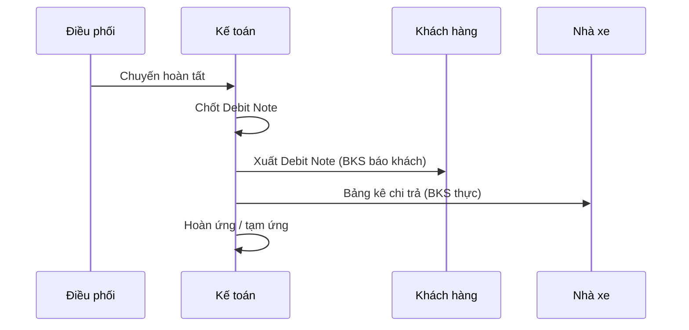

# 6. Phân hệ kế toán

Phân hệ kế toán cho kế toán thấy ngay "bức tranh tiền" — phải thu, phải trả, cược, quỹ, nợ đến hạn; thao tác phơi phiếu / công nợ / quỹ / nhân sự tại một nơi. Tài liệu nền: hồ sơ chi tiết các bộ phần, phần 1, phát hành 05/10/2026, kèm hai bản sửa đặc tả chi phí ngày 19/10. Vai trò chính: Kế toán; liên quan: Lái xe/Ops nhập chi phí, CUS khai cược, Điều vận ghi chú. Trong chương này, mã **AC-KT-nn** là tiêu chí của phân hệ kế toán, mã **AC-CP-KT-nn** là tiêu chí của quy trình O2C; ký hiệu §n.m là số mục trong bản đặc tả tương ứng. Chỗ nào chưa có căn cứ, chương ghi rõ **"Chưa chốt"** hoặc **"Còn mở"**; không tự đặt điều khoản.

## 6.1 Vị trí kế toán trong luồng O2C

**Luồng.** Kế toán là bước cuối O2C: sau khi lái xe hoàn thành chuyến và CUS bổ sung hồ sơ → **lập bảng kê khi đủ dữ liệu & chứng từ → khách phản hồi + thanh toán → ghi thu tiền, phân bổ công nợ, chốt kỳ**; chuỗi: chứng từ gốc → bảng kê → phản hồi KH → ghi thu/chi → phân bổ công nợ → phơi phiếu → báo cáo → quyết toán → chốt debit. Kế toán đối chiếu hồ sơ/số tiền, bảng kê, thanh toán/phân bổ, chấm công/lương, khóa kỳ **trong phạm vi của mình**.

- Trên **Bảng tổng quan tiền**, kế toán theo dõi phải thu/phải trả, cược, quỹ và các cảnh báo nợ.
- Tại **Kiểm soát phơi phiếu**, kế toán duyệt chi phí, thêm khoản chi và lập phiếu thu/chi.
- Qua **Kế hoạch điều động → Chốt debit**, kế toán lập công nợ và xuất Debit Note.
- Trên **Sổ quỹ / công nợ**, kế toán ghi thu và phân bổ nguồn.
- Ở **Tạm ứng / hoàn ứng**, kế toán duyệt chi phí Ops và lập phiếu hoàn ứng.
- Với **Chấm công / lương / nhân sự**, kế toán xem và chốt trong phạm vi quyền.

**Bốn danh mục.** Tài liệu ghi "3 mục chính" nhưng liệt kê **4**: Phơi phiếu · Công nợ vận tải · Quỹ · Khác — tài liệu giữ 4, cách gọi chính thức còn cần chốt.

**Bảng tổng quan tiền (AC-KT-01…05)**: (1) 2 thẻ *Nợ phải thu / phải trả theo hạn nợ* — tổng lớn + nhãn Quá hạn/Trong Hạn + thời điểm "số liệu tính đến" + nút *Tải lại*, nhấp cột Số lượng → chi tiết từng khách (AC-KT-01); (2) biểu đồ cột theo tuần: số cont, số tiền cược, đã hoàn cược (AC-KT-02); (3) thông báo Quỹ góc phải = quỹ tiền mặt + quỹ công ty tại ngày (AC-KT-03); (4) cảnh báo nợ 4 nhóm trước 5 ngày / quá hạn 1–10 / 30 / 60 ngày (AC-KT-04) và cảnh báo song song: cont chưa hoàn cược, nợ quá hạn, **Quỹ âm chỉ hiện khi cả hai quỹ < 0** (AC-KT-05).

**Phân công kế toán theo xe.** 1 xe ↔ 1 người phụ trách hiện hành, 1 người ↔ nhiều xe; **độc lập** với phân Ops, chỉ là trách nhiệm + bộ lọc mặc định, **không thu hẹp quyền xem**; xe chưa phân công có nhóm riêng; đổi phân công giữ lịch sử người đã đối chiếu/chi tiền (AC-CP-KT-01). Gán nhiều xe trong 1 thao tác được ghi nhận như một lần giao dịch.

**"Phê duyệt" — Chưa chốt.** Tài liệu có hai chỗ dùng từ này: **phê duyệt cước** khi lệch cước và **duyệt chi phí / duyệt tạm ứng**; cả hai chạm nguyên tắc **không phê duyệt nội bộ** — ở màn chốt debit, "duyệt" được quyết định ngày 21/09 hiểu là **đối soát, không phải phê duyệt**. Vai trò "phê duyệt" chưa được chủ sản phẩm xác định.

## 6.2 Chứng từ & định khoản

Các loại chứng từ gồm phiếu thu, phiếu chi (gắn nguồn quỹ), Debit Note/bảng kê công nợ theo đợt, hóa đơn kết hợp, phiếu hoàn ứng và yêu cầu tạm ứng (chỉ ghi nhu cầu, *Chưa giao tiền*). Về định dạng tiền, mọi trường số tiền mặc định `1,000,000` ở **tất cả phân hệ** (đơn vị VND, áp dụng từ 21/10); số phải hữu hạn, sai định dạng/vượt giới hạn bị chặn **cả ở nhập và lưu** (AC-CP-KT-19).

**Thêm khoản chi (§2.1).** Chọn *Tiền đường* hoặc *Chi phí lô hàng* → 2 phiếu nhập cạnh nhau. Trường: Ngày (mặc định hôm nay) · **Nhóm chi phí (chỉ 2 nhóm)** · Tên khoản chi · Số tiền · Số hóa đơn · Thu khách hàng · Người chi · Bên thực chi · Nhà cung cấp · "Nhập thu/trả bằng nhau":

- **Ô đánh dấu = cờ có hóa đơn**, bật lên mới yêu cầu số hóa đơn.
- **Nhà cung cấp** khi chọn = mặc định tên nhà xe chạy tuyến đó theo đặc tả, nhưng ghi chú còn để mở cho chính hành vi này → **Chưa chốt:** cách đặt giá trị mặc định này.
- **Thêm liên tục nhiều dòng**, không lưu từng dòng (khay thao tác giữ nguyên nhóm/bên/ngày, các ô tự trống); bỏ "Ghi chú khoản chi" và "Loại chứng từ".

**Chi phí xe nhà / xe ngoài.** Xe ngoài: kế toán điền/sửa tay; xe nhà (Silver): lái xe nhập, kế toán tích **xác nhận/từ chối/sửa** — hai luồng khác nhau (AC-KT-06). Mọi bộ phận vận hành được khai chi phí cho mọi lô (quyết định ngày 17/10); về phân quyền, chỉ Quản trị / Quản lý / Kế toán được khai chi phí, **điều vận không khai chi phí**.

**Bảng duyệt tiền đường.** Khung *Chi tiết tiền đường &lt;Bill&gt;*: STT · Khoản lái xe nhập · Ngày · Lái xe · Ban đầu · Thực chi hiện tại · Tích Duyệt/Từ chối · Kế toán duyệt; dòng tổng cuối: *Tổng phát sinh · Đã duyệt*. **Chỉ dòng ĐÃ DUYỆT mới vào phiếu chi trả lái xe**; "Đã duyệt" = cột Tiền đường của bảng kiểm soát phơi phiếu. Tiền đường **hệ thống tự ghi nhận, kế toán điều chỉnh, lái xe chỉ xem**; nâng/hạ Lạch Huyện tự cộng — còn mâu thuẫn với ghi nhận "lái xe vẫn sửa được" → **Chưa chốt:** ai được phép sửa tiền đường.

**Nguồn quỹ phải khớp dòng chi** (chọn nguồn **trước** khi ghi, quyết định bằng quy tắc dòng chi, không suy từ tên tài khoản):

- Dòng chi thuộc chi hộ **có hóa đơn** (kể cả chi phí hóa đơn) thì ghi vào **Quỹ tiền mặt**.
- Dòng chi là ứng Ops, chi phí lô **không hóa đơn**, phát sinh Ops, tiền đường hay cược container thì ghi vào **Quỹ công ty**.

Chọn sai → phiếu **từ chối kèm tên dòng sai quỹ**; phiếu trộn 2 nguồn → từ chối + yêu cầu tách phiếu (AC-CP-KT-11).

**Phiếu thu/chi từ BÁO CÁO THU/TRẢ PHƠI** (đổi tên từ "Báo cáo tháng"): 2 nút *Lập phiếu thu* / *Lập phiếu chi*; cột STT = **ô đánh dấu chọn/chọn tất cả để lập phiếu hàng loạt**; mỗi nhà xe có tổng riêng (vd "Vận tải" 3.000.000₫; hàng loạt "Vận tải" + "Duyên Hải" = 5.372.000₫). Phiếu nhập: Ngày chi · TK chi · STT · Nhà xe · Chi phí · Số cont · Số tiền · Tổng tiền · Ghi chú · Xác nhận. Không gộp thu + chi thành số ròng, không trộn đối tượng không cùng phiếu (AC-CP-KT-08).

**Ghi phiếu: trọn vẹn, chống ghi trùng.** Mọi dòng còn hợp lệ, cùng kỳ, không vượt số còn lại; một dòng hỏng → **cả phiếu không ghi**, giữ lựa chọn của người thao tác. Sau khi ghi: **phiếu + phân bổ + số dư quỹ cập nhật đúng một lần**; đã thu/đã trả = tổng phân bổ; không ghi đè Thực thu/Thực chi. Bấm lặp/thử lại không tăng thu/chi/công nợ lần thứ hai (AC-CP-KT-09/12). **10 thao tác ghi tài chính bắt buộc mã chống ghi trùng** (3 điều chỉnh cước, 3 theo dõi hoàn cược, 4 thao tác phơi phiếu): thiếu mã → bị từ chối; lặp lại cùng mã → chỉ ghi một lần; dùng mã khác cho nội dung khác → bị từ chối; mọi thao tác phải ghi vào **sổ lệnh ghi**. Hủy/đảo phiếu: quyền + **lý do**, giữ dấu vết.

**Khóa lô / khóa kỳ.** Khóa lô đóng băng tổng phải thu, phải trả, nhóm chi phí, nhãn cảng nâng/hạ; sửa chi phí bị chặn; trường theo dõi thực tế (ngày nộp hoàn cược, tiền về, số đã hoàn) vẫn bổ sung được; dòng **đã có số hóa đơn khóa**, đổi thì sửa tại nguồn chi phí. Lô đã khóa, kế toán không thêm được tờ khai (nút bị tắt kèm lý do). Không tự mở kỳ, không tự thay số tiền đã chốt (AC-CP-KT-20).

**Định khoản kế toán tổng hợp — Chưa chốt.** Phân hệ kế toán **không có bút toán/định khoản kế toán tổng hợp**: không có danh mục tài khoản, không ghi nợ/có chi tiết, không có bảng ánh xạ tài khoản. "TK chi", "quỹ ACB", "TK OPS" chỉ là **tên nghiệp vụ/tên quỹ, không phải danh mục tài khoản kế toán**.

## 6.3 Công nợ (AR/AP, cấn trừ chi hộ)

**Nguyên tắc.** Thanh toán dựa trên khoản thu/chi **thực tế**, phân bổ đúng đối tượng/bảng kê/khoản nợ; thu một phần giữ phần còn lại; "ghi nhận trong ứng dụng ≠ có chuyển khoản". **Thực thu** = khoản tính cho khách, ghi công nợ (chưa phải tiền vào quỹ); **Đã thu** = phiếu thu + phân bổ thực tế. Ví dụ §7.6: thực chi 500.000, thực thu 300.000 → công nợ 300.000, đã thu 0; thu 100.000 → còn 200.000, chênh lệch −200.000 không thành "phí dịch vụ âm"; thực thu 0đ hoặc cao hơn thực chi đều được. AC-CP-KT-10: thu vượt bị chặn, không âm ngầm.

**Công nợ trên phơi (§3.4).** Hai bảng đối xứng: **PHẢI THU** (khách: Tiền nâng · Tiền hạ · PS khác · Tổng · Đã thu · Còn phải thu · Ghi chú) và **PHẢI TRẢ** (nhà xe). Dòng **"Chưa xác định"** gộp khoản không rõ đối tượng; dòng **"XE NHÀ – SILVER SEA"** là dòng gộp đặc biệt; **ẩn dòng còn = 0 mặc định** (AC-KT-15 — Chưa chốt: có cần nút bật hiện lại hay không); báo cáo mặc định theo thời gian tìm kiếm; bảng gắn với kế toán phụ trách xe.

**Bảng 1.2.1 Kế hoạch điều động tổng hợp (§4.1).** **PHẢI THU:** Cước thu auto · Lạch Huyện auto · Phụ phí auto · Phát sinh (CUS) · Tổng thu. **PHẢI TRẢ:** Cước trả ĐV · Lạch Huyện (điều vận) · Phát sinh (điều vận) · Tổng 1 · Phí RU. Bộ lọc nhỏ theo cột *Thông tin lô hàng* + *Phân xe*; nút *Gửi yêu cầu điều chỉnh cước* và *Debit* tác động trên **tập đang lọc**. Thiếu dữ liệu → nhãn **"Thiếu cước thu / Thiếu phụ phí…"**, **không gán 0**.

**Lệch cước → chặn Debit (AC-KT-13).** Gửi yêu cầu điều chỉnh cước → đẩy tới người có quyền "phê duyệt" (xem 6.1 — Chưa chốt); **trong lúc chờ không xuất được Debit dòng đó**. Rút yêu cầu → lô mở lại + giữ trạng thái đã xác nhận trước; lô khóa số liệu không nhận yêu cầu mới; xác nhận/rút **không** đổi đơn giá.

**Xuất Debit — chốt theo đợt (§4.3).** Lọc nhà xe → tích tất cả/dòng → hộp thoại: *Từ ngày–Đến ngày* · **Lần** (1, 2, 3…) · **Tháng** (1–12) · chiều *Phải thu/phải trả* → tên + số tiền · **VAT 0/5/8/10% tự nhân** → tổng = tiền + VAT. Luật đợt:

- Đợt = 1 khách hàng + 1 tháng + 1 chiều + 1 số lần; **một lô chỉ thuộc một đợt** — hộp thoại là **hành động chốt, không phải bộ lọc**; lô cùng đối tác, có **ngày giao** trong khoảng chọn; chiều phải trả cùng 1 nhà xe.
- Tổng đợt: phải thu = tổng cột Tổng thu; phải trả = tổng cột Tổng 1 (không gồm Phí RU). Chốt bị chặn + **nêu rõ lô** khi: chưa có ngày giao; chưa xác định được số thu/trả; còn yêu cầu điều chỉnh cước chờ; số lần đã dùng trong cùng tháng và chiều của khách hàng; lô đã thuộc đợt khác.
- Sau chốt: bảng **TỔNG HỢP CÔNG NỢ KHÁCH HÀNG** tự liệt kê đợt (kỳ = lần + tháng). Bản đặc tả ngày 19/10 ghi **"Xuất Debit đang không xuất được"** trong khi bảng trạng thái đã xác nhận hoàn thành → cần kiểm chứng lại — **Chưa chốt**; đồng thời còn lỗi chọn tất cả theo cột và lỗi ô Ngày hiển thị dấu ô vuông đã ghi nhận.

**Chi tiết phải thu/trả + tổng hợp công nợ tháng (§4.4).** Lọc *Từ–Đến ngày* → tổng hợp sản lượng các bên trong tháng, đối soát cuối tháng tránh sót nhà cung cấp; **tổng hợp công nợ = tổng tiền + VAT**. Cột: STT · Tên · Cước thu · Cước trả · Tổng · nút "Lại". Bảng dùng **tên rút gọn** của đối tác, thống nhất theo mã đối tác (khách hàng/nhà xe).

**Cấn trừ chi hộ.** Bảng 1.1.2 có cột **"Số tiền trả bên cung cấp HĐ"**, **"Số tiền trừ cho khách hàng (nếu có)"**, **"Chênh lệch"** — chi hộ trừ vào phải thu của khách ngay trên dòng hóa đơn. Khoản ứng chỉ **giảm phải trả khi đã giao tiền và đã phân bổ** tính đến ngày chốt; hoàn tác phân bổ sau ngày chốt **không** xóa phân bổ kỳ trước; **không cộng khoản chi hộ đã có trong debit/phân bổ khác**. **Chi phí hóa đơn** = phí trả nhà cung cấp để lấy hóa đơn, riêng của lô (không phải toàn bộ giá trị hóa đơn), gắn với công việc đó; nhiều công việc thì người nhập chọn, **không tạo nghĩa vụ thanh toán thứ hai**. Dòng **Phí khác (không hóa đơn)** do CUS gõ tay số thu khách; dòng có hóa đơn thì khóa.

**Xe nội bộ.** Mã đối chiếu SilverSea vẫn nhóm vào nhà vận tải trong báo cáo phải trả nhưng **vẫn loại xe nội bộ**, không biến xe nhà thành xe ngoài, **không tạo công nợ nhà cung cấp lần thứ hai** (AC-CP-KT-14).

**Công nợ khách hàng theo khách + "Bỏ xe công ty" (§7.10).** Tổng hợp cước/công nợ theo từng khách trên chuyến thật; mỗi dòng mang loại hình xe (mặc định Xe nhà) — **không suy** từ tên xe/BKS/gõ tay. Tích **"Bỏ xe công ty"**: **hệ thống ở máy chủ tính lại** (không tính ở màn hình), bản xuất ra dùng đúng bộ lọc đang bật, tích **không ẩn khách nào**.

**Ghép/tách cước LCL (bảo toàn tiền).** Ghép N lô: **Lô 1 giữ 100%, Lô 2..N = 0đ**, hai nhóm độc lập — nhóm chi (trả ĐV) và nhóm thu (thu khách hàng); **thu theo từng lô độc lập, không chia tỷ lệ kg/CBM**. Hủy ghép / xóa Lô 1 → **tự chuyển 100% sang Lô kế vị** ("không để cước rơi về 0₫"), có nhật ký thao tác; sau khi tách, các lô thành viên phải **trở về giá trước khi ghép** — phần này còn chưa đạt. **PHẢI THU đọc theo nhóm thu, PHẢI TRẢ đọc theo nhóm chi**, báo cáo công nợ đọc **cùng một công thức tính duy nhất**. *Lãi chuyến = tổng thu − tổng trả*; màn chốt debit: *lợi nhuận = tổng thu − tổng 1 − phí RU*.

**Biển số trên chứng từ công nợ (phải thu vs phải trả).** Debit Note gửi khách in **biển số báo khách (ảo)** — "tuyệt đối không in biển số thực tế"; bản kê nhà xe (phải trả) in **biển số thực** + loại xe tính cước TRẢ, **không bao giờ in biển số báo khách**. Không xác định được lô/chuyến → **để trống, không đoán biển số**; không đổi số tiền/khóa sổ tài liệu đã chốt khi sửa đường xuất. Chú thích dòng lô ghép "Ghép xe cùng Bill [Số Bill Lô 1]" in trên Debit Note, lưới CUS giữ "Ghép cước cùng Bill". Khi xuất, bản in **tôn trọng cấu trúc cột của mẫu** và thống nhất với số liệu hiển thị trên màn hình.

**Điểm mở.** Thời điểm ghi **công nợ phải trả** trên chuỗi debit của nhà cung cấp chưa được đặc tả — giữ quy tắc hiện hành đến khi khách hàng xác nhận — **Còn mở**. Mục **Công nợ vận tải (§4) còn mở**, khách tự hoãn.

## 6.4 Đối soát, thu/chi & quỹ

**Nguồn hướng dẫn thao tác.** Hướng dẫn sử dụng phân hệ Kế toán (phát hành 09/10/2026, vai trò Kế toán) mô tả 12 màn nghiệp vụ thực tế, **bổ sung** cho bản đặc tả; tài liệu này ra **trước** bản sửa đặc tả chi phí 19/10 và các quyết định sau — nơi mâu thuẫn, bản đặc tả chốt mới nhất thắng.

**Sổ quỹ (§5).** Hai nguồn quỹ = **Quỹ tiền mặt** + **Quỹ công ty** (đổi tên từ "Quỹ TM" ngày 05/10 — chỉ đổi cách hiển thị, tên mã nội bộ giữ nguyên); mỗi phiếu thu/chi gắn **đúng 1 nguồn**, sổ từng nguồn đọc riêng, tài khoản chưa gắn nguồn được đếm riêng; lịch sử sổ đơn nguồn cũ được **lồng vào dòng tiền tài khoản công ty** bằng phân loại tài khoản — bút toán cũ nguyên vẹn, số dư liên tục; nguồn Tiền mặt **bắt đầu trống** từ thời điểm bật. Bảng tổng quan tiền (§2.3) và ghi nhận hoàn cược (§3.6) đọc số tiền từ các quỹ này. Sổ quỹ của Ops **chỉ đọc, đúng phạm vi** — hệ thống tự thu hẹp theo vai trò, không nhận thông tin định danh do màn hình gửi lên. Màn **Sổ quỹ**: bảng Số phiếu · Ngày · Đối tượng · Mô tả · Tài khoản · Thu/Chi · Số dư; nhãn tổng số dư phía trên; dòng trạng thái "số dư ghi sổ, cập nhật đến thời điểm hiển thị"; xuất tệp / thêm giao dịch theo phân quyền.

**Hoàn cược (§3.6, Bảng 1.1.3).** CUS tích "có cược" + điền số tiền cược dự kiến → dòng tự tạo đủ khách/hãng tàu/Bill/số tiền; CUS không điền → kế toán điền tay (AC-KT-08). "Thêm cược": ô tra cứu **4 số cuối Bill/Book** gợi ý bill, chọn là tự điền Hãng tàu + Tên khách từ bảng CUS, lưu chống ghi trùng, không tạo bảng cược mới — nhưng phần tra cứu hiện **chỉ khớp theo Mã đặt chỗ (trường đang trống)** chứ không khớp Số vận đơn/Bill, đã thử 9 cách đối chiếu đều không gợi ý được → **Chưa chốt**. Ngày nộp CV: kế toán chọn lịch hoặc gõ tay (dd/mm/yy); **Ngày dự kiến hoàn cược = ngày nộp CV + 14 ngày**, sửa tay được (AC-KT-09); hãng tàu hoàn cược lâu hơn → sửa tay ngày dự kiến, **không tự chặn**. Trạng thái 3 mức: *chưa hoàn cược* (mặc định) / *KT ghi chú* / *đã hoàn cược*; **tích "đã hoàn cược" → ghi nhận đã thu + đổ tiền về quỹ ACB** (AC-KT-10). Sắp xếp mặc định: chưa hoàn cược lên đầu, ngày xa nhất → gần nhất. Hai cảnh báo song song (AC-KT-11): (1) **ngày cược + 7 ngày chưa có ngày nộp CV** → dòng đếm hiển thị đỏ + số lượng, thông báo hiện ngay, tắt được trong phiên (bộ lọc: có ngày nộp CV + chưa hoàn cược; ví dụ gốc 21/09→28/09 = "01 lô hàng"); (2) cảnh báo liên tục **tổng tiền ở trạng thái "chưa hoàn cược"**. 3 thao tác theo dõi hoàn cược nằm trong **10 thao tác ghi tài chính bắt buộc mã chống ghi trùng** (6.2). Màn **Theo dõi hoàn cược**: bộ lọc Khách hàng · Tuyến xe · Tài khoản · Trạng thái; chưa có khoản đủ điều kiện → trạng thái trống; hoàn cược gắn với từng container sau khi hoàn thành chuyến và trả vỏ đúng quy định.

**Tạm ứng / hoàn ứng (§3.7, Bảng 1.1.4).** Bảng duyệt chi phí Ops — cột *Ngày duyệt*, tích tất cả/từng dòng → duyệt; sau khi duyệt, **Sổ Quỹ TK OPS = "Còn phải hoàn ứng"** trong báo cáo tổng hợp hoàn ứng (AC-KT-12). Công thức: **Còn phải hoàn ứng = Số tiền ĐNTT − Số tiền đã ứng** (đã ứng = tạm ứng đầu ngày của Ops); **dương → công ty thanh toán hoàn ứng; âm → công ty yêu cầu hoàn trả + cảnh báo thu lại, không hiện số âm trần** (đã chốt ngày 21/10). Bộ lọc: Từ/Đến ngày ĐNTT · Nhân viên thanh toán · Loại theo dõi (Theo lô hàng/Theo nhân viên) · Tiến độ TT · nút *Lập phiếu hoàn ứng*. **Hai luật số âm khác nhau, đừng gộp:** phiếu hoàn ứng **âm được phép** (số tiền hoàn ứng có dấu, không đặt giới hạn từ 0) nhưng **Thực chi khoản chi mới âm bị chặn**. Bản đặc tả ngày 19/10 §c: thiếu nút "PHÊ DUYỆT TẠM ỨNG", phiếu hoàn ứng không được tích xác nhận → đã ghi nhận ngày 18/10/2026; **dòng chờ xử lý có nút *Phê duyệt tạm ứng*** (duyệt = giải ngân, thao tác ngay trên màn chi phí), phiếu hoàn ứng **bắt buộc tích "Xác nhận hoàn ứng"** (hệ thống ghi người xác nhận và thời gian xác nhận). Khoản chi hộ vừa tạo **sửa/xóa được đến khi có đối soát thủ công**, phiếu hoàn ứng thủ công giữ bất biến sau khi lập (đã chốt ngày 21/10) — nhưng có ghi nhận **chi phí vừa tạo bị gắn "Đã lập phiếu/đã gửi kế toán" ngay** → bộ phận vận hành không sửa/xóa được, phiếu hoàn ứng chỉ đọc, số dư ví kẹt lệch kéo dài → cần quyết định "thiết kế có chủ đích hay lỗi hồi quy" — **Chưa chốt**. Màn **Tạm ứng**: thẻ *Chờ xử lý · Lịch sử · Xác minh*, lọc nhanh Nhiên liệu / Thu hộ / Tất cả / Chờ duyệt / Chờ nhận tiền, trạng thái *Đã ghi nhận · Đã hủy*, mở chi tiết từng khoản để xem lịch sử và duyệt/chi tiền. Màn **Hoàn ứng**: lọc kỳ (Từ/Đến) · nhân viên · đợt đối soát → 3 dòng tổng (Tổng ĐNTT · Tổng đã ứng · Tổng còn phải hoàn ứng) + bảng chi tiết từng nhân viên và trạng thái chênh lệch; hướng dẫn ghi **"kỳ hoàn ứng phải chốt trước khi tính lương để khấu trừ các khoản còn thiếu chứng từ"**. Về đường tạo phiếu hoàn ứng: Kế toán **không có đường nào tạo phiếu hoàn ứng** (màn Tạm ứng mục đối soát không có nút tạo, màn Hoàn ứng chỉ đọc, màn công nợ phải trả nút LẬP PHIẾU bị tắt, tìm kiếm "Phiếu chi" không ra kết quả) → làm gián đoạn việc kiểm chứng nhóm thao tác ghi tài chính (6.2) — còn mở.

**Đối soát cuối kỳ & thu/trả phơi.** Nhãn đối soát (bản dùng thử): *"Lô trong kỳ 190 · Chưa đối soát 52 · Chờ xác nhận đối soát 188"* + nút *"Chọn tất cả 190 lô đủ điều kiện · Đối soát · Hoàn tác"*; ô tìm kiếm "Mã lô, bill/booking, khách hàng, container" + Từ–Đến + Khách hàng ▾ + Nhà xe ▾ + nút *Cột* (chọn cột dạng nhãn). Lọc *Từ ngày–Đến ngày* → đối chiếu nhanh tổng số lượng nhà cung cấp phải xử lý trong tháng. Hướng dẫn mô tả màn **Chốt debit** với bộ đếm *Lô trong kỳ · Chưa đối soát · Chờ xác nhận · Đã đối soát* và bước "chọn dòng → **Xác nhận đối soát**" (chỉ chốt khi số liệu cước thu/chi khớp hợp đồng và chứng từ) — **bổ sung** cho hộp thoại Xuất Debit §4.3 (6.3), không thay thế. BÁO CÁO THU/TRẢ PHƠI đã ghi ở 6.2; bổ sung: **chọn tên nhà xe → bảng chi phí còn thiếu chưa thanh toán của các lô hàng**.

**Tổng quan kế toán.** Mục *Công việc kế toán* với 3 thẻ **Phải thu · Phải trả · Đối chiếu**, mỗi dòng có nút *Tạo phiếu thanh toán* (thu tiền khách hàng) / *Tạo phiếu chi* (chi trả nhà cung cấp); số liệu tổng hợp **theo thời gian thực** từ lô hàng, chuyến xe và chứng từ đã ghi nhận; mỗi vai trò chỉ thấy menu được phân quyền. Hướng dẫn ngày 09/10 mô tả màn này **khác cấu trúc** bảng tổng quan tiền §2 của bản đặc tả (2 thẻ hạn nợ + biểu đồ cược + thông báo quỹ + cảnh báo) — cùng 1 màn hay 2 màn riêng → **Chưa chốt**.

**Công nợ khách hàng.** Thẻ tổng hợp *Tổng công nợ phải thu · Số khách hàng · Số khách quá hạn*; bảng khách hàng: tên · tổng công nợ · số tiền quá hạn · ngày thanh toán gần nhất; bộ lọc (vd chỉ hiện khách quá hạn) để tập trung thu hồi; **dòng quá hạn tính theo số ngày kể từ ngày đến hạn thanh toán** của từng khoản; dưới cùng là bảng tổng hợp sản lượng vận tải theo tháng để đối chiếu doanh số với công nợ.

**Ghi nhận chi phí.** Phiếu: Ngày phát sinh (\\*) · Nhà cung cấp (\\*) · Hạng mục (\\*) (vd *Phí nhiên liệu / dầu*) · Loại chi phí · Số tiền (đ) (\\*) · Mã biên lai · Ghi chú; khung bên phải hiển thị ảnh hóa đơn/chứng từ; thiếu trường bắt buộc → **viền đỏ + dòng chữ đỏ ngay trên phiếu, không lưu**; chi phí sau khi lưu xuất hiện ở Sổ quỹ và báo cáo lãi lỗ.

**Nhà cung cấp** (menu Danh mục): lọc trạng thái + ô tìm kiếm; bảng tên · tên rút gọn · mã · mã số thuế · liên hệ · SĐT · công nợ (tổng hợp từ các chi phí đã ghi nhận); nút Xuất bảng tính kèm thông báo xác nhận.

**Chấm công / lương / nhân sự (§6).** Bảng chấm công và bảng lương chia văn phòng / lái xe, danh sách nhân sự; hiện trạng quản lý theo **"Đơn vị phụ trách"** (bộ phận), yêu cầu tách văn phòng/lái xe **chưa làm** — **Còn mở**. Màn **Lương & chấm công**: chọn tháng/năm; thẻ tổng hợp *Tổng quỹ lương · số lái xe · số đã xác nhận · ngày đi chuyến · ngày chờ việc*; bảng lương từng lái xe, chọn thẻ xem chi tiết cấu thành; nút *Chốt kỳ lương* (khung bên phải) khóa số liệu — hướng dẫn ghi **"mọi điều chỉnh sau chốt cần được phê duyệt riêng"** → chạm nguyên tắc **không phê duyệt nội bộ** → **Chưa chốt**. Quy tắc đi kèm: ký hiệu xếp lệnh **K/Q/Đ/L/N/P** — K (kẹp 2 cont 20, kết hợp trả/đóng hàng) = 1 chuyến; Q (quay đầu) = 2 chuyến; Đ (chạy đơn) = 1 chuyến; L (lưu ca) = không tính chuyến, chỉ tính ngày công; N = nghỉ không phép; P = nghỉ có phép = 1 ngày công; **2 chế độ lương lái xe**, mỗi lái xe chọn 1 — theo chuyến (300.000đ/chuyến + lương cơ bản, từ chuyến 21 +100.000đ/chuyến) hoặc theo tháng (lương cứng, vd 10.000.000đ/tháng đủ công), hệ thống phải lưu hình thức từng lái xe; báo cáo *Tổng hợp xếp lệnh tháng* theo mẫu bảng tính (lưới ký hiệu theo ngày, cột Tổng lệnh đơn/kẹp/quay đầu/Tổng số chuyến/Số ngày công, in quy ước ký hiệu); mục chấm công từng bị ẩn — **cần kiểm phân quyền ai thấy** — **Còn mở**.

## 6.5 Mô hình dữ liệu (trích xuất)

Trích từ bản đặc tả và hướng dẫn, dùng để đối chiếu dữ liệu khi triển khai — **không phải cấu trúc dữ liệu chính thức**; không có danh mục tài khoản và bút toán kế toán tổng hợp (xem 6.2).

- **Lô/Phơi phiếu (Bảng 1.1.1)** có các trường chính: mã lô, lịch trình, khách hàng (+nhà máy), số container, loại cont, xuất/nhập, trọng tải, nâng (địa điểm/đơn giá), hạ, cước thu (tự động), Lạch Huyện (tự động), phụ phí (tự động), phát sinh (CUS), cước trả ĐV, phát sinh DV, phí RU, tiền đường, tiền nâng, tiền hạ, PS khác, ngày, trạng thái nhận phơi (đã/chưa + ngày tích), ghi chú vận tải, ghi chú lái xe, hình thức phơi, phân xe (nhà xe + BKS), cờ xe nhà/xe ngoài.
- **Chi phí dòng (phiếu nhập + bảng duyệt)** có trường chính: nhóm chi phí (Tiền đường — danh sách trường trong bản gốc bị cắt dở).
- **Hóa đơn kết hợp (Bảng 1.1.2)** có các trường chính: ngày, lô (khách/nhà máy), số cont, loại cont, xuất/nhập, MST, nhà cung cấp, số tiền, số hóa đơn, số tiền trả bên cung cấp HĐ, số tiền trừ cho khách (nếu có), chênh lệch, ghi chú, tiến độ hóa đơn (đã gửi / chưa gửi / Gửi hóa đơn + "chọn nâng/hạ" — mỗi lô theo dõi theo chiều nâng hoặc hạ).
- **Cược (Bảng 1.1.3)** có các trường chính: ngày cược, khách hàng, hãng tàu, bill, số tiền cược, ngày nộp CV, ngày dự kiến hoàn cược (= CV + 14), trạng thái hoàn cược (3 mức), ghi chú, cờ "có cược".
- **Tạm ứng/hoàn ứng (Bảng 1.1.4)** có các trường chính: ngày lập, ngày duyệt DNTT, nhân viên, lô (khách/nhà máy, hàng hóa), phí chi hộ không hóa đơn (tên phí, phí giao nhận, phí phát sinh), phí chi hộ có hóa đơn (tên phí, số HĐ), ghi chi, ĐNTT, đã ứng, còn phải hoàn ứng, đợt đối soát.
- **Công nợ (1.2.1 + 1.4.x)** có các trường chính: kỳ (từ/đến), lần, tháng, chiều (thu/trả), VAT%, số tiền VAT, tổng; đối tác (khách/nhà xe) với cước thu / cước trả / tổng.
- **Quỹ** gồm **4 thực thể tiền**: quỹ tiền mặt, quỹ công ty, quỹ/tài khoản **ACB** (chuyên hoàn cược), **TK OPS** (tạm ứng) — bảng tổng quan tiền đọc tổng 2 quỹ.
- **Sổ quỹ (giao dịch)** có các trường: Số phiếu, Ngày, Đối tượng, Mô tả, Tài khoản, Thu/Chi, Số dư (kèm nhãn tổng số dư và trạng thái "số dư ghi sổ").
- **Chi phí ghi nhận** có các trường: Ngày phát sinh (bắt buộc), Nhà cung cấp (bắt buộc), Hạng mục (bắt buộc), Loại chi phí, Số tiền (bắt buộc), Mã biên lai, Ghi chú, ảnh hóa đơn/chứng từ.
- **Công nợ khách hàng** gồm thẻ Tổng công nợ phải thu / Số khách hàng / Số khách quá hạn; dòng khách hàng có tên, tổng công nợ, tiền quá hạn, ngày thanh toán gần nhất.
- **Lương & chấm công** có các trường: tháng/năm, Tổng quỹ lương, số lái xe, số đã xác nhận, ngày đi chuyến, ngày chờ việc, hình thức lương từng lái xe (chuyến/tháng), bảng lương + cấu thành.
- **Nhà cung cấp** có các trường: tên, tên rút gọn, mã, mã số thuế, liên hệ, SĐT, công nợ.
- **Nhân sự** có các trường: nhân viên, đơn vị phụ trách/bộ phận (cần tách văn phòng/lái xe), bảng chấm công, bảng lương.

## 6.6 Báo cáo

- **Bảng tổng quan tiền**: AC-KT-01…05 (2 thẻ hạn nợ, biểu đồ cược tuần, thông báo Quỹ, cảnh báo nợ 4 nhóm, Quỹ âm) — chi tiết ở 6.1.
- **Bảng 1.1.1 tổng hợp phơi phiếu**: nút **TỔNG CON (cột F) kiểu bảng tính**; phân rã tổng theo người chi.
- **Bảng 1.1.2 hóa đơn kết hợp**: 4 ô Tổng (cont, tiền, thu, chi) + tiến độ hóa đơn.
- **Bảng 1.1.3 hoàn cược**: ô Tổng + bộ lọc trạng thái; 2 cảnh báo song song.
- **Bảng 1.1.4 + báo cáo tổng hợp hoàn ứng**: 3 thẻ *Tổng ĐNTT · Tổng đã ứng · Tổng còn phải hoàn ứng* (hoặc 6 cột STT…Còn phải hoàn ứng), lọc theo đợt đối soát, kèm nhãn chiều số.
- **BÁO CÁO THU/TRẢ PHƠI**: Phải thu theo khách / Phải trả theo nhà xe, **ẩn dư 0** (AC-KT-15), lọc theo khoảng ngày; chọn tên nhà xe → hiện chi phí còn thiếu.
- **Chi tiết phải thu/trả + tổng hợp công nợ tháng**: lọc Từ–Đến ngày, tổng hợp sản lượng các bên để đối soát cuối tháng; **tổng hợp = tổng tiền + VAT**.
- **Báo cáo lãi lỗ**: 4 thẻ *Tổng doanh thu · Tổng chi phí · Lãi gộp · Biên lợi nhuận*; biểu đồ doanh thu & lãi gộp theo tháng + cơ cấu chi phí; bảng **Top xe theo lợi nhuận**; bảng chi tiết lãi lỗ theo từng tháng; nút Xuất bảng tính; kỳ mặc định là tháng hiện tại, đổi bằng bộ lọc thời gian — **màn này chỉ có ở hướng dẫn, bản đặc tả không mô tả quy tắc tính doanh thu/chi phí** → **Chưa chốt**.
- **Năng suất đội xe**: tab *Toàn đội trong 1 ngày* gồm 6 chỉ số tổng hợp + bảng chi tiết từng xe; tab *Từng xe trong 1 tháng* gồm sản lượng, số xe hoạt động, % năng suất bình quân; xuất bảng tính ở tab tháng; số liệu lấy từ chuyến hoàn thành trong kỳ.
- **Lương & chấm công / Tổng hợp xếp lệnh**: màn Lương & chấm công (thẻ tổng hợp + bảng lương + Chốt kỳ lương); báo cáo bảng tính tổng hợp xếp lệnh tháng theo ký hiệu K/Q/Đ/L/N/P.
- **Xuất bảng tính**: nút xuất + thông báo xác nhận ở báo cáo lãi lỗ, nhà cung cấp, năng suất tab tháng.

## 6.7 Edge cases

- **Quỹ âm**: cảnh báo **chỉ khi cả hai quỹ < 0** (AC-KT-05); một quỹ âm không kích hoạt cảnh báo — cách xử lý tiếp theo chưa có tài liệu → **Chưa chốt**.
- **Số âm hoàn ứng**: "Còn phải hoàn ứng" âm nghĩa là Ops ứng cao hơn làm hàng → cảnh báo thu tiền, **không hiện số âm trần** (đã chốt).
- **Số âm dòng chi phí**: dòng chi phí âm **không cộng vào bất kỳ tổng nào** (dòng vẫn hiện để đối soát); riêng Thực chi mới âm bị chặn — luật này **khác** luật phiếu hoàn ứng âm (chi tiết Chương 2 §2.4.5).
- **Dư 0**: khách có còn phải thu = 0 bị **ẩn mặc định** (AC-KT-15) — có cần nút bật hiện lại hay không **chưa chốt**.
- **Chưa xác định**: đây là dòng gộp các khoản không rõ đối tượng; thiếu dữ liệu Debit thì hiển thị nhãn **"Thiếu …"**, không gán 0.
- **Xe nhà vs xe ngoài**: hai luồng duyệt chi phí khác nhau (AC-KT-06).
- **Nhập trùng Ops**: hệ thống báo trùng và hiện hộp thoại xác nhận "ĐÃ ĐƯỢC ID…. NHẬP TRƯỚC ĐÓ, BẠN VẪN TIẾP TỤC NHẬP CHỨ"; dòng đã hủy không cảnh báo.
- **Chờ điều chỉnh cước**: chặn xuất Debit của dòng đó (AC-KT-13).
- **Hãng tàu hoàn cược lâu hơn 14 ngày**: sửa tay ngày dự kiến, hệ thống không tự chặn.
- **Cảnh báo cược +7 ngày**: đếm theo bộ lọc (có ngày nộp CV + chưa hoàn cược); tắt được trong phiên.
- **Ảnh/chứng từ**: Ops **có thể chụp hoặc không, không bị ghi nhận thiếu chứng từ** (Ops in hóa đơn đặt bàn kế toán đối soát).
- **Hai dòng gộp đặc biệt**: "Chưa xác định" + "XE NHÀ – SILVER SEA" trong báo cáo thu/trả phơi.
- **Đơn vị phụ trách**: hiện là bộ phận nhân sự; yêu cầu tách văn phòng/lái xe chưa làm.

## 6.8 Các điểm còn mở

1. **"3 mục chính" vs 4 danh mục** (§8) — tài liệu giữ 4 (Phơi phiếu / Công nợ vận tải / Quỹ / Khác); cách gọi cần chốt.
2. **Vai trò "phê duyệt"** — yêu cầu đẩy phê duyệt cước (§4.2), duyệt chi phí/tạm ứng (§3.3, §3.7) và hướng dẫn "điều chỉnh sau chốt kỳ lương cần được phê duyệt riêng" đều chạm nguyên tắc **không phê duyệt nội bộ** — cần chủ sản phẩm xác định vai trò & cách đối chiếu (xem 6.1).
3. **Quỹ đích hoàn cược ACB (§3.6):** tài khoản ACB cố định hay cấu hình được?
4. **Trạng thái "nhận phơi" ở màn hình máy tính (§3.1):** ánh xạ với trạng thái hệ thống hiện có?
5. **Ẩn khách dư 0 (§3.4):** có cần nút bật hiện lại?
6. **Xuất Debit (§4.3):** bảng trạng thái đã xác nhận hoàn thành nhưng bản đặc tả ngày 19/10 ghi *"Xuất Debit đang không xuất được"* — cần kiểm chứng lại; việc kiểm tra trở lại gần đây làm lỗi ô Ngày tái xuất hiện; các ô Lần/Tháng/VAT trong hộp thoại quá nhỏ nên không đọc đủ nội dung.
7. **Công nợ vận tải (§4) còn mở** — khách tự hoãn "tuần sau kiểm tra tiếp".
8. **§3.5, §3.6 "đã thực hiện – chưa kiểm chứng":** cần kiểm chứng lại trước khi tuyên bố hoàn thành.
9. **Các phân hệ còn lại của hồ sơ chi tiết các bộ phần** (Điều độ, Lái xe, CUS, Quản lý) chưa được cung cấp tài liệu nguồn.
10. **Không có danh mục tài khoản / bút toán kế toán tổng hợp** trong bản đặc tả — định khoản kế toán tổng hợp không được mô tả; "TK chi", "quỹ ACB", "TK OPS" chỉ là tên nghiệp vụ (xem 6.2).
11. **Ảnh minh họa** chỉ được mô tả qua chú thích hình ảnh, không đọc được chi tiết — màu sắc và vị trí trên ảnh chưa thể xác nhận.
12. **Màn Tổng quan kế toán** (3 thẻ Phải thu/Phải trả/Đối chiếu) khác cấu trúc bảng tổng quan tiền §2 của bản đặc tả — cùng 1 màn hay 2 màn riêng?
13. **Báo cáo lãi lỗ** chỉ có ở hướng dẫn ngày 09/10, bản đặc tả không mô tả — quy tắc tính doanh thu / chi phí / lãi gộp / biên lợi nhuận chưa có căn cứ.
14. **Đường tạo phiếu hoàn ứng:** kế toán không có nút tạo ở mọi màn → làm gián đoạn nhóm thao tác ghi tài chính (xem 6.2) — còn mở.
15. **Phần tra cứu "4 số cuối" thêm cược** chỉ khớp *Mã đặt chỗ* (trường đang trống) chứ không khớp Số vận đơn → không gợi ý được lô.
16. **Chi phí vừa tạo bị gắn "Đã lập phiếu/đã gửi kế toán" ngay** → bộ phận vận hành không sửa/xóa được, số dư ví kẹt lệch — cần quyết định đây là thiết kế có chủ đích hay lỗi hồi quy (đã chốt ngày 21/10).
17. **Mục chấm công bị ẩn** — cần kiểm phân quyền ai thấy.

*Kết thúc Chương 6.*

## Sơ đồ kế toán

