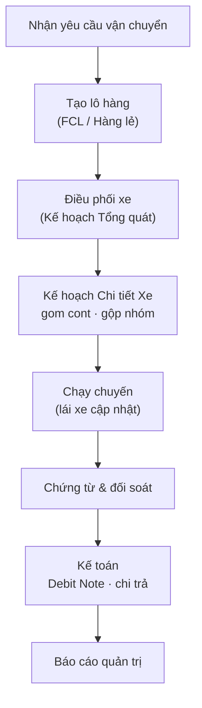

# Đặc tả nghiệp vụ — Silversea (TTransport)

## Sơ đồ kiến trúc

> Bản đặc tả nghiệp vụ của phần mềm quản lý vận tải Silversea (TTransport) — hệ thống quản lý lô hàng, điều phối, cước phí và kế toán cho doanh nghiệp giao nhận vận tải. Ngày tổng hợp: 27/10/2026.

Tài liệu mô tả **luồng nghiệp vụ, quy tắc tính tiền, trạng thái dữ liệu và yêu cầu giao diện** đang áp dụng của hệ thống — 

## Mục lục

- Chương [1. Tổng quan hệ thống và nguyên tắc chung](spec/1-t-ng-quan-h-th-ng-v-nguy-n-t-c-chung.md) trình bày vai trò người dùng, phạm vi, các nguyên tắc vận hành cốt lõi và chuẩn trải nghiệm.
- Chương [2. Luồng nghiệp vụ Order-to-Cash](spec/2-lu-ng-nghi-p-v-order-to-cash-o2c.md) mô tả luồng tiếp nhận đơn → điều vận → giao hàng → thu tiền, các trạng thái lô/chuyến và cách xử lý ngoại lệ.
- Chương [3. Tiếp vụ, lô hàng và tờ khai hải quan](spec/3-module-ti-p-v-l-h-ng-v-t-khai-h-i-quan.md) nói về tạo lô, ghép lô, container và số tờ khai, chứng từ, hàng lẻ.
- Chương [4. Điều phối, lái xe và dữ liệu chủ](spec/4-module-i-u-ph-i-m-n-h-nh-l-i-xe-v-d-li-u-ch.md) gồm bảng điều vận, ứng dụng lái xe, danh mục nhà máy–kho–khách hàng.
- Chương [5. Cước phí, chứng từ vận đơn và báo giá](spec/5-c-c-ph-ch-ng-t-v-n-n-v-b-o-gi.md) gồm danh mục phí, công thức tính cước, tính cước tự động, khai chi phí và báo giá.
- Chương [6. Phân hệ kế toán](spec/6-ph-n-h-k-to-n.md) gồm chứng từ, công nợ phải thu/trả, thu chi, đối soát và báo cáo.
- Chương [7. Ma trận yêu cầu chính thức](spec/7-ma-tr-n-y-u-c-u-ch-nh-th-c.md) là bảng 35 yêu cầu chính thức và 23 yêu cầu bổ sung kèm trạng thái.
- Chương [8. Quyết định nghiệp vụ và vấn đề đang mở](spec/8-quy-t-nh-r-ng-bu-c-v-v-n-ang-m.md) liệt kê các quyết định đã chốt theo ngày, lỗi đang sửa, tính năng đã hủy và rủi ro.
- Chương [9. Logic nghiệp vụ Hàng lẻ (LCL)](spec/logic-nghi-p-v-h-ng-l-lcl.md) tập trung vào nghiệp vụ hàng lẻ: tạo lô lẻ, gom/tách cước thu–trả, phân bổ xe và các luật đang áp dụng.
- Chương [10. Yêu cầu giao diện người dùng (UI/UX)](spec/10-y-u-c-u-giao-di-n-ng-i-d-ng-ui-ux.md) tách riêng toàn bộ yêu cầu về màn hình, nút, bảng, bộ lọc và chuẩn trải nghiệm, tham chiếu từ các chương nghiệp vụ.

## Sơ đồ nghiệp vụ

- [Luồng nghiệp vụ O2C](https://book.tingting.vip/s/silversea/p/artifact-6cae21e6292b6fa715eab0d2) — sơ đồ dùng ở Chương 2.
- [Trạng thái lô hàng và chuyến](https://book.tingting.vip/s/silversea/p/artifact-cc20f74b41c9086a7aac09d0) — sơ đồ dùng ở Chương 2.
- [Tương tác các bên trong luồng O2C](https://book.tingting.vip/s/silversea/p/artifact-9c85e35463c15af4585bcc80) — sơ đồ dùng ở Chương 2–4.
- [Kiến trúc: trục cốt lõi & phân hệ vệ tinh](https://book.tingting.vip/s/silversea/p/artifact-ea725bcd059a02df69c0554f) — sơ đồ dùng ở Chương 1.
- [Quy trình tính cước](https://book.tingting.vip/s/silversea/p/artifact-214cc718911bdf1c06ec8ac6) — sơ đồ dùng ở Chương 5.

## Một số thuật ngữ

- **Lô** là một đơn vận tải; một lô hàng nguyên container có thể gồm nhiều container.
- **Công việc** là phần việc gắn với một container hoặc một phần hàng lẻ.
- **Chuyến** là hành trình thực tế của một xe.
- **Kẹp** là tình huống hai container đi đồng thời trên cùng một xe.
- **Kết hợp** là hai công việc nối tiếp nhau dùng chung một vỏ container.
- **Tờ khai** là tờ khai hải quan, được quản lý theo từng container.

## Sơ đồ một trang

