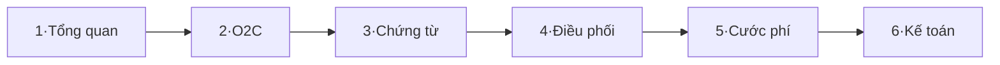

# Silversea

Wiki nghiệp vụ & kỹ thuật hệ thống Silversea — vận tải container và hàng lẻ (đường bộ + hải quan).

## Cách đọc

- Nếu mới onboard, hãy đọc tuần tự theo thứ tự **1 → 2 → 3 → 4**.
- Khi cần tra nhanh một nghiệp vụ, dùng mục lục dưới và tìm kiếm (^K).
- Mọi thay đổi nghiệp vụ đều được ghi vào **Business Logic Changelog**.

## Đặc tả nghiệp vụ (spec 1–8)
1. [Tổng quan hệ thống và nguyên tắc chung](spec/1-t-ng-quan-h-th-ng-v-nguy-n-t-c-chung.md) — bối cảnh, vai trò, nguyên tắc dữ liệu.
2. [Luồng nghiệp vụ Order-to-Cash (O2C)](spec/2-lu-ng-nghi-p-v-order-to-cash-o2c.md) — từ nhận yêu cầu đến đối soát. Sơ đồ: [O2C](so-do/s-lu-ng-nghi-p-v-o2c.artifact) · [Tương tác các bên](so-do/s-t-ng-t-c-c-c-b-n-trong-lu-ng-o2c.artifact)
3. [Module Chứng từ, lô hàng và tờ khai hải quan](spec/3-module-ti-p-v-l-h-ng-v-t-khai-h-i-quan.md) — CUS, tờ khai per-cont, bộ chứng từ.
4. [Module Điều phối & màn hình Lái xe](spec/4-module-i-u-ph-i-m-n-h-nh-l-i-xe-v-d-li-u-ch.md) — Kế hoạch Tổng quát/Chi tiết Xe, gom chuyến, phân xe.
5. [Cước phí, chứng từ vận đơn và báo giá](spec/5-c-c-ph-ch-ng-t-v-n-n-v-b-o-gi.md) — bảng giá, phụ phí, báo giá.
6. [Phân hệ Kế toán](spec/6-ph-n-h-k-to-n.md) — phải thu/trả, chốt debit, hoàn ứng.
7. [Ma trận yêu cầu chính thức](spec/7-ma-tr-n-y-u-c-u-ch-nh-th-c.md) — REQ ↔ module.
8. [Quyết định ràng buộc và vấn đề đang mở](spec/8-quy-t-nh-r-ng-bu-c-v-v-n-ang-m.md) — ruling + open questions.

## Nghiệp vụ chuyên sâu
- [Logic nghiệp vụ Hàng lẻ (LCL)](spec/logic-nghi-p-v-h-ng-l-lcl.md) — định nghĩa, gom cont, gộp/tách cước, BKS thực/báo khách, bảo toàn doanh thu.
- [Đặc tả kỹ thuật tổng hợp (TTransport)](c-t-k-thu-t-t-ng-h-p-silversea-ttransport.md) — bản tóm lược một trang.
- [Business Logic Changelog](business-logic-changelog.md) — mọi thay đổi nghiệp vụ theo ngày.

## Sơ đồ (artifacts)
- [Kiến trúc: trục cốt lõi & phân hệ vệ tinh](so-do/s-ki-n-tr-c-tr-c-c-t-l-i-v-ph-n-h-v-tinh.artifact)
- [Quy trình tính cước](so-do/s-quy-tr-nh-t-nh-c-c.artifact)
- [Trạng thái lô hàng và chuyến](so-do/s-tr-ng-th-i-l-h-ng-v-chuy-n.artifact)

## Thuật ngữ chuẩn

- **Chứng từ (CUS)** là bộ phận tiếp nhận và xử lý hồ sơ lô hàng; không dùng từ "tiếp vụ".
- **BKS thực** là biển số của xe chạy thực tế.
- **BKS báo khách** là biển số ảo in trên chứng từ gửi khách; khi để trống, hệ thống mặc định dùng BKS thực.
- **Hàng lẻ (LCL)** là lô không gắn container riêng, chạy bằng xe tải theo trọng tải hoặc gom chung container.
- **Lô chính (nhóm ghép)** là lô giữ 100% cước trong nhóm ghép; các lô phụ có cước bằng 0₫.
